# PYNQ-Z2 多频段音频加速器 —— 设计报告

> 2026 全国大学生嵌入式芯片与系统设计竞赛 · FPGA 创新设计赛道 · 自主选题 · **初级组**
>
> 平台：AMD PYNQ-Z2（Zynq-7020，`xc7z020clg400-1`）
> 工具链：Vivado / Vitis HLS **2020.2**（版本选择理由见 §9）
> 仓库：本仓库，MIT 许可（见根目录 `LICENSE`）

---

## 0. 一页速览

「对应位流」这一列不是装饰：本仓库里有 20 多颗位流，**同一个指标只对生成它的那一颗负责**。
把 16.7× 和演示通路并排写而不注明来源，是最容易被误读的一处，所以单列一栏。

| 项 | 值 | 对应位流 | 证据 |
|---|---|---|---|
| 功能 | 48 kHz 四频段动态范围压缩（助听器验配场景），运行期可调 | `fir_pl.bit`（演示通路） | §2 |
| 算法 | 相减式分频：3 个 193 抽头线性相位低通 + 两两相减，段边界 500 / 1000 / 2000 Hz | 三套实现同源 | §2.2 |
| 实现 | 同一算法三套实现：Python 参考 / HLS 综合核 / 手写 RTL | — | §4 |
| 同芯片加速比 | **16.7×**（ARM 6.117 µs/采样 vs PL 核 0.367 µs/采样） | ⚠️ `fir.bit`（**上一代块模式**，不是演示通路） | `data/results/accel_cpu_vs_fpga.md` |
| 端到端通路 | 麦克风 → PL（前端 + 压缩）→ 耳机，音频**全程不出 PL** | `fir_pl.bit` | `data/results/dma_pl_direct_20261025.md` §1 |
| 延时 | 数字段 96 采样 = **2.00 ms**（群延迟，48 kHz；2026-11-02 抓取窗口互相关实测 96 采样 = 1.966 ms）+ 声学 **1.23 ms**（10-22 实测）。**两个分量分报，没有合并实测**（§10） | `fir_pl.bit` | `data/results/latency_*`、`data/results/pl_delay_20261102.md`、`acoustic_lat_20261022.npz` |
| 正确性 | 逐位自检 960000/960000；与 HLS 出货核并排 4800 点 0 点不同 | `fir_pl.bit` / `fir.bit` | §5 |
| 长稳 | 块模式 600 秒 80188 块 **0 丢块**；PL 直连 600 秒 ×3 溢出/欠载**零增长**；深压 300 秒、600 秒（单音）与 600 秒（语音）三趟同样零增长 | 两条线分别记账 | `data/results/live_dropout_recheck_20261024.md`、`soak_pl_600_20261029_1031.md`、`soak_pl_20261102.json`、`soak_pl_deep_20261102.md` |
| **失真** | 默认参数（+22 dB / −10 dBFS / 0.7）THD+N **0.09%**（压缩器未启动）；`show` 档（+30 dB）**2.36%**（压缩器确认动作）；−20 dBFS 门限 9.32%；深压（−40 dBFS、k 0.5）37.24%；限幅单独动作 48.4% 属另一机制 | `fir_pl.bit` | §5.1、`data/results/thdn_20261102.md` |
| 技能包 | `skill/` 下 **35 条**可复用条目，A/B/C 三档，其中 8 条是提示词工作流 | — | §7 |

---

## 1. 选题背景、前人工作与创新点

### 1.1 要解决的实际问题

感音神经性听力损失的特点是**频率选择性**：不同频段的听阈和不适阈差别很大，单一的整体增益
会把某些频段推到不适阈、另一些仍然听不清。助听器的标准做法是**多频段动态范围压缩（WDRC）**——
把频谱切成若干段，每段独立设定压缩阈值、压缩比、起停时间，再做验配。

这件事在嵌入式平台上有一个硬约束和一个容易误当约束的项：

1. **实时性 + 确定性（硬约束）。** 48 kHz 名义下单采样预算 20.83 µs；本设计的 I2S 分频比
   决定了实际采样率是 **48.828 kHz**，对应预算 **20.48 µs**（§2.5，下文一律用后者）。
   平均耗时够不够不是全部问题，
   偶发的抢占会让输出断一下 —— 助听器最怕的不是平均慢，是**偶尔卡一下**。
2. **功耗与体积（不作立论）。** 助听器确实是电池供电的可穿戴设备，但本项目的功耗目前只有
   Vivado 估算（PL 动态 0.746 W，置信度 Low，15.5 µJ/采样，见
   `data/results/performance_profile_20261022.md`），整机实测未开展，板级也没有功耗计接入
   条件 —— 这一项列为后续工作（见 §10），本报告的任何主张不依赖功耗或体积。

所以这是一个"软件能跑、但跑得不合场景"的典型问题：把滤波与压缩搬到 PL，用确定性换掉抖动，
把 CPU 腾出来做参数验配与自适应。本作品的核心主张因此收在两条，均有板上实测支撑：
**延迟由硬件时序决定**（分解口径见 §5）与**参数运行期可验配**（双耳双 bank，见 §2.4）。

### 1.2 前人做过什么

本项目在设计前实测或阅读了四份可比的公开工作，逐条列清差异 —— 这一节的作用是划出
"哪些是别人已经证明可行的、我们借了什么、哪里不一样"。

| 来源 | 做了什么 | 实测/结论 | 与本项目的差异 |
|---|---|---|---|
| `soheilbh/fir_accel_pynq` | 27 抽头**单段** FIR + AXI-DMA，PYNQ 上跑 | 板上实测软件 0.0922 s / 硬件 0.00469 s，**19.67×** | 它是单段低通、通信场景（100 MHz 采样、200 kHz 信号）；本项目是 4 段相减式 + 压缩 + 运行期验配，且是音频采样率 |
| `Nunigan/FIR-FIlter_HLS` | HLS 实现 float / fixed 两版全并行 FIR | 定点全面更省 | 它只到"综合结果"一层；本项目把对照推到**布局布线实测**，并补了"限流"这一维（见 §4.3） |
| Xilinx `Vitis_Accel_Examples` 之 `shift_register` | 同一个"延迟线整体移位压不住 II"的坑 | U250 上 72×、U200 上 7.1× | 本项目在同一处拿到同一量级的收益（449 → 36 拍），并把它整理成可复用条目 `skill/pitfalls/hls_synthesis_and_directives.md` |
| Odatix 的 FIR 例子 | 分析 II 达不到的成因 | 原话："memory ports cap the loop long before the operators do"，且 II 不达标时**不报错** | 本项目的 `cyclic factor=13` 实验（449→437，几乎无效）复现了这条结论 |

另外复现了一个"反例"：把 CPU 侧写成"4 段各自一个滤波器"会让加速比虚高 18%，
因为它比 PL 侧多干 1/3 的乘法。**这个形状被明确排除在基线之外**，理由与方法见
`data/results/accel_cpu_vs_fpga.md` §「同一套算法得落实到乘加次数上」。

### 1.3 创新点（按可验证性排序，不按好听程度）

1. **相减式分频，把"4 段"变成"3 个滤波器"。**
   传统做法是 4 段各设计一个带通，乘法量是 4/3 倍。改成 3 个低通 + 两两相减后，
   第 4 段靠 `x[D] − y2` 白拿。**定点下相减是精确的**，所以四段之和恒等于延迟 96 拍的输入 ——
   这条恒等式后来成了整条验证链的支点（§5 的"直通检验"就是它）。
   代价是要证明抽头数够：65 抽头时第 2 段在**自己**的中心频率 707 Hz 处就被压掉 14.2 dB，
   四段根本没分开。实测 193 抽头才满足"每条边界两侧都 ≤ −20 dB"（§4.1）。

2. **同一算法的三实现互证，而不是一个实现的自我宣称。**
   Python 浮点参考、HLS 综合核、手写 RTL 三套并存，互相逐位对拍。
   最有说服力的一条：RTL 与 HLS 出货核在同一进程里先后加载、跑同一份输入，
   4800 点**0 点不同**（`data/results/rtl_vs_hls.md` §9.6）。三套实现同时错成一样，
   概率远低于一套实现对。

3. **把音频数据从 PS 手里彻底挪出 PL。** 出货版（块模式）每块要 PS 逐字 MMIO 搬一整块；
   DMA 版 PS 只写地址；**全 PL 直连版音频一个字节都不过 PS**，PS 只读状态。
   三条通路各自的延时与适用范围在 `data/results/dma_pl_direct_20261025.md` 里分表记，
   不合并成一个"最快延时"。

4. **把"优化前后的对比"做成了机器自动生成的东西，不是手工抄的表。**
   `src/python/parse_hls_csynth.py` 从 68 份 csynth 报告里抠出四个字段排成表；
   `src/python/compare_golden_vs_hw.py` 做黄金比对并给退出码。
   这两个脚本本身被提炼成通用技能（§7），与题目解绑。

---

## 2. 设计原理与功能框图

### 2.1 信号链

麦克风/线路经 I2S 进 PL，在 PL 内走完四段分频 → 四段压缩 → 增益斜坡，再经 I2S 回到 codec，
中途一个音频采样都不过 PS。三个 193 抽头低通共用同一条延迟线、三张系数表按相位轮着喂，
第四段靠相减白拿：

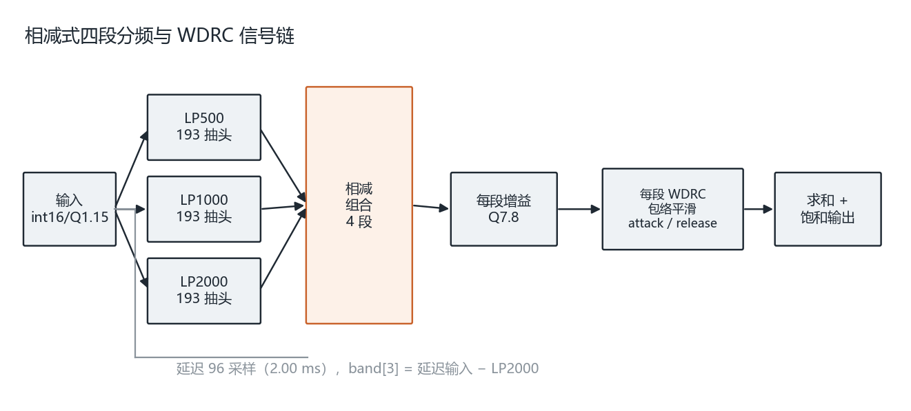

四段的构成：`b0 = LP500(x)`、`b1 = LP1000 − LP500`、`b2 = LP2000 − LP1000`、`b3 = x[D] − LP2000`。
图由 `src/python/plot_report_figures.py` 的 `fig_chain()` 生成，不手画。

三条性质值得单独说：

- **`Σb ≡ x[D]` 是恒等式，不是近似。** 定点减法无舍入，四个频段之和必然等于延迟 96 拍的输入。
  所以"不压缩时输出 = 输入延后 96 拍"可以被当作硬判据，而不是"听起来差不多"。
- **只有一套 195 个乘法器，三张系数表按相位轮着喂（P0/P1/P2）。**
  板上只有 220 个 DSP，585 个乘法器根本放不下 —— 这不是优化选项，是唯一能落地的做法。
  代价是每采样 3 拍（这个数是仿真日志里数出来的：`3000 cycles / 1000 samples`）。
- **群延迟 96 采样不体现在拍数上。** 外壳每块开头复位延迟线，进多少出多少，
  输入输出 TLAST 几乎对齐，延迟藏在数值里。按"输出比输入晚 288 拍"去验会读出一个不存在的错
  （`data/results/rtl_vs_hls.md` §9.7 记了这次误读）。

### 2.2 数值契约

| 量 | 格式 | 说明 |
|---|---|---|
| 采样 | `int16` / Q1.15 | 接口统一 |
| 系数 | `int18` / Q1.17 | `q = round_half_away_from_zero(x · 2^17)`，**全量验证 579 个系数、不符 0 个** |
| 乘积 | 34 位有符号 | 16 × 18 位，精确无舍入 |
| 累加器 | 40 位 / Q8.32 | 上界 6.99e10 < 2^39，**不会溢出**，且**与加法顺序无关** |
| 压缩中间量 | `drc_t` Q2.22、`gain_t` Q7.8 | 每次收窄赋值向负无穷取整再饱和（AP_TRN + AP_SAT） |
| 输出 | `acc >>> 17` 后饱和到 int16 | 17 = 32 − 15 |

「与加法顺序无关」这一条是**能随便摆加法树**的前提，也让 RTL 不必去模仿 HLS 的
5 路部分和结构。实测累加器峰值 `|acc| = 1.70e9`，40 位上限 5.50e11，余量 324 倍。

一个反直觉的量化细节：HLS 综合出的系数 ROM 里是**有符号 15 位**，不是 16 位
（HLS 对 `const` 数组做了常量值域裁剪）。按 16 位读，579 个里 305 个对不上；
按 15 位读 0 个。而**正数两种读法一样**，所以抽查几个数会以为规则对了 —— 必须全量比。

### 2.3 软硬件划分

| 放哪 | 做什么 | 为什么放这 |
|---|---|---|
| **PL** | I2S 收发、四段前端、四段压缩、增益斜坡、抓取缓冲、寄存器窗口 | 每采样确定性执行；不随系统负载抖动 |
| **PS** | 参数验配（双耳各自一组）、网页界面、录音回放、状态与电平监控 | 需要交互、需要文件系统、需要网络 |
| 不进 PS 也不进 PL | 音频采样本身（全 PL 直连版） | 少一次搬运就少一次调度抖动 |

划分依据不是"哪边算得快"，而是**抖动容忍度**：算得快但会被抢占的东西，放在助听器
信号链上就是不合适。`data/results/accel_cpu_vs_fpga.md` 末尾把这条写开了 —— 两边实时倍率分别是
3.41× 和 56.8×，**都够实时**，光看吞吐这件事在 ARM 上也能做。真正拉开差距的是确定性和
CPU 占用（功耗只有估算值，见 §1.1 的边界说明，不作为划分依据）。

⚠️ 这一条的读法要收窄，否则会把两条线混起来：本项目已有的 CPU 占用实测
（`data/results/performance_profile_20261022.md` §2：进程 145.3%，其中 io 线程 100.3%）
**属于上一代块模式 `fir.bit`**，不是演示通路 `fir_pl.bit` 的读数。PL 直连版把音频留在 PL 内，
PS 只剩 100 Hz 状态轮询，占用应显著更低 —— **这个数还没有实测**，不能拿块模式的 145.3%
当作演示通路的证据。复量命令现成（`perf_probe.py cpu 60`），列为后续工作，见 §10。

演示通路的软件结构如下图：上半是 PS 的控制面（HTTP → tmpfs → 100 Hz 控制环 → AXI-Lite），
下半是 PL 的数据面闭环。**唯一的跨面接口是 AXI-Lite，且它不搬音频** ——
这正是"音频不出 PL"在软件侧的落点。

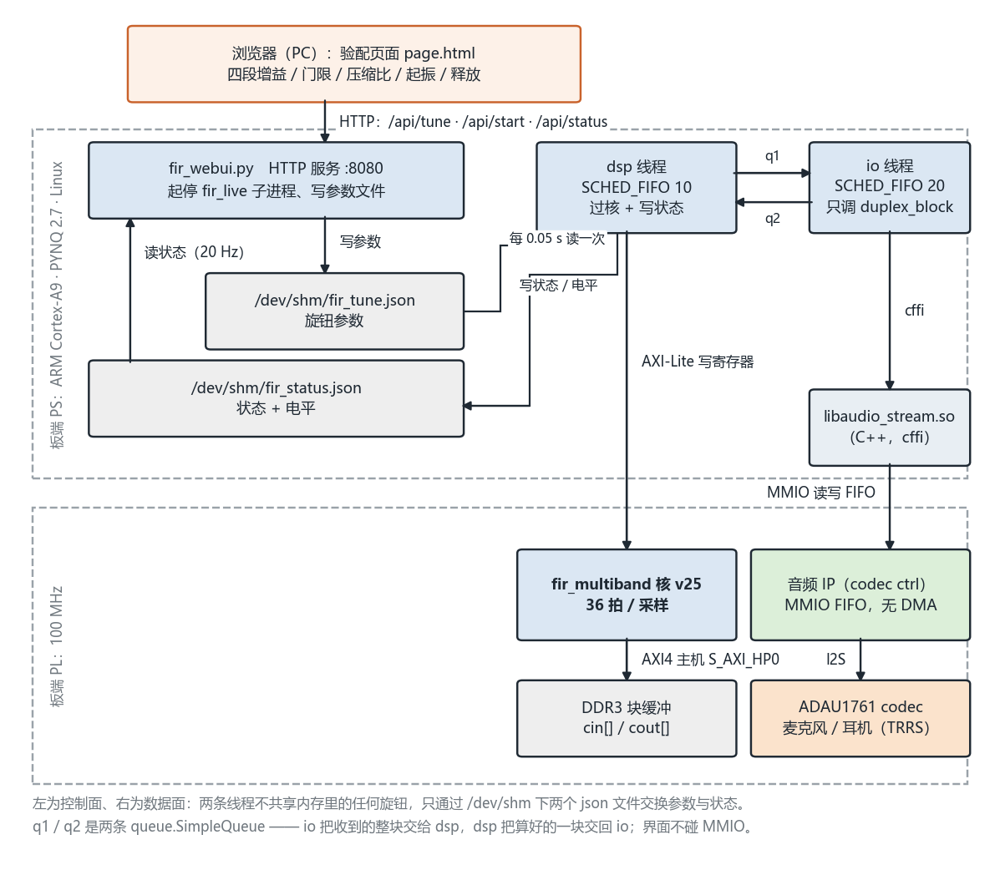

### 2.4 接口设计

参数通路与状态通路都是**同一块 AXI-Lite 寄存器窗口**，基址 `0x43C40000`、窗口 64 KiB。
双耳各一个参数 bank（布局相同），另有一片控制/状态区。

**控制与状态区（`0x000–0x0FF`，共 33 个地址：32 个可读 + `0x70` 只写）** —— 下面只列判据会用到的：

| 偏移 | 名字 | 用途 |
|---|---|---|
| `0x00` | `ID` | 恒 `0x504C_0002`。加载位流后第一件要读的东西，读错说明 `base.bin` 把它盖了 |
| `0x04` | `CTRL` | bit0 `run` / bit1 `drc_en` / bit2 `flush`（16 拍自清）/ bit3 `mpo` / bit4 `tone` / bit5 `src` / bit8 `clr` |
| `0x08` | `STAT0` | `[15:0]` 采集溢出、`[31:16]` 播放欠载 —— 长跑时这两个都"必须不涨" |
| `0x0C` | `STAT1` | `[15:0]` 播放 FIFO 水位、`[31:16]` 采集 FIFO 水位 |
| `0x10` | `STAT2` | `[31:16]` 播放 FIFO 峰值水位（调目标水位的依据）；`[15:0]` 输出溢出，正常恒 0 |
| `0x40` / `0x44` | `peak_in` / `peak_out` | 每 16 ms 窗锁存的 `\|max\|`，长跑判据的主力 |
| `0x78` / `0x7C` | `CAP_IDX` / `CAP_DATA` | 抓取缓冲的逐字读窗口（写索引 / 读数据） |
| `0x80` / `0x84` | `POP_CNT` / `POP_MAX` | 相邻采样跳变判据，做在 PL 里，不靠读窗口 |

**参数 bank（左耳 `0x100–0x17F`、右耳 `0x200–0x27F`，布局相同）：**

| 组内偏移 | 寄存器 | 说明 |
|---|---|---|
| `+0x00` | `GAIN[4]` | 四段验配增益 |
| `+0x10` | `THR[4]` | 压缩阈值 |
| `+0x20` | `RATIO[4]` | 压缩比 |
| `+0x30` | `ATK[4]` | attack |
| `+0x40` | `REL[4]` | release |
| `+0x50` | `ENV[4]` | 包络读数（只读） |
| `+0x60` | `GR[4]` | 当前增益衰减量（只读） |
| `+0x70` / `+0x74` | `RAMP_DIV` / `RAMP_BUSY` | 增益斜坡 |

bank0 在 `0x100–0x17F`（左耳）、bank1 在 `0x200–0x27F`（右耳）——
**`+0x70` 是 bank 内相对偏移，bank0 的绝对地址是 `0x170` 不是 `0x070`**。
这条在板上真踩过：写 `0x070` 读到恒 0，一度误判成寄存器没实现。

抓取缓冲走 `0x78`（写下标）/ `0x7C`（读数据）这个**逐字读窗口**，
而不是直接读 `axi_bram_ctrl` —— 后者在本设计里读回恒为 `0x8`，
根因是 `SINGLE_PORT_BRAM` 填了 0 导致读口走了没人接的 B 口（生成的 wrapper 里能直接读到
`.bram_rddata_b(...1'b1,1'b0,1'b0,1'b0)` = `32'h00000008`，和板上读回的一字不差）。
完整经过与另一处"A 口地址被当字地址接"的错，见 `data/results/rtl_vs_hls.md` §9.4。

**完整寄存器级契约在 `report/fir_pl_register_map.md`** —— 含每个字段的位定义、出厂默认值、
读写语义、8 个"读回恒 0"的地址（接口位保留、数据源未接，读不报错但值恒 0，
不知道这件事会误判成"写坏了"），以及整字写与 bank 选择这两个真踩过的坑。

**上一代块模式核 `fir.bit` 的寄存器是另一套，记在 `report/hardware_interface_spec.md`。**
那套是 HLS 自动生成的 `ap_ctrl_hs`（`AP_CTRL` / `in_r` / `out_r` / `length_r`），
与本文这张表的地址**没有任何一处重合** —— 照那份写驱动，对着演示位流一个字都读不对。
两份都留在仓库里，因为两条通路都还在（§3 的四通路表）。

验配页面写参数、控制环读状态的实际时序如下图（100 Hz，只写变化的位）：

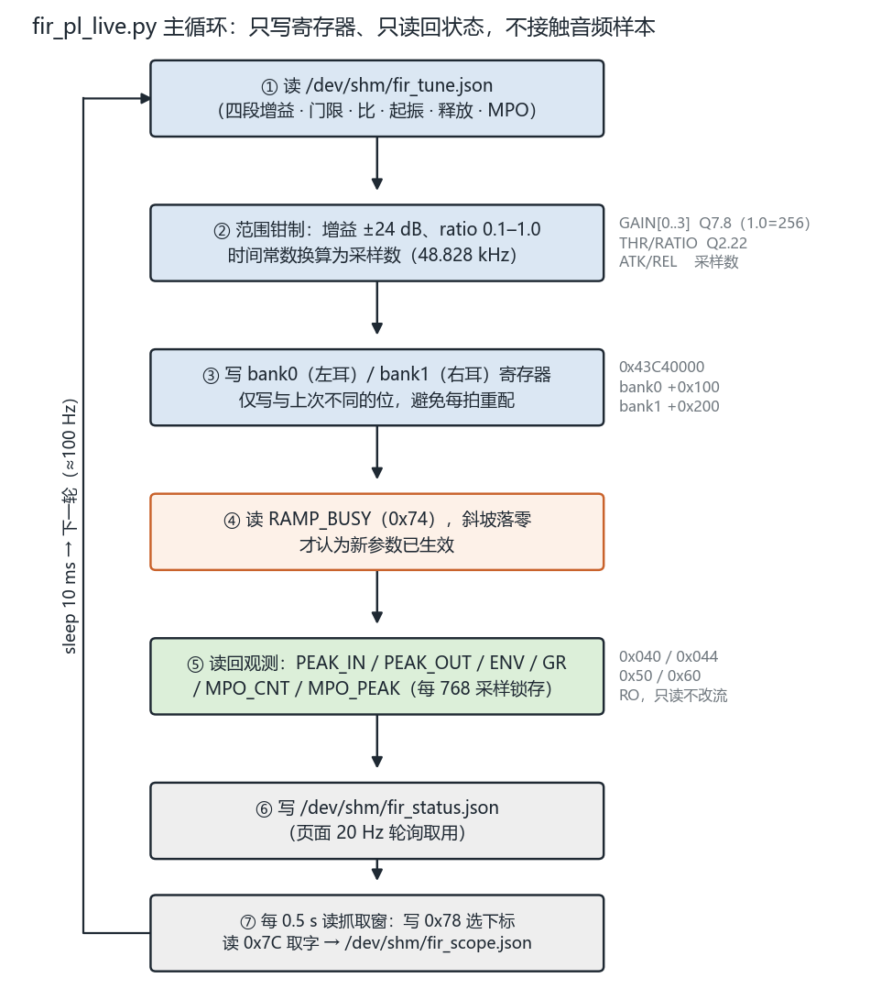

### 2.5 时钟方案与时序约束

**整个 PL 只有一个逻辑时钟域**：`FCLK_CLK0` = 100 MHz，来自 PS 的 PLL。
寄存器总线、FIR、压缩器、I2S、两个 FIFO 全挂在这一个时钟上 —— 因此
**本设计不存在跨时钟域（CDC）路径，也不需要任何同步器或握手**。
这一条不是"运气好"，是有意的：把 I2S 的位时钟做成同源分频，代价是采样率被
100 MHz / 2048 钉在 48.828 kHz，换来的是整条链路没有一个亚稳态窗口。

| 时钟 | 频率 | 怎么来 | 给谁 |
|---|---|---|---|
| `FCLK_CLK0` | 100 MHz | PS PLL（`ps7/FCLK_CLK0`） | PL 全部逻辑 + AXI-Lite |
| `BCLK` | 3.125 MHz | `clk_cntr[4]`，100 MHz / 32 | codec 位时钟（输出） |
| `LRCLK` | 48.828 kHz | `clk_cntr[10]`，100 MHz / 2048 | 左右声道帧时钟（输出） |
| `MCLK` | 10.000 MHz | 独立 `clk_wiz_10MHz`（MMCM ×15.625 / ÷78.125） | **只给 codec**，不进任何逻辑 |

三点说明：

1. **`MCLK` 只到端口，不进逻辑。** 它在 BD 里由单独一个 `clk_wiz` 出，走 `audio_clk_10MHz`
   端口直接送出片外。所以它不是第二个时钟域，是"给外部器件供的钟"。
2. **`BCLK`/`LRCLK` 都先打一拍再输出。** 这样和 PYNQ 官方 `audio_codec_ctrl` 的
   `sclk_int`/`lrclk_int` 同相，codec 看到的时序和官方 IP 一样，**I2C 配置序列一个字不用改**。
   少这一拍也能工作，但会与官方 IP 差半个 BCLK，换 IP 时容易莫名其妙。
3. **48.828 kHz 不是 48.000 kHz，差 1.7%。** 这是分频比的直接结果（100 MHz 整数分频出不了
   48 kHz），不是误差、也不该"修正"。做时长/采样数换算要用前者：按 48 kHz 算 600 秒会差 10 秒。

**时序约束的实际形态**：`board/overlay/audio_pins.xdc` 里**只有引脚与 `IOSTANDARD`**，
没有一条 `create_clock` / `set_false_path` / `set_clock_groups`。原因有两层：

- **主时钟由 BD 自动推导**：`ps7` 的 `FCLK_CLK0` 与 `clk_wiz` 的各输出，Vivado 在
  `assign_bd_address` / `validate_bd_design` 之后会为它们生成时钟约束，
  手工再写一条 `create_clock` 反而会和它冲突（写成两个时钟、或把自动约束覆盖掉）。
- **没有需要打断的路径**：单时钟域，既没有跨域路径要 `set_false_path`，
  也没有异步时钟组要 `set_clock_groups`。`IIC_*` 两条 I2C 是 PS 经 EMIO 引过来的，
  在 PL 里只到引脚、不进逻辑，也不产生需要约束的内部路径。

所以时序收敛的判据全部落在实现报告上，不在约束文件里：
**WNS **+0.090 ns** / TNS 0 / 49 518 个端点零失败**（`board/overlay/fir_pl_timing.rpt`），
资源 **LUT 20 509 / FF 13 556 / BRAM 10 / DSP 213（96.82%）**（`fir_pl_util.rpt`）。
余量确实薄，这在本报告里是如实记账的短板（§4.3 第 3 条、§10 B 组第一行），不是"约束写得松"。

### 2.6 I2S 接口协议：为什么自己造，以及帧格式怎么定

**为什么不用官方 IP。** 出货用的 `audio_codec_ctrl` 只有 AXI-Lite，**每个采样都要 PS 读写
一次寄存器**；它的 `duplex_block` 块长下限 360（7.5 ms）就是被这个逐点握手卡住的
（`data/results/performance_profile_20261022.md` §1.5）。演示通路要的是"音频不出 PL"，
所以自造一个带 AXI-Stream 端口的 I2S 主端：`i2s_duplex.v`。

**帧格式（逐条对齐 I2S 标准与 codec 配置，改一个字都等于换协议）：**

| 项 | 定法 | 依据 |
|---|---|---|
| 帧长 | 每声道 **32 个 BCLK**，LRCLK 低 = 左、高 = 右 | LRCLK = BCLK/64 |
| 数据位宽 | **24 位**，左对齐、MSB 在前 | codec 配 24 位字长 |
| 起始位置 | LRCLK 跳变后**跳过第一个 BCLK 上升沿**，从第二个开始移入 | I2S 标准：MSB 在跳变后第二个边沿有效 |
| 剩余位 | 发送侧数到 **25 位**才换声道，第 25 位固定补 0 | 保证 24 位数据 + 帧边界都在窗口内 |
| 收侧符号扩展 | `{{8{rl[23]}}, rl}` 补成 32 位 | 24 位有符号 → 32 位字，低 8 位是符号不是零 |
| 流格式 | 交错立体声，一采样一个 32 位字（`[31:16]` 有效） | 与 `audio_stream.cpp` 的 `duplex_block` 一致 |

**"跳过第一个 bit" 是这条通路最容易写错的一处。** 少跳这一位，收到的数据整体左移一格，
听感是"有声音但失真"，而位计数、FIFO 水位、`ovf/und` 计数全部正常 ——
四个状态字没有一项会报警。这也是为什么验证要靠逐位对拍（§5 的 ④⑤ 两层），
而不是靠"能出声就算通"。

**两个错误计数器是这条协议的唯一自检口**（`STAT0`）：
`[15:0]` 采集溢出（上一对还没送进 FIFO 又来一对）、`[31:16]` 播放欠载（LRCLK 边沿到了、
手里凑不齐一对）。长跑判据就是这两个都不涨（§5 的 ⑧）。

**为什么录音 FIFO 4096 字、播放 FIFO 只要 1024 字**（2026-10-25 实测定下来的）：
录音侧要吸收 PS 偶尔 10 ms 的卡顿，1024 字（10.7 ms）会被顶满丢采样；
播放侧**不能用 4096**，因为 MM2S 是"能塞就塞"，水位会爬到很高（实测 4096 字那版 `tx_lvl`
恒为 4086，光这一项就是 42 ms）。试过缩到 512：播放积压从 10.5 掉到 5.2 ms，
但录音侧同时反弹到 8.3 ms，总延迟一点没变（18.9 vs 18.8 ms）——
**缺的是水位控制，不是浅 FIFO**。留着 1024 是因为水位要摆动的余地在它里面。

### 2.7 两个状态机

`i2s_duplex.v` 里有本设计全部的状态机，共两个。它们是初级组考察侧重
（"逻辑设计、状态机、时序约束、接口协议"）里最该展开的部分，所以单列一节。

**收：6 态，按 LRCLK 跳变同步，配 5 位位计数与 24 位移位寄存器**

```
        start_left=LRCLK↓              bit_rdy=BCLK↑
 R_WAIT_L ──────────────► R_SKIP_L ──────────────► R_READ_L ──(rbit==24)──► R_WAIT_R
    ▲                                                                          │
    │                                                                 start_right=LRCLK↑
    │                                                                          ▼
 R_WAIT_L ◄──(rbit==24)── R_READ_R ◄────────────── R_SKIP_R ◄──────────── R_WAIT_R
```

- `R_WAIT_L` / `R_WAIT_R`：等 LRCLK 边沿。**这两个态让状态机自己回到帧对齐**——
  任何一次相位丢失（上电、`flush`、codec 重启）都在下一帧的第一个边沿重新同步，
  不需要额外的复位序列。这是选"边沿驱动"而不是"自由运行的 64 分频计数器"的全部理由。
- `R_SKIP_L` / `R_SKIP_R`：**丢掉跳变后的第一个 BCLK 上升沿**（§2.6 那条）。
  单态 + 单条件，就是为了让这一位在代码里看得见 —— 它是有意跳的，不是漏了。
- `R_READ_L` / `R_READ_R`：每个 `bit_rdy` 移入一位，`rbit` 数到 24 表示该声道收满。
  `rbit` 在非 `READ` 态清零，所以两个声道的位计数天然独立。
- 帧满的那一拍：`rx_valid = (rxs == R_READ_R) && (rbit == 24)`。此时 `rl`/`rr` 在上一个
  时钟沿已装齐，所以是"用上一拍的结果"——打一拍读，不组合读。

**发：4 态，按 BCLK 下降沿移出，配 25 位位计数**

```
        start_left           write_bit=BCLK↓
 T_WAIT_L ─────────► T_WRITE_L ──────────────► (tbit==25) ──► T_WAIT_R
    ▲                                                            │
    └──────── (tbit==25) ◄──── T_WRITE_R ◄──── start_right ◄──────┘
```

- `T_WAIT_L` 那一拍**不取数**（`tx_rd_en` 里显式排除了 `start_left`）：
  那一拍正是把 `hold0`/`hold1` 拷进移位寄存器的拍，同一拍再改 `hold` 会拷错。
  这是代码里唯一一处"看起来多余、删了会错一位"的条件。
- 发送侧要**先攒够两个字**（`hold_cnt == 2`）才能成对交出，所以 `tx_rd_en` 是
  "没攒满 && FIFO 非空 && 不是 `start_left`"。
- `tbit` 数到 **25** 而不是 24：第 25 个下降沿是帧边界，此时数据已全部移出、
  下一拍换声道。数 24 会让最后一位少发一个 BCLK。

**这两个状态机都是有意的"状态极简"设计**：没有嵌套状态、没有计数器驱动的多级流水，
换声道完全由外部 `LRCLK` 决定。代价是每个声道必须严格 32 个 BCLK（分频比固定），
收益是**每个状态的出口条件只有两三个，逻辑深度只有几级** —— 静态看不会成为时序瓶颈。

---

## 3. 功能框图（层次）

先看系统级：虚线框是 PL / PS 边界，**音频全程在 PL 内闭环，不过 PS、不过 DDR**；
PS 只在控制面每 100 ms 写一次寄存器并读回状态。

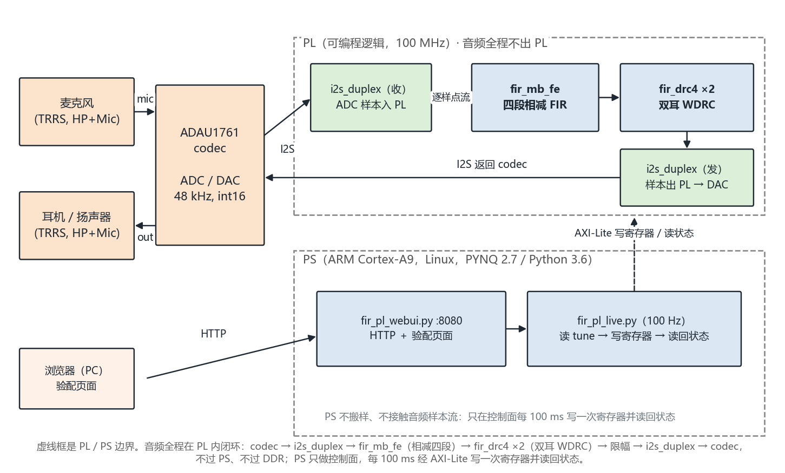

再看 PL 内部的模块层次：

```
┌─ PS (ARM Cortex-A9 ×2, 667 MHz) ────────────────────────────────┐
│  fir_pl_webui.py    网页验配界面 / 波形 / 频谱 / 电平表          │
│  fir_pl_live.py     后端：读抓取缓冲、写参数、状态机             │
└───────────────┬─────────────────────────────────────────────────┘
                │ AXI-Lite（参数与状态，不搬音频）
┌───────────────┴─ PL (100 MHz) ──────────────────────────────────┐
│  fir_pl_regs.v    寄存器窗口 + 抓取缓冲读口                      │
│      │                                                          │
│  i2s_duplex.v ──► fir_mb_fe.v ──► fir_drc4.v ──► fir_gain_ramp  │
│      ▲                │                │              │         │
│      │                └──► cap_bram ◄──┘              │         │
│      └────────────────────── I2S 回放 ◄───────────────┘         │
└─────────────────────────────────────────────────────────────────┘
```

同一套算法还有另外三种包装，都在仓库里、都能复现，但**不在演示通路上**。
「配套材料」这一列是**分流用的**：`board/notebooks/` 下的 Jupyter 笔记本是上一代块模式
（`fir.bit`）的教学与调试产物，**不要用它们验演示通路**；演示通路的一切在
`board/scripts/` 与 `board/probes/` 下（`board/notebooks/README.md` 有逐份说明）。

| 包装 | 位流 | 数据怎么走 | 用途 | 配套材料 |
|---|---|---|---|---|
| 块模式 + HLS 核（上一代出货） | `board/overlay/fir.bit` | codec ↔ 厂商音频 IP ↔ 核，PS 逐字搬 | 加速比 16.7× 就是在这颗上量的 | `notebooks/test_multiband.ipynb`、`notebooks/w5_tuning_ui.ipynb`、`scripts/fir_core.py` |
| 块模式 + RTL 外壳 | `fir_rtl.bit` | AXI-Lite + BRAM，LOAD/RUN/DRAIN | 与 HLS 核同源对拍的载体 | 无 notebook，走 `probes/` 下 RTL 对拍脚本 |
| DMA + AXI-Stream | `fir_rtl_dma.bit` | `axi_dma` ↔ `fir_stream_shell` | 连续流吞吐 25.7 M 采样/秒 | `scripts/` 下 DMA 系列 |
| **全 PL 直连（当前演示）** | `fir_pl.bit` | codec ↔ I2S ↔ 前端 ↔ 压缩 ↔ codec，**音频不出 PL** | 延迟与抖动的主线 | **`scripts/fir_pl_live.py`、`fir_pl_webui.py`；`probes/board_accept.sh`** |

> `notebooks/w2_audio_playback.ipynb` 与 `w3_own_overlay_audio.ipynb` 是 PYNQ 入门那两课
> （`base.bit` → 自建 `audio.bit`），与上面四条通路都不冲突，也不属于任何一条。

---

## 4. 优化过程

这一节按指南要求给**优化前后的性能与资源对比**。所有数字都标了来源文件；
凡是估算值都注明"估算"，不与实测混排。

### 4.0 先说取舍的全貌，再说每一格是怎么来的

指南 §3.3.4 那句话是"不以显著的资源代价换取有限的性能收益"——它本质上是一个**取舍陈述**，
用逐行的过程表很难说明白，所以先把全部 68 版摆成一张图。

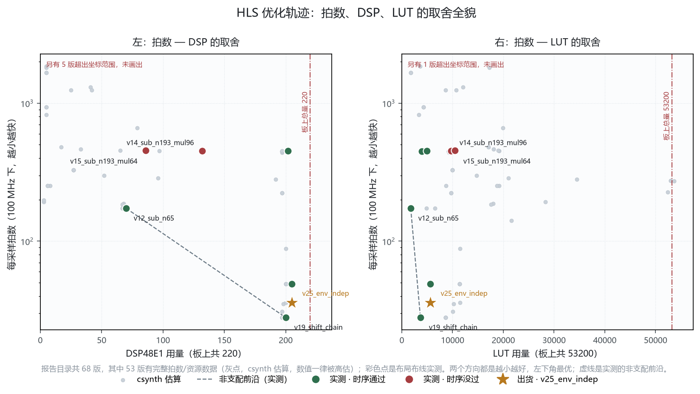

图由 `src/python/plot_pareto.py` 现场生成（不手画、不手抄）：灰点是从 68 份 csynth 报告里
解析出的估算值 —— **68 版中 53 版同时有拍数与资源字段，其余 15 版报告不全，不上图**（脚本实跑输出：估算点 53 / 实测点 9 / 前沿 2 点）；彩色点是 `data/results/impl_metrics.md` 里的布局布线实测值（v25 取 OOC 那一组），
绿 = 时序通过、红 = 没过，星号是出货的 `v25_env_indep`。两个方向都是越小越好，
**虚线是非支配前沿** —— 落在前沿上的点，没有任何一个别的点能同时在拍数和资源上打赢它。

读法，四条。**第 2 条最重要，它是这张图的解释边界**：

1. **前沿上只有两个点**：`v12_sub_n65`（65 抽头）与 `v19_shift_chain`（193 抽头）。
   其余大部分版本都落在前沿里面，也就是被某个已有点全面碾压 —— 它们的作用是记录
   "哪条路走不通"，不是候选方案。
2. **这两个轴表达不了"功能"，所以前沿只在同一功能集内可比。** `v19` 没有峰值包络与
   attack/release —— 那是 v21 才加的（§4.2）。它在图上"支配"了 v25（200 DSP / 31 拍
   vs 205 / 36），但支配的是一个**少一个功能**的版本。真正同功能可比的是 **v21 → v25**
   那一段：49 → 36 拍，DSP 一个没多。这一点要写在图上读不出来，所以写在这里。
3. **限流那一组（`v14` / `v15`，红点）在两条轴上都更差**：DSP 从 202 降到 132 / 86，
   但 LUT 涨到 9702 / 10443、时序从 +1.624 掉到 −0.138 / −0.620。
   这是"以显著资源代价换取有限（实际是负的）性能收益"的教科书例子，
   也是 §4.3 结论的图形证据。
4. **在"含 WDRC 的同功能族"里，`v25` 是最优格**：36 拍 / 核 205 DSP（整机 213/220 = 96.8%）/
   OOC 5622 LUT / WNS +1.739。往左一格（少 DSP）没有不吃 LUT 的路，
   往下一格（更少拍）没有不加 DSP 的路 —— 这就是"停在 96.8%"的全部理由。

下面四节是这条轨迹的逐步拆解，每一节都能在这张图上找到对应的点。

### 4.1 第一步：抽头数与结构（决定下限）

| 抽头 | 过渡带 `3.3·fs/N` | 最差边界残留 | 段 2 在**自己**中心 707 Hz 处 |
|---|---|---|---|
| 65 | 2437 Hz | **−6.0 dB** | **−14.2 dB** |
| 129 | 1227 Hz | −14.5 dB | −4.1 dB |
| **193** | **820 Hz** | **−21.4 dB** | −1.6 dB |

判据是"每条边界两侧都 ≤ −20 dB"。65 抽头不是"串音大了点"，是第 2 段连自己该通过的
707 Hz 都压掉了 14 分贝 —— 那四段根本没分开，压缩比调什么都一样。**193 是量出来的下限。**

下图是按核内 **Q1.17 实际系数**算出来的四段频响（不是理想滤波器的理论曲线），
三条虚线是 500 / 1000 / 2000 Hz 的段边界。读法就看一件事：**每条虚线两侧，
两条相邻曲线是否都落到 −20 dB 以下** —— 这是"193 抽头刚好够"的直接图形证据。

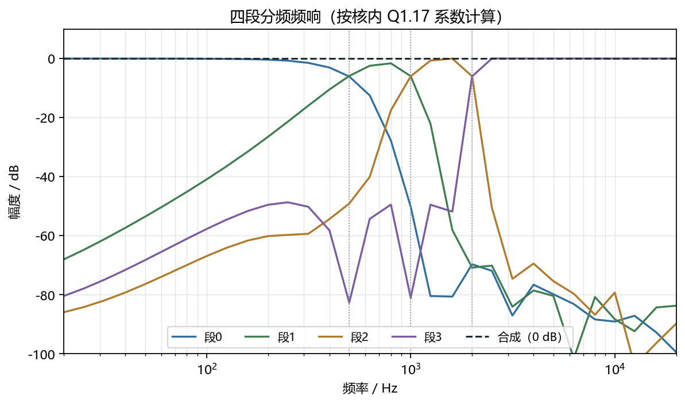

### 4.2 第二步：拍数（从 1661 到 36）

| 版本 | 改了什么 | 拍/采样 | DSP（csynth / OOC 实测） | 关键判据 |
|---|---|---|---|---|
| `v0_baseline` | 起点（浮点，4 段各自带通） | 1661 | — | — |
| `v13_sub_n193` | 改相减式 + 定点 Q1.15 | 449 | 197 / **202** | 频段分得开 |
| `v19_shift_chain` | 延迟线改成移位链（`-DFIR_SHIFT_CHAIN=1`） | **31** | 197 / **200** | 算法一字未改，csim 逐字节相同 |
| `v20_gain` | 加每段验配增益 | 35 | 198 / 未量 | +4 拍 = 每段一次乘法 |
| `v21_wdrc` | 加峰值包络 + attack/release | 49 | 200 / **205** | 合段循环 II 被假依赖抬到 4 |
| **`v25_env_indep`** | 一条 `DEPENDENCE inter false` | **36** | 200 / **205** | II 4→1，**DSP 一个没多** |

> 这张表的口径**不统一，必须说明**：拍数是 csynth 的调度值（调度步数，不是实测）；
> DSP 两列分别是 csynth 估算与 OOC 布局布线实测 —— **估算和实测差得不小，
> 所以两列都给，不要只引一列**。`v20_gain` 没有留 OOC 报告，只能给估算值。
> 逐版的实测资源见 `data/results/impl_metrics.md`；引用某一版的资源前，
> 先确认读的是哪一次构建的报告（同目录下 `v23_drc_u0` 那份 `.rpt` 写 195，
> 而构建记录是 200，就是读错了一次）。

这张表画成图是这样（拍数用对数轴，否则 449 会把其余四版压成一条平线）：

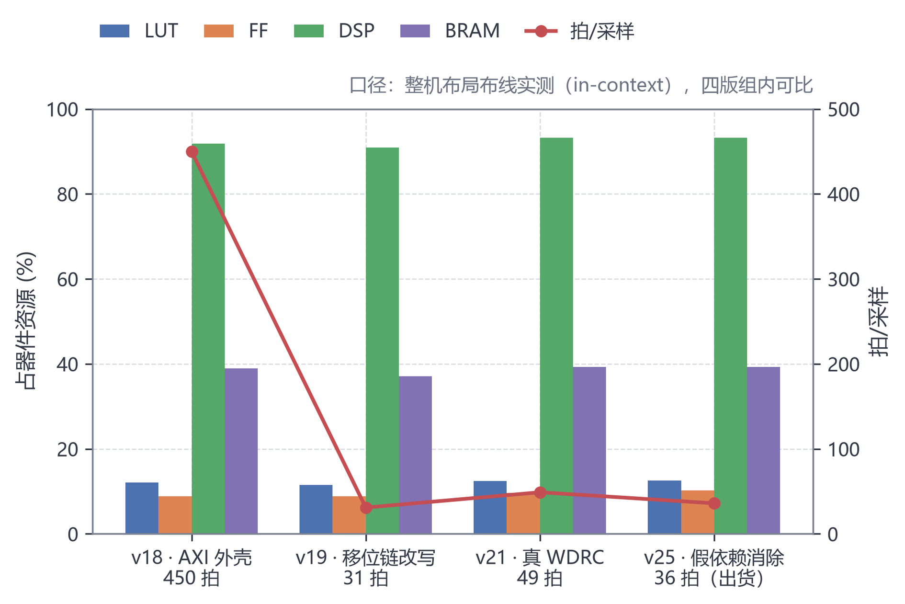

图里最该看的是 **v21 那根柱子为什么比 v19 高**：加了峰值包络与 attack/release 之后，
合段循环被一条假依赖把 II 从 1 抬到 4，拍数从 31 涨回 49，而 DSP 一个没省。
**功能增加导致拍数倒退，这不是退步，是缺一条 pragma** —— v25 用一条
`DEPENDENCE inter false` 把 II 拉回 1，拍数回到 36，DSP 仍是 205。
这一段（v21 → v25）才是真正同功能可比的对照，也是 §4.0 那张 Pareto 图的读法边界。

其中最有价值的一次，是 **449 → 31 那一步的诊断**。读 csynth 的循环表：

| 循环 | 干什么 | 迭代 | achieved II | 拍数 |
|---|---|---|---|---|
| `VITIS_LOOP_270_4` | 延迟线整体移位 | 194 | **2** | **398** |
| `VITIS_LOOP_281_5` | 3 个低通 | 3 | 1 | 11 |
| `VITIS_LOOP_356_10` | 4 段压缩求和 | 4 | 1 | 12 |

**88% 的拍数（398/450）花在"把延迟线挪一格"上**，真正的乘法只占 11 拍 ——
202 个 DSP 铺在片子上，97% 的时间空着。**这个核不是算得慢，是搬得多。**

根因不是 pragma 没生效，是 `hist[k] = hist[k-1]` 有距离 1 的**环依赖**，
C 语义要求按序执行，编译器拒绝展开是**正确行为**。改成"串起来的临时变量"之后，
依赖从数组跨迭代变成标量跨迭代，日志里出现 `Unrolling ... with a factor of 195`，
拍数直接掉到 31，**算法一个字没改，csim 输出逐字节相同**。

同一条路径上试过但**没用**的三条（记录在 `build/hls/reports/t*`）：

- `ARRAY_PARTITION cyclic factor=13`：449 → 437，几乎无效。194 不能被 13 整除，
  跨 RAM 边界仍要串行。这与 Odatix 的结论一致。
- 只给外循环加 `PIPELINE`：449 纹丝不动。官方文档"编译器会自动展开移位循环"
  在这份代码上**不复现**（指令确实生效了，两份报告 diff 只差日期）。
- 完全拆分 `hist`：224 拍。方向对但收益小，且被后来的移位改写完全覆盖。

### 4.3 第三步：DSP 与资源（为什么最终占 96.8%）

这是本项目最容易被问的一处，所以把完整对照摊开。

**先看限流这条路（实测，OOC，同一器件/约束/努力度）：**

| 版本 | 乘法器 | 拍/采样 | DSP | LUT | WNS | 失败端点 |
|---|---|---|---|---|---|---|
| `v13_sub_n193` | 不限 | 449 | **202 (91.8%)** | 3962 | **+1.624 ✅** | 0 |
| `v14_sub_n193_mul96` | 限 96 | 452 | 132 (60.0%) | 9702 | **−0.138 ❌** | 19 |
| `v15_sub_n193_mul64` | 限 64 | 455 | 86 (39.1%) | 10443 | **−0.620 ❌** | 443 |

**三条同时反向：DSP 省了 57%，LUT 涨了 2.6 倍，时序从过变成不过，拍数几乎没动（+1.3%）。**
原因是复用乘法器 = 把两个 DSP48 串成一条中间没有寄存器的链，最差路径 10.491 ns，逻辑 4 级。
所以"省 DSP"在这里不是优化，是拿最紧的两项去换一个没用的一格。

**再看当前演示位流的实测占用**（`board/overlay/fir_pl_util.rpt` 与 `fir_pl_timing.rpt`）：

| 资源 | 用量 | 占比 |
|---|---|---|
| DSP48 | **213 / 220** | **96.82%** |
| Slice LUT | 20509 / 53200 | 38.55% |
| WNS @ 10 ns | **+0.090** | 0 失败端点 / 49518 端点 |

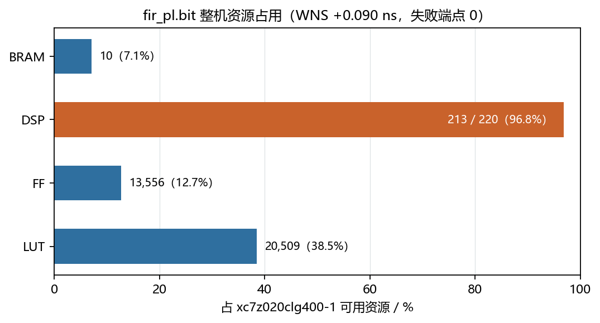

一张图说清"为什么只有 DSP 这一根是红的"：LUT 38.5%、FF 12.7%、BRAM 7.1% 都很宽松，
**只有 DSP 顶在 96.8%**。这不是资源分配失衡，而是这个算法本身就是"乘法密集、控制稀疏"——
FIR 需要乘法，而 I2S、AXI 互联、寄存器窗口、FIFO 需要的都是 LUT/FF，不需要 DSP48。

**结论与坦白：**

1. **全系统只有 FIR 用 DSP。** I2S 控制器、AXI 互联、寄存器窗口、抓取缓冲、
   音频 IP 全都是 0 个 DSP48。213 个是真花在刀口上，不是散在各处漏掉的。
2. **96.8% 是"用 DSP 换时序"的结果，不是目标。** 上表已经把相反的取向量过了，
   它在三个维度上都更差。指南说"资源使用率不是越高越好，应结合性能、时序和扩展余量判断"——
   本项目的判断依据就是这张对照表，不是"我们用了很多 DSP 所以很强"。
3. **余量确实薄，这是本项目最实在的短板。** `+0.090 ns` 意味着往 PL 里再加任何东西
   都必须重量时序。若要留扩展余量，正确做法是**降抽头数**而不是复用乘法器 ——
   但 §4.1 已经量出 129 抽头时边界残留 −14.5 dB，达不到判据。**这一格目前没有解**，
   如实记在这里而不是绕过去。

### 4.4 第四步：数据通路（从"算得快"到"传得省"）

加速比只回答"核算得快不快"。真正决定体验的是数据怎么到核、怎么回来。
四条通路依次剥掉一层 PS 参与：

| 通路 | 每块 PS 要做什么 | 延时 | 证据等级 |
|---|---|---|---|
| 块模式 `fir.bit`（上一代出货） | 逐字 MMIO 搬一整块 | 演示档 16.2 ms | 板上实测 |
| DMA `fir_dma_core.bit` | 只写地址和长度 | **14.4 ~ 14.8 ms** | 板上实测 |
| DMA 无核 `fir_dma.bit` | 同上 | 10.1 ms（这条路的结构地板） | 板上实测 |
| **全 PL 直连 `fir_pl.bit`** | 配一次 codec，之后只读状态 | 数字段 **2.00 ms** + 声学 1.23 ms | 数字段 96 采样，2026-11-02 互相关实测（94—96，中位 96）；声学 2026-10-22 实测 |

这里有一处**必须说清的修正**：早前对外报过"全 PL 直连约 2.3 ms"，那是按压各级 FIFO 水位
推算的，**公式里少算了半个群延迟项**。现在只报分解（96 采样 ≈ 2.00 ms + 声学 1.23 ms），
不再报那个合数。2026-11-02 用抓取窗口对进核/出核两路做互相关，把 96 采样量成了板上值
（5 个有效窗口 94—96 采样，中位 96，与 (N−1)/2 一致，见 `data/results/pl_delay_20261102.md`）。**2.3 ms 是一个错过的数，不要引用。**

延迟预算的图形形态如下：

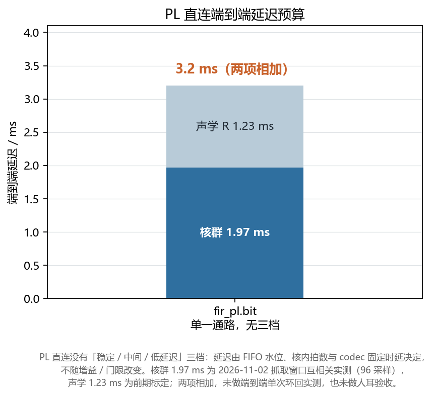

图上有两个数要连注释一起读。其一，核群的 **1.97 ms** 是 2026-11-02 抓取窗口互相关的
**实测值**（96 采样），不是按 `(N−1)/2` 推算的 2.00 ms —— 两个数差 0.03 ms，
正文按实测值报，推算值只用来说明"和理论一致"。其二，图上那个 3.2 ms 是两项**算术相加**，
图下注释已写明"**未做端到端单次环回实测、也未做人耳验收**"。
这正是 §4.4 那条口径的具体形态：**分量各有实测出处，合数只作示意并标出未验**。
它和那个作废的"2.3 ms"的区别不在数字大小，而在于**有没有标注它的证据等级**。

### 4.5 延迟分布与 deadline miss

§4.4 给的是单值，助听场景更怕"偶尔卡一下"，所以把块模式那批逐块时间戳算成了分布。
PS 在环的 n2_l480 配置：36 拍核 20 秒一趟实测 2,022 块，数字通路延迟 P95 = 19.94 ms、
P99 = 20.58 ms、max = 22.23 ms；同配置 120 秒复测 12,069 块（10-22，49 拍核，与 36 拍核逐档相同，差 ≤ 0.04 ms），
P95 = 20.02 ms、P99 = 20.56 ms、max = 28.92 ms，其中超过 25 ms 的只有 8 块（0.07%）。
按"块间隔超过标称 L/48 = 10 ms"计，deadline miss 为 10.1% —— 这一项要连同定义读：
该趟块间隔中位 9.945 ms 本身就贴着阈值，超出阈值 0.5 ms 以上的只有 72 块（0.60%），
它反映的是余量而不是成片卡顿（同配置 300 秒长跑 0 丢块，见 `live_dropout_recheck_20261024.md`）。
这层抖动的来源是 PS 逐块调度与搬样；全 PL 直连把音频留在 PL 内，从机制上取消了这一层，
600 秒长跑 I2S 溢出与欠载零增长（`soak_pl_600_20261029_1031.md`）。
九趟测量的完整分位数表见 `data/results/latency_quantiles.md`，该表只覆盖 PS 在环的
块模式线，不与 PL 直连的数混用。

---

## 5. 功能正确性是怎么确认的

本项目不用"听起来对"当判据。整条验证链是**分级放行**的：上一级不通过，下一级的结论
一概不算数。下图就是这个顺序 —— 上面一行是"设计侧"（从浮点模型一路收到实现），
下面一行是"板侧"（集成 → 频响/压缩/延迟 → 鲁棒性 → 长跑），每次优化都要把
**数值 · 拍数 · 时序 · 板端** 四类回归全跑一遍。

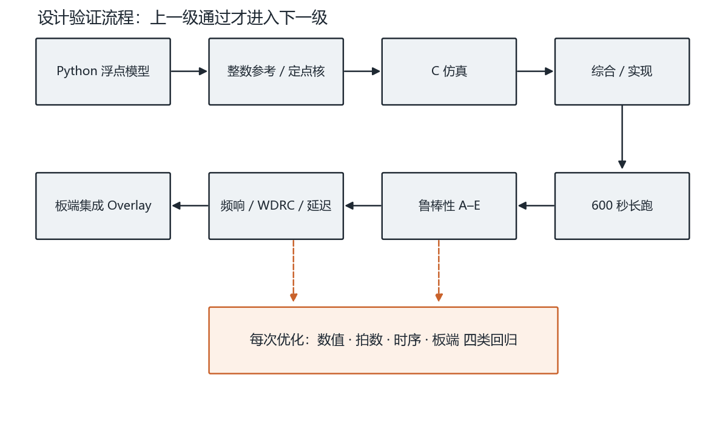

在这个流程下，功能正确性被拆成八层判据，每一层能独立定位一类问题
（① ~ ⑥ 是单点正确性，⑦ ⑧ 是两条通路各自的长稳，分开记账）：

| # | 验证项 | 判据 | 结果 |
|---|---|---|---|
| ① | 系数规则：RTL 系数表 ↔ HLS 综合出的 ROM | 全量逐项比对 | **579 个 / 不符 0 个** |
| ② | 参考模型：整数模型 ↔ 浮点卷积 | SNR | 72.5 / 76.3 / 78.2 dB |
| ③ | RTL ↔ 整数模型（xsim） | **逐位** | 1000/1000 相同（累加器与输出都比） |
| ④ | 板上 ↔ xsim 黄金向量 | 逐位 | 4800 点 **0 点不同**（bypass 与 DRC 各一份音源） |
| ⑤ | RTL ↔ HLS 出货核，同一进程并排 | 逐位 | 4800 点 **0 点不同，最大差 0 LSB** |
| ⑥ | 实时通路：麦克风 → PL → 耳机 | 逐位自检 | **960000/960000**，40.00 秒音频 / 40.19 秒墙钟 |
| ⑦ | 长稳：块模式线连续 600 秒 | 丢块数 | 80188 块 **0 丢块** |
| ⑧ | 长稳：PL 直连线 600 秒 ×3（E3 10-29 / T9 10-31 / 11-02 复测） | 溢出与欠载计数零增长 | overrun **54944 → 54944**、und 全 0、FIFO 溢出与跳变 0；11-02 复测 605.4 s / 300 采样点同样零增长；另跑深压 300 s 与 600 s 两趟单音（+24 dB/−40 dBFS/0.5），有效增益 19.08 dB；再用语音音源跑 600 s（包络 −45~−36 dBFS 起伏），判据同样全 PASS |

⑦ 与 ⑧ 是两条线，**分别记账、不互相归属**：⑦ 测的是 PS 在环里的块模式 `fir.bit`
（`data/results/soak600_20261023.md`），⑧ 测的是样本不过 PS 的 `fir_pl.bit`
（`data/results/soak_pl_600_20261029_1031.md`，含判据、配置与复现命令；
2026-11-02 的复测把每 2 秒一个采样点写进 `data/results/soak_pl_20261102.json`，可直接画图核对）。

两条线的长稳曲线放在一起看，差别一目了然：

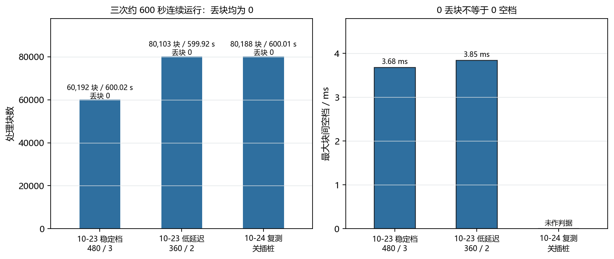

这张图的第二个面板是**特意画出来的反例**：丢块数恒为 0，但块间隔的空档并不为 0。
"0 丢块"只说明没有整块丢失，"有没有卡一下"要看空档分布 —— §4.5 那组 deadline miss
10.1% 就是从这个面板读出来的。把两件事分开报，是为了不让"0 丢块"盖住"偶发卡顿"。

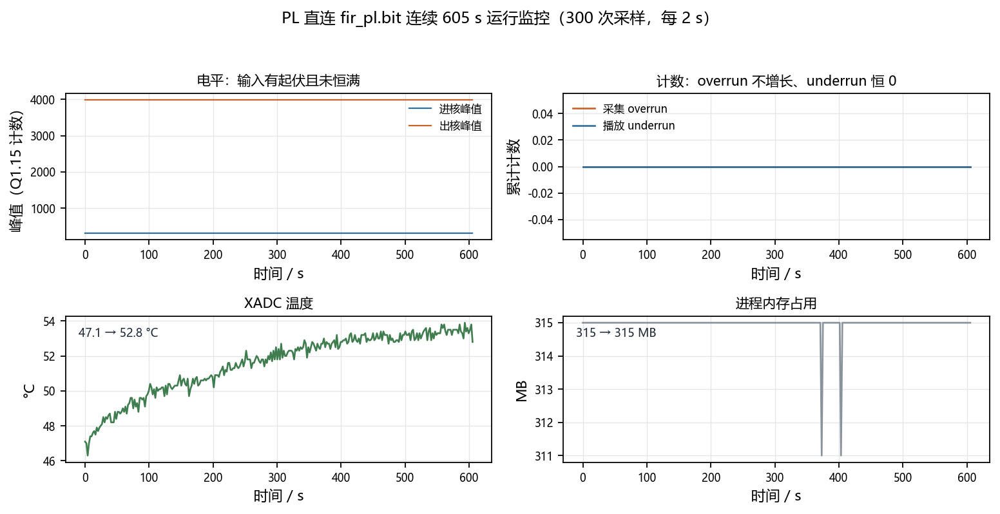

PL 直连这张四面板图里，第四个面板（内存）是长跑里最容易被忽略的一项：
进程内存末值仍高于首值 40 MB 以内，说明 600 秒里没有泄漏。前两个面板是这条通路的核心判据 ——
**出核峰值全程不变**说明压缩器在空闲（这一趟验的是通路成立，不是压缩效果，§8.6 末段单独补了深压两趟）；
**overrun 全程不增长、underrun 恒 0** 说明 I2S 两侧 FIFO 的水位是中性平衡的（§2.6 末尾那条）。

几处方法论上的选择，比结果本身更值得写：

- **先比累加器，再比输出。** 输出是"右移 17 + 饱和"之后的结果，会把低 17 位全扔掉。
  只比输出的话，"乘法算错一点"和"移位量写错"长得一模一样。先比累加器，
  错在哪一步就是确定的：累加器就不对 → 乘法/加法树/下标；累加器对、输出不对 →
  只剩移位量和饱和两行。RTL 里 `acc_raw` 单独引出来就是为了这一步，**不是给板子用的**。
- **两侧都先各自和黄金一致，再互相比对。** ⑤ 如果只做并排比对，
  两边同时错成一样也会显示"逐位相同"。
- **判定"压缩器真的启动了"要看包络。** `golden_n4800_drc_quiet/` 那份音源包络最高
  205844、阈值 419456，**压缩器一次都没启动** —— 逐位相同只证明直通没弄坏。
  必须用 `_loud` 那份：47% 的段-采样衰减量 > 0、rms 降 1.77 dB。
  这个坑真踩了：把 DRC 改成 8 级流水时写错两处，1000 点那份单元 tb 照样 1000/1000 全对。

### 5.1 已知缺陷：减法式压缩的零交叉死区（含"哪一档测过、哪一档没测"）

**先说功能是对的。** 压缩器的静态传输曲线（250 Hz、13 档阶梯扫过 −52 至 −4 dBFS）
如下：四条不同参数的曲线在阈值以下**与直通虚线重合**，越过阈值后斜率变缓、向下偏折，
偏折幅度随压缩比增大（`.010/.30` 那条最狠）。这是标准的软膝特性，说明每段的包络跟踪、
增益计算、平滑都没有结构错误。

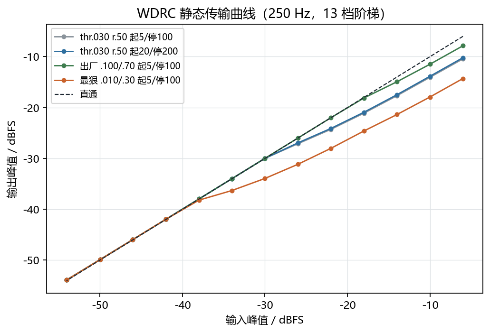

> 这张图的数据源是 `data/results/wdrc_curve_20261023.json`（2026-10-23 那批静态扫描），
> 横纵轴都是**峰值电平**，不涉及失真 —— 所以它和下面那张 THD+N 表不冲突、也不互相引用。
> 仓库里另有一张 10-23 的纯 THD 曲线（`fig3_5_thd.png`），那批的压缩比是 0.50 / 0.30，
> 而 11-02 这批 THD+N 是 0.70，**两个口径不能并排放**，所以本节只引表、不引那张图。

**然后是这个功能的代价。** 减法式压缩在零交叉处留死区：`src/rtl/fir_drc4.v` 里 `y = sign(a)·max(0, |a| − gr)`
在信号过零附近留下宽度约 2G 的平台。2026-10-31 与 2026-11-02 在板上用 1 kHz 整数周期单音
量过多组对照（`data/results/thdn_localization_20261031.md`、`data/results/thdn_20261102.md`）：

| 工况 | THD+N |
|---|---|
| 不压缩（输入本底） | **0.09%** |
| **默认参数 +22 dB / −10 dBFS / 0.7** | **0.09%**（压缩器未启动） |
| +24 dB / −10 dBFS / 0.7 | 0.09% |
| +30 dB / −10 dBFS / 0.7 | 2.36% |
| +24 dB / −20 dBFS / 0.7 | **9.32%** |
| +24 dB / −40 dBFS / 0.5，atk 5 ms rel 100 ms | **37.24%** |
| +36 dB / −10 dBFS / 0.7（限幅器动作） | 48.4%（另一机制，不并列） |

失真随压缩深度单调上升，attack/release 放慢 10 倍几乎不改变结果（排除包络纹波假设），
奇次谐波为主、偶次全部低于 −80 dBc。定点前端本身不产生失真（0.09% ≈ 输入本底）。

两点口径必须一起写清：其一，**代码默认门限是 −10 dBFS，不是 −20 dBFS**——早先把 9.13%
标成"演示默认"是错的，那条实际对应 −20 dBFS，本轮复现为 9.32%；默认参数下压缩器不启动，
THD 等于本底。其二，板载 WAV 播放自 2026-11-01 起统一衰减 32 dB（`fir_pl_live.py` 的
`PLAY_GAIN_DB`），所以本表用满幅音源把入核峰值拉回 803 计数（−32.2 dBFS）后测量，
读数与 10-31 那批可比。
**机制已定位、修法未实现**，如实记录。

**为什么不赶在提交前改。** 修法明确（把减法式衰减换成乘法式线性增益），但有两个硬约束：

- **挡路的是时序，不是 DSP 个数。** 出货版本 DSP 已占 213/220，四段各加一个乘法器还剩 3 个；
  更紧的是乘法槽：195 个乘法器 × 3 拍轮转 = 585 槽，实际用 579，**只剩 6 槽**，
  加 4 条乘加路径后 583/585 = 99.7%。数量上刚好够，但 WNS 只有 +0.090 ns，
  再插一级乘法与配套加法树大概率不收敛。
- **改完必须重跑四关**（csim 逐位 / csynth 拍数 / 实现时序 / 上板自检），任何一关没过都不能出货。

若要走这条路，正确顺序是**先换时序余量再改结构** —— 但有一个容易被漏掉的前提：
**整条音频时钟树都是从 `FCLK_CLK0` 派生的**。BCLK 是 `clk_cntr[4]`、LRCLK 是 `clk_cntr[10]`，
codec 的 MCLK 来自 `clk_wiz_10MHz`，而它的 `clk_in1` 也接 `FCLK_CLK0`（`build_audio_pl.tcl`）。
所以**直接把核时钟从 100 MHz 降到 75~80 MHz 会把采样率同比拉低 20~25%**
（LRCLK 48.828 → 39~37 kHz、MCLK 10 → 8~7.5 MHz），**不是"对功能零影响"** ——
这一版早期的稿子在这里写过"零影响"，漏掉了 MCLK 的输入源。

真正的顺序是三步：① 先让音频时钟独立（`clk_wiz` 换独立输入，或 MCLK 改由 PS 的另一路 `FCLK` 供）；
② 按新核时钟**重算 I2S 分频比**，保住 48.828 kHz 与 10 MHz；
③ 再降核时钟换 WNS。做这三步的底气来自余量本身：每采样预算 20.48 µs，
而演示通路前端只占 3 拍（30 ns @ 100 MHz），**余量约 680 倍** —— 降频碰不到吞吐，只换时序。

在没有把握之前改硬件，比留一个**已定位、有缓解档、有复测方法**的缺陷更容易出事。

**已经提供的缓解档。** `fir_pl_webui.py` 的 `PRESETS` 分四档，切换只需一条命令
（`curl -X POST .../api/preset -d '{"name":"clean"}'`）：

| 预设 | 参数 | THD+N | 用途 |
|---|---|---|---|
| `demo` | +22 dB / −10 dBFS / MPO −6 | **0.09%**（11-02 实测，压缩器未启动） | 开机默认；**响度优先，靠 MPO 限幅出声**，压缩器本身没动 |
| `show` | +30 dB / −10 dBFS / MPO 0 | **2.36%**（11-02 实测，压缩器确认动作） | **现场 A/B 用这一档**：四档里唯一"压缩器确实在压"且失真仍可控的 |
| `soft` | +14 dB / −20 dBFS / MPO 0 | 谐波回到 −90 dBc 量级（10-31 边界实验），总数未单独记 | 想压一点又不出粗糙感 |
| `clean` | +22 dB / THR 0 dBFS（不压缩）/ MPO 0 | **0.07%**（10-31 第 1 组，输入 1000 计数） | A/B 的"未压缩"参照面；现场以音质优先时切这一档 |

四档都在同一颗位流上运行期切换，不需要重编。**四档的听感来源不同，汇报时必须说明用的是哪一档**：
`demo` 的"有效果"来自限幅器（该机制单独动作时 THD+N 48.4%，与压缩失真不是一回事），
`show` 才是压缩器本身在动作。**`show` 的 2.36% 是在满幅音源、入核峰值 803 计数下量的**，
换现场语音素材后电平不同，听感需要人耳确认一次；若出现削顶，把 `mpo_db` 降到 −6 再听，
那一档的 THD 要重测（`thdn.py` 现成，命令见 §8.4）。以音质为先仍用 `clean`。

**A/B 对比要先对齐响度，否则比的是音量不是音质。** 下图是同一段语音的三条 100 ms 包络：
原始输入（灰）、过核未补偿（蓝，整段低了约 7 dB）、过核并把响度补回来（橙虚线）。
未补偿那条整体下沉是压缩器正常工作造成的，听感上会被误判成"声音变小了/变闷了"；
把响度补平之后，缺的那部分才听得出来是"动态被压掉了"。

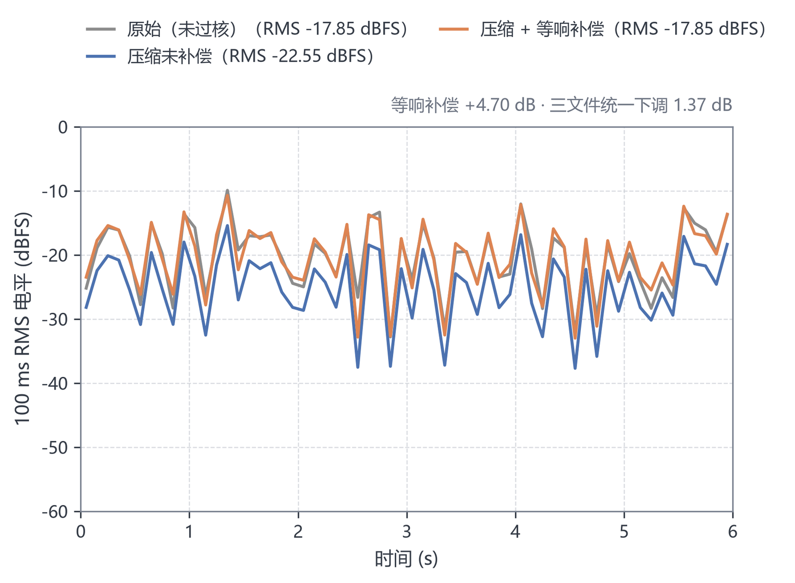

现场演示照这条做：切 `demo` 与 `clean` 对比时，先让两边响度接近，再问"听不听得出区别"。
否则观众听到的第一反应永远是"响的那个更好"，与压缩器做得好不好无关。

---

## 6. 大模型协作记录

本作品全程与大模型协作开发，协作记录与可复用产物随仓库交付：`report/llm_collab_log/` 保存了 49 份协作日志，`skill/` 目录沉淀了 35 条可复用材料（含 8 条提示词工作流，`checkers/` 与 `templates/` 下另有可直接运行的校验与模板工具），索引见该目录 `README.md`。本节说明记录方式，并选三个案例展开。

### 6.1 记录方式

每篇日志按工作单元组织，固定六段：【任务】【提示词】【模型回答】【哪里错了】【怎么修正】【沉淀】，末尾附【验证边界】。提示词按原话保留，模型回答只摘与判断相关的部分，不做事后润色。【哪里错了】按责任方分为三类：模型的判断错、模型的假设错、我们自己的判断错。这样区分的目的是让"是谁错了"可查，而不是笼统写成"经过多轮迭代"。

**这里有一处取舍要主动说明：日志里不写模型型号与版本。** 协作跨 2026-09-25 至 2026-11-01 共 38 天、49 篇，期间模型版本换过数轮，同一句提示词在不同版本上的表现差异很大。把型号钉进日志，读者能得到的只有"当时是哪个版本"，这个信息几个月后就失效，反而会给复现者一个假的抓手。所以日志只记三样**与型号无关**的东西：

1. **任务单元** —— 一次只解决一个问题，标题就是那个问题（如"丢块是探针自己造成的"）；
2. **提示词原话** —— 不润色，包括问错的那些；
3. **错误的归属** —— 模型的判断错、模型的假设错、我们自己的判断错，三类分开记。

判据是：**换一个模型，这套记录仍然成立**。§6.7 那八条工作流就是这个取舍的直接产物 —— 它们描述的是"什么样的提问能逼出一个可证伪的假设"，不是"哪个模型擅长什么"。同理，本节三个案例选的都是"某条回答被实测推翻、用什么实验推翻"的过程，而不是"某模型给出了好答案"。

| 类别 | 实例 | 价值 |
|---|---|---|
| 模型的判断错了 | 频谱 Y 映射把所有正值压成 0，画面成一条贴顶的平线，看起来像"没数据"；其实数据是对的 | 错在**呈现**，会被误读成"功能坏了" |
| 模型的假设错了 | 声称"加了 `PIPELINE` 编译器会自动展开移位循环"，实测 449 拍纹丝不动 | 文档结论不能直接当设计依据 |
| **我们自己的判断错了** | ① 把"采集电平自激"当成硬件故障，查了三个晚上，根因是 24 位补码没做符号扩展的**读法假象**；② 写离线假缓冲验证 RTL，假缓冲自己写错，差点据此去改 RTL | 先怀疑测量工具，再怀疑被测对象 |
| 环境坑 | 板上 `ksoftirqd` 被提到 `SCHED_FIFO 50`，普通进程被挤开 10~30 ms；不套 `chrt` 时 60 秒断流几十次 | 这类不会报错，只会让数难看 |

记录的重心不是模型写了多少代码，而是哪些判断被实测推翻、用什么实验推翻的。下面三个案例分别对应算法优化、接口正确性与测量方法，且都与正文的某条结论直接相关。

### 6.2 案例一：449 拍的瓶颈定位与移位链改写

**问题**：综合报告显示每个采样 449 拍。48.828 kHz 下每采样的时间预算是 20.48 µs，核只用掉 4.49 µs，实时余量不足 4.6 倍，202 个 DSP 有九成时间在空转。

**提示词（原话）**：「给我把这 449 拍拆开：瓶颈在哪一段循环？压下去。约束：算法一个字不能动（csim 输出必须逐字节相同），DSP 和 LUT 不能涨，时钟 100 MHz 不变。改完每版给我拍数/LUT/FF 对照，最后上板复量。」

**模型回答**：第一轮建议给外层循环加 `#pragma HLS PIPELINE`，理由是"拍数多说明流水线不够深"；第二轮建议限制乘法器数量或降低时钟。

**哪里错了**：只加 PIPELINE 的版本仍是 449 拍，两份综合报告逐行比对只差日期；限制乘法器的版本把 LUT 从 3962 推到 10443，才勉强在 80 MHz 收敛，方向相反。改看综合报告的循环表后才定位到：398/449 拍花在 `hist[k]=hist[k-1]` 这个整体移位的纯搬运循环上，乘加只占 11 拍。给搬运循环加流水线指令，等于给已经开满的传送带再加一节。

**怎么修正**：该行的依赖距离为 1，C 语义要求严格按顺序执行，编译器必须拒绝展开。把值串接在一个标量临时变量上，语义完全不变，展开后成为寄存器连线。实现为一个编译开关 `FIR_SHIFT_CHAIN`，默认关闭，默认路径与改动前逐字节相同。

**最终验证**：csim 输出与改动前逐字节相同，直通检验仍为最佳位移 96、800 点零错配；整机 LUT 6422→6127、DSP 202→200、WNS +0.256→+1.283 ns；上板单采样 4.6 µs→0.4 µs。该对照为当日 OOC 综合口径，出货版本加入每段增益后为 35 拍。

### 6.3 案例二：首颗位流上板的四个静默缺陷

**问题**：首颗 PL 直连位流上板后，寄存器与音频通路同时表现为"写进去没反应"，四个缺陷全部不产生报错。

**提示词（原话）**：「`fir_pl_regs` 的位流编出来上板吧。上板后跑 `pl_regs_check.py` / `pl_gain.py` / `pl_demo_check.py`：ID 和默认增益对不对、四段增益写得进读得回、斜坡 100 ms 内落零、连跑 60 秒不丢字。有问题直接改，改完重编。」

**模型回答**：按顺序跑寄存器窗口、逐段增益、斜坡与连续运行四项自检，逐项读回比对。

**哪里错了**：其一，BD 中接了线但漏掉 `assign_bd_address`，Vivado 只给 CRITICAL WARNING，位流照常生成，上板读该窗口必然总线错。其二，自检把 bank 内偏移当作绝对地址（读 0x070 而非 0x170），读回恒 0，被误判为"RTL 没写进去"，险些去改 RTL 初值。其三，斜坡模块在一拍内串完 19 级逻辑，WNS −3.5 ns。其四，四段增益只有两段是活的：128 位参数包按 64 位切分，b1/b3 恒 0，b2 取到 b1 的值；演示时四段写同一增益，只听得出整体变响。

**怎么修正**：BD 脚本在 validate 之前加断言，五个 AXI 从机缺一即 error；自检偏移改为"基址 + bank + 偏移"三级计算并打印绝对地址；斜坡拆成两级流水；参数位宽按下游用法裁切；单元测试补八条"四段各自落到自己槽位"的断言。

**最终验证**：斜坡与改动前 RTL 副本逐位比对零失配；故意删去一条 `assign_bd_address`，断言确实报错；WNS 由 −3.5 ns 回到 +0.253 ns；上板连续 60 秒零丢字。

### 6.4 案例三：丢块是探针自己造成的

**问题**：同一位流、同一块板、同一份脚本，白天按演示配置跑 600 秒两趟均零丢块；夜间 16.2 ms 档 41 秒丢 4 块且持续增加，31.0 ms 档 60 秒丢 5 块。

**提示词（原话）**：「16.2 档 41 秒丢了 4 块，还在涨；31 档 60 秒丢 5 块。但同一天上午按演示配置跑 600 秒，两趟都是 0 丢块。同一个位流、同一台板子、同一份 `fir_live.py`，白天不丢晚上丢。查清楚是回归还是别的原因」

**模型回答**：先区分"改了什么"与"没改什么"。位流 MD5、脚本 MD5 与服务配置均未变化，唯一不同的是夜间用探针运行，而探针默认给子进程打开 `DROP_TRACE` 与 `GAP_TRACE`。

**哪里错了**：把"600 秒零丢块"当成配置的属性，没有把测量工具本身的开销计入块预算。插桩每块多做三次 `perf_counter`、一次 `time` 与两次列表追加，块周期由 7.483 ms 升至 7.505 ms，每块多花 15—25 µs；而这一档每块的余量只有十几微秒。

**怎么发现**：四臂对照，每臂 60 秒，只切换插桩与网页两个开关，其余条件不变。开插桩分别丢 19 块与 20 块，关插桩均为 0 块。

**怎么修正**：探针增加 `--no-trace` 选项，短配置一律关闭插桩；判据统一为"缺口 ms/60 s 与 `lost_total`"，不再使用会回落的瞬时积压值。

**最终验证**：关闭插桩后 180 秒 24027 块、600 秒 80188 块，均零丢块；与 3.3.3 的 PL 直连长跑结论互相独立、分别记账。

### 6.5 协作边界

每篇日志末尾的【验证边界】记录三件事：哪一部分是推演、哪一部分真正上板量过、哪一个数在写作时尚未确认。例如 2026-10-24 一篇明确写明"16.2 ms 档 600 秒只跑了一趟"；2026-10-28 一篇写明嘴到耳 2.54 ms 是当时算法下的合数，后来发现少算半个群延迟项而作废，改为只报分解。正文 3.3.2 采用分解口径，与这条记录一致。

这一节是本文件里我们最不愿意删的部分：它让"哪些结论现在能用"变成可查的，而不是靠记忆。

### 6.6 完整日志索引

49 篇日志位于 `report/llm_collab_log/`，按日期与工作单元命名，索引见该目录 `README.md`。本节引用的三篇为 `2026-10-07_hls_loop_carried_dependency.md`、`2026-10-28_first_bitstream_and_three_bugs.md` 与 `2026-10-24_dropout_was_the_probe.md`。技能包 35 条位于 `skill/`，每条统一给出适用场景、使用方法、已验证效果与失效条件。


### 6.7 智能体工作流设计

协作不是"问一句、抄一段"，而是把 8 条提示词串成一个有回路的固定流程。回路四步，
每一步都对应 `skill/prompts/` 下的一条，也都对应一次真实翻车：

| 步 | 做什么 | 对应条目 | 挡住的错 |
|---|---|---|---|
| ① 先量工具 | 动手改之前先列出测量环节，做单变量对照 | `measure-tool-first.md` | 追了三个晚上的"话筒自激"，其实是 24 位补码没做符号扩展的读法假象 |
| ② 单假设闭环 | 一个假设 → 一个实验 → 一个证伪条件，禁止同时动两个变量 | `board-fault-hypothesis-loop.md` | 死机排查里同时动了电源、网线、重启，却把功劳记在电源上 |
| ③ 不自证 | 同一进程并排跑两套实现 + 直通恒等式 + 逐级比中间量 | `dual-implementation-crosscheck.md`、`golden-mismatch-triage.md` | "过了自己的测试"不算证据；分不清结构错还是对齐错时会白改一轮 |
| ④ 口径收口 | 每个数字标"实测 / 推算 / 假设"，不同起止点的数不许并列 | `latency-budget-decomposition.md` | "约 2.3 ms"这种漏了半个群延迟项的推算数被当成实测 |

**人在回路的位置是固定的**：模型给候选解释和实验设计，"这个实验能不能证伪"、
"读数会不会是工具自己造的"由人判。日志里【哪里错了】按责任方分三类
（模型判断错 / 模型假设错 / 我们自己的判断错），就是为了让这一步可查 —— §6.1 那条
"先怀疑测量工具"的规矩，本身是被模型的一次错误建议反向教出来的。

回路之外还有一处工程化的用法：**把"每人都要重做一遍"的事直接做成脚本**
（成败判据写在退出码里），再让模型去改脚本而不是改结论 —— §7.2 的六条工具类条目
都是这么来的。这样做的好处是可验证：`skill/` 下 6 个可直接跑的 Python 工具
都带 `--selftest` 或明确的 0/1 退出码，评审不需要跑完整个工程就能确认它们还能用。

---

## 7. 技能包是怎么提炼的

`skill/` 下 35 条，判据是**不与本项目绑定、换题目换板卡仍可用**，分三档：

| 档 | 含义 | 条目 |
|---|---|---|
| A | 与题目、板卡都无关 | 21（7 篇笔记 + 8 条提示词工作流 + 6 条工具/模板，见下） |
| B | 任意 PYNQ-Z2 题目可用 | 8 |
| C | 音频/信号处理类题目可用 | 6 |

格式统一：frontmatter（`name` / 塞满症状词的 `description` / `license` /
`compatibility` / `metadata.version`）+ 正文开头两节 **什么时候用** / **什么时候别用**
（后者就是失效条件）。

- **笔记类 21 篇**：现象 → 原因 → 命令，末尾附「从哪次失败里总结出来的」与修订表。
- **提示词工作流 8 条**：写的是**提问顺序**而不是话术，每条带「模型容易错在哪」的实证记录
  与「怎么知道它答对了」的验收判据。
- **工具/模板类 6 篇**：本体是可执行脚本或可直接拷走的骨架，正文写清它抠哪些字段、
  判据阈值怎么定、以及**什么时候别用**（比如 csynth 汇总不能当实测引用）。

### 7.1 提炼路径

不是事后补写的总结，是**从失败现场直接抽的**：

| 失败 | 抽成 | 现在的形态 |
|---|---|---|
| 加速比被查出虚高（1.6 倍 vs 修正后 1.4 倍），因为两边跑的不是同一套系数、同一个采样率 | `audio-data-consistency` | 判据 + 统一采样率的检查顺序 |
| 板子连续静默硬死，`hung_task`/`softlockup`/`sysrq`/`ftrace` 全被裁掉 | `pynq-board-hang-capture` | 只剩 `panic_print=31` 一条路，附真实栈 |
| 把 `tools/` 拆进 `board/probes/` 与 `sim/model/` 后，六个脚本静默指错目录 | `refactor-path-breakage` | 五条规则，每条对应一次静默失败 |
| 定点版反而多出 LUT，误判成"定点本身的开销" | `hls-fixed-point-types` | 43% 的 LUT 是饱和逻辑，而累加器余量 256 倍、这些选择器一次都不触发 |
| 每跑一版 HLS 都要手工抄 csynth 的数字，慢且易错 | **`csynth-report-table`（工具类）** | 一条命令把 68 份报告拉成一张表 |

### 7.2 工具类条目（指南 3.3.2 举例的四类通用 PYNQ Skill）

| 指南举例 | 本项目对应 | 位置 |
|---|---|---|
| **Overlay 加载与 register_map 使用范式** | **`skill/templates/pynq_overlay_skeleton.py`**：加载 → `.bit`/`.hwh` 配对校验 → 寄存器访问器（含 bank 相对偏移陷阱）→ 抓取窗口 → 自检，一条命令出全流程骨架 | **新增** |
| 黄金参考比对、性能与资源数据自动采集并生成报告 | `skill/checkers/csynth_report_table.py`（资源与 II 表）、`skill/checkers/golden_compare.py`（SNR + 直通 + 逐位） | 新增 |
| 可复用的 DMA 搬运与缓存一致性处理封装 | `skill/templates/axi_stream_dma_host.py`（含 `flush` / `invalidate` 的正确时序与两个把数报错的坑） | 新增 |
| 从接口契约自动生成主机侧调用代码或测试骨架 | `skill/templates/register_map_stub.py`（喂一份寄存器表，生成读/写/自检骨架） | 新增 |
| （配套踩坑清单） | `skill/pitfalls/pynq_overlay_loading.md`：`.hwh` 与 bit 必须同一次构建 | 已有 |

这五条的共同点是**换一个 PYNQ 题目直接能用**：两条只依赖 csynth 报告的字段名和
黄金文件的格式，另外三条只依赖寄存器表、AXI-Stream 语义与 `.bit`/`.hwh` 契约，都不含本项目的算法。
`pynq_overlay_skeleton.py` 是把本项目的**坑**而不是**算法**抽出来：bank 内 `+0x70` 与绝对
`0x170` 的混用、`axi_bram_ctrl` 因 `SINGLE_PORT_BRAM=0` 读回恒 `0x8`、抓取窗口冻结会自己
造台阶 —— 这三条都写在脚本注释里，换题目照样会踩。

---

## 8. 复现说明

本节给出从空白 SD 卡到可验收状态的完整步骤。工具位置一律用环境变量注入，不写死在脚本里；所有脚本与配置随仓库交付。

### 8.1 硬件与接线

硬件为 PYNQ-Z2（`xc7z020clg400-1`），外接四段 3.5 mm 耳麦、网线与 USB 串口线。供电跳线 J9 置 12 V 档；JP1 为启动模式选择，保持 SD 启动位置不动。网线直连 PC 的以太网口，板上固定地址 `192.168.2.99`；串口 115200 8N1，Windows 下通常枚举为 COM6。

音频接口有两处容易出错：板上音频输入跳线决定使用板载驻极体麦克风还是耳麦麦克风，位置会改变输入增益；板载自动耳机开关只在插头插入的上升沿检测一次并锁存，换耳机后若通路无声，重新插拔到检测完成或断电重启即可。

### 8.2 镜像与依赖

SD 卡写入 PYNQ 2.7.0 官方镜像，板上 Python 为 3.8.2；主机侧脚本需要 Python 3.9 以上，依赖见仓库 `requirements-python.txt`。板上脚本必须使用 PYNQ 虚拟环境解释器，否则会报 `ModuleNotFoundError: No module named 'pynq'`。写法为：

```bash
sudo env XILINX_XRT=/usr /usr/local/share/pynq-venv/bin/python3 -u <脚本>
```

### 8.3 工具链与构建

工程使用 Vivado 2020.2 与 Vitis HLS 2020.2，器件 `xc7z020clg400-1`，完整构建约需 60 GB 磁盘空间与相应 license。选择该版本的原因是它与 PYNQ 2.7.0 镜像所带的 XRT 版本匹配，且本工程全部 IP、约束与时序均在该版本下验证通过；工具路径通过环境变量注入，换版本时只需修改 `HLS_CFLAGS` 与 `build/hls/directives/` 两处，源码不变。

```bash
export VIVADO_BIN=/path/to/vivado
export VITIS_HLS_BIN=/path/to/vitis_hls
```

块模式三步构建：C 仿真约 1—2 分钟，导出 HLS IP 约 3 分钟，出整机位流约 5—10 分钟：

```bash
./rebuild.sh csim
./rebuild.sh ip
./rebuild.sh bit
```

产物为 `board/overlay/fir.bit` 与 `fir.hwh`。最终交付的 PL 直连位流单独构建：

```bash
bash build/run_pl_build.sh
```

产物为 `fir_pl.bit` 与 `fir_pl.hwh`。

### 8.4 失真复测：每一档预设各测一次

THD+N 这一项有"哪一档测过、哪一档没测"的问题（§5.1），复测只需要两条命令：

```bash
# 1) 切档（在跑网页服务的机器上）
curl -X POST http://192.168.2.99:8080/api/preset \
  -H "Content-Type: application/json" -d '{"name":"demo"}'      # demo / show / soft / clean

# 2) 量 THD+N（板上）
MSYS_NO_PATHCONV=1 python board/probes/board_ssh.py --sudo \
  "cd /home/xilinx/dma_exp && XILINX_XRT=/usr /usr/local/share/pynq-venv/bin/python3 -u \
   thdn.py --wav wav/tone1001_lo.wav --loop 4 --tag <档名>"
```

2026-11-02 已在交付位流上把默认档补测完：默认参数（+22 dB / −10 dBFS / 0.7）THD+N
**0.09%**，与输入本底相同（压缩器未启动）；同一轮还量了 +30 dB/−10 档 2.36%、
+24/−20 dBFS 档 9.32%、深压 37.24% 与限幅 48.4%。完整七档见 §5.1，
原始数据 `data/results/thdn_20261102.md`。`PRESETS["demo"]["thdn"]` 已按实测改成 0.0009，新增的 `show` 档填 0.0236（同一批
+30 dB/−10 dBFS 实测点）；`soft` 档仍未实测（`None`），`--selftest` 的断言相应只守 `soft`
必须为 `None`、其余三档必须等于各自实测值 —— 没实测就不许填数这条规矩靠它守着。

### 8.5 部署与服务

板上工程位于 `/home/xilinx/dma_exp/`。把 `fir_pl.bit`、`fir_pl.hwh` 与 `board/scripts/` 下的 Python 脚本拷入该目录，安装并启用 systemd 服务 `fir-pl-webui.service`。该服务加载位流并拉起验配页面（:8080）与 100 Hz 控制环，带 30 秒循环守护。

服务单元必须声明 `After=bootpy.service` 与 `Wants=bootpy.service`。板卡开机约 49 秒时，PYNQ 启动脚本会加载基础位流 `base.bin`，覆盖自行加载的位流，表现为寄存器 ID 读成 0、整条音频通路输出全零；用服务依赖把自定义位流的加载排在其后即可避免。

停止服务用 `systemctl stop fir-pl-webui`，不要用 `pkill`：守护进程会在 30 秒内把实时进程重新拉起，与验收探针争抢 PL，现象是整机失联、ping 全丢。

### 8.6 验收与预期输出

无板回归执行 `bash sim/run_all_checks.sh`，依次完成 RTL 协同仿真（DRC 增益、参数、斜坡三组）、寄存器文件单元测试、全 RTL 语法检查、PL 直连后端自检与网页端自检五项，全部通过返回 0，任一项失败返回非 0。

上板验收执行 `bash board/probes/board_accept.sh`，检查寄存器窗口、压缩器、双耳处方与抓取窗口，逐项打印可判读的 PASS 行；脚本会自行停止常驻服务，跑完再启动。

长跑执行下列命令，脚本每 2 秒读取一次 `/api/status` 与 `/api/health`，结束时按判据逐条打印 PASS 或 FAIL：采集 overrun 全程不增长、播放 underrun 全 0、running 全程为真、ramp_busy 最终归零、peak_in 大于 0 且最小值小于 30000（非静音、非卡满）、温度末值减首值小于 10 ℃、内存无泄漏等。这组判据只证明通路与调度没有异常，不证明压缩器在工作：2026-11-02 那趟进出核峰值全程恒定、压缩器空闲，判据照样全 PASS。压缩器工作状态另跑了两趟：+24 dB / −40 dBFS / 0.5，300 秒与 600 秒，有效增益 19.08 dB（设定 24 dB，压掉 4.9 dB），判据同样全 PASS；600 秒那趟有一次 `PLAYLATE` 造成的源侧毛刺，计数仍全零。另用语音音源跑 600 秒（300 点）：输入有起落和静音段，GR 在 32.7% 的采样点动作，判据同样全 PASS。见 `data/results/soak_pl_deep_20261102.md`。

```bash
python board/probes/soak_pl_600.py --secs 600 --json soak_pl.json
```

预期结果与本文一致：位流 MD5 为 `628b75b3d7a13015a69125fb8ac2d228`，hwh MD5 为 `7fa8e8b3b53aa8bcc9d7ecfac2f546a5`；资源 LUT 20509、FF 13556、BRAM 10、DSP 213/220；WNS +0.090 ns，49518 个端点零失败。

表 A-1  验收预期输出样例

| 检查项 | 应打印的 PASS 行 | 判据阈值 |
|---|---|---|
| 无板回归（5 项） | 5 行 `OK`，末行「全部通过。」 | 日志依次出现「三组仿真都通过」「PASS 寄存器文件全部通过」「LINT OK」「SELFTEST PASS」（后端、网页各一次）；退出码 0 |
| 上板·寄存器窗口 | `REGS PASS` | IP 识别码正确；四段默认增益 0 dB；写入的增益 / 门限 / 压缩比 / attack / release 与斜坡值原样读回 |
| 上板·压缩器随参数动 | `DRC PLY PROBE PASS` | 门限抬高后 GR 归零；ATK=REL=0 档峰比落在 0.15—0.50（实测 0.30） |
| 上板·双耳两套处方 | `DUAL PROBE PASS` | 同参数时左右相对差 ≤ max(2000, 1%)；只改右耳后右 GR 更大且 > 100000；右耳 +18 dB 后 envR/envL 在 6—10，左耳变化 < 5% |
| 上板·抓取窗口 | `CAP WINDOW PASS` | 零穿越测频误差 ≤ max(15 Hz, 5%)；冻结期间指针与数据不动；读窗口期间 ovf / und 不增长 |
| 长跑·12 条判据 | 12 行 `[PASS] …`，末行 `SOAK PASS (600 s)` | age < 1 s；overrun 末值 = 第 2 点；underrun 最大 0；ramp_busy 末值 0；peak_in 最大 > 0 且最小 < 30000；温度末−首 < 10 ℃；内存末 > 首−40 MB；采样失败 0 |
| 长跑·预期读数（深压 600 s） | `SOAK PASS (600 s)` | 进核峰值 803；出核 7211—7225（一个 16 ms 窗口因源侧毛刺读到 10055）；有效增益 19.08 dB；温度 54.0—55.5 ℃；内存 311—315 MB |

### 8.7 结果比对

复现结果先对 MD5，再对数字；MD5 不一致说明不是同一版位流，后续数字不可比。各测试的原始输出与数据出处约定见 `data/results/README.md`，该文件标明哪些文件是当前结论、哪些仅作历史记录不可引用。本项目所有引用过的数字都能在那份索引里找到原始输出。

上述流程已在无本地构建缓存的干净副本（`git worktree add --detach` 拉取 HEAD）上完整执行过一次：第一轮在 Vivado 的 IP 脚本上偶发报错（`roe_framer` 的 `xipi_bd_helper_procs.tcl: invalid argument`），脚本重试后第二轮完成布局布线与位流生成。干净副本的产物与交付位流不是逐位相同（MD5 `534a4b60…` 对 `628b75b3…`）——Vivado 的布局布线不保证可复现，本仓库同一设计的两次构建位流 MD5 也不相同；一致性以资源与时序为判据：LUT 20497 对 20509，FF 13556、BRAM 10、DSP 213 完全相同，WNS +0.065 ns 对 +0.090 ns，时序端点 49524 对 49518，均零失败。干净副本的位流另外临时替换上板跑过四项验收（`board_accept.sh --skip-push`），4/4 PASS，读数与交付位流同一量级（`data/results/clean_build_accept_20261102.md`）；长跑、THD 与延迟仍来自交付位流，验收后已换回交付位流并重启服务。

### 8.8 已知限制

本工程的时序余量仅 0.090 ns，对工具版本与器件速度等级较敏感，更换 Vivado 版本后需重新核对时序收敛与 HLS 编译参数。鲁棒性试验不包含高低温、供电压力、老化与电磁兼容，也不能替代长时间运行稳定性测试。

### 8.9 数据出处约定

报告里每个数字都能追到一份原始输出，**索引是 `data/results/README.md`**（它同时标明哪份是
当前结论、哪些仅作历史记录不可引用）。本报告正文高频引用的几项对位如下：

| 正文里的数 | 落在哪 |
|---|---|
| 16.7×、6.117 / 0.367 µs | `data/results/accel_cpu_vs_fpga.md` |
| LUT 20509 / FF 13556 / BRAM 10 / DSP 213 / WNS +0.090 | `data/results/impl_metrics.md`、`board/overlay/fir_pl_timing.rpt` |
| 960000/960000、40.19 秒墙钟 | `data/results/fir_live_run_20261015.txt` |
| 600 秒 ×3 溢出/欠载零增长 | `data/results/soak_pl_600_20261029_1031.md`、`soak_pl_20261102.json` |
| 96 采样 / 1.966 ms 群延迟 | `data/results/pl_delay_20261102.md` |
| 0.09% / 2.36% / 9.32% / 37.24% / 48.4% | `data/results/thdn_20261102.md` |
| 延迟分位数 P95 / P99 / max | `data/results/latency_quantiles.md` |
| 53 估算点 / 9 实测点 / 2 前沿点 | `src/python/plot_pareto.py` 实跑输出 |

图表也是脚本产的，不手画：`src/python/plot_report_figures.py` 出本报告里**除 §4.0 取舍图
以外的全部插图**（§1 验证流程、§2 信号链与三张架构/频响图、§3 系统框图、§4 资源与延迟、
§5 长稳与失真曲线，共 12 张），`src/python/plot_pareto.py` 出 §4.0 的取舍图
（现场解析 68 份 csynth 报告 + `impl_metrics.md`）。
本次补图时**没有调整任何图的参数**，插进去的就是入库的那一版 —— 图号与正文数字一格没改。

**图的复现口径**：数值可复现（脚本现场解析报告，不手抄），但**图片文件不逐位相同** ——
重跑一次得到的 PNG 与入库版本二进制不同（matplotlib 渲染与元数据差异），
2026-11-02 第三方实跑已确认这一点。所以对图的判据是"脚本能重建、数值能核对"，
不是"文件 MD5 一致"；真正按 MD5 校验的只有 `fir_pl.bit` / `fir_pl.hwh` 这对位流。

---

## 9. 工具链与器件声明

**器件**：`xc7z020clg400-1`（PYNQ-Z2），板上实测，非仿真评估。

**工具版本**：Vivado / Vitis HLS **2020.2**，PYNQ-Z2 镜像 **2.7.0**，
内核 `5.4.0-xilinx-v2020.2`。

指南 §3.3.3.1 推荐 Vivado / Vitis **2026.1 或 2025.2**，其他版本需说明并保证脚本可复现。
本项目用 2020.2。这一条要分两层说清：**2025.2 与 PYNQ-Z2 之间不存在官方可用组合（9.1），
而 2024.1 那一档是存在的，得单独交代为什么没去（9.2）。**

### 9.1 为什么不是 2025.2：官方栈里没有这个组合

PYNQ 的镜像与 Vivado 是成对发版的，而 PYNQ-Z2 的镜像停在 3.1.0：

| PYNQ 版本 | 对应 Vivado | PYNQ-Z2 镜像 | 说明 |
|---|---|---|---|
| 2.7.0 | 2020.2 | ✅ `pynq_z2_v2.7.0` | **本项目在用** |
| 3.0.0 | 2022.1 | ✅ `pynq_z2_v3.0.0` | |
| 3.1.0 | 2024.1 | ✅ `pynq_z2_v3.1.0` | 最后一版支持 Z2 |
| **4.0.0** | **2025.2** | **❌ 已移除** | changelog 原文：*Support for Pynq-Z1 and Pynq-Z2 boards is removed* |

也就是说，**"2025.2 + PYNQ-Z2"这个组合在 AMD 官方软件栈里不存在**：要上 2025.2 就得走
PYNQ 4.0，而 4.0 已经把 Z2 的 board 目录、BSP 与板级文档全部删掉。
来源：PYNQ 官方 changelog（`pynq.readthedocs.io/en/latest/changelog.html`），2026-11-02 核对。

### 9.2 为什么不升到 2024.1：这一档是真的存在

3.1.0 有 Z2 镜像，所以"只能停在 2020.2"这句话本身不成立，得单独交代。三条理由：

1. **全部上板数据都绑在 2.7.0 上。** 600 秒长跑 ×2、40 秒实时通路、960000 点逐位自检、
   16.7× 加速比，全部在 2.7.0 + 2020.2 这一套下取得。换镜像等于整批实测作废、必须重跑。
2. **上一代块模式 overlay 依赖以 2020.2 格式打包的 IP。** `fir.bit` 用的 `audio_codec_ctrl`
   是 2020.2 的打包格式，重新生成要连带重验时序、位流与稳定性。
   ⚠️ 这条**只对上一代 `fir.bit` 成立**：当前演示通路的 `board/overlay/build_audio_pl.tcl`
   里没有 `audio_codec_ctrl`，只有 ps7 / clk_wiz / axi_interconnect / axi_gpio /
   blk_mem_gen / axi_bram_ctrl 加两个自定义 module。两条通路要分开说，不能混着用。
3. **提交窗口内换镜像的风险高于收益**，且换完必须重跑四关才能引用任何数字。

**可做的替代验证（列为后续工作，不谎称已完成）**：PL 侧设计本身与工具版本无关，
用 2025.2 单独做一次 OOC 综合 + 实现、出资源/时序对照即可证明 —— 这条路不需要 PYNQ 参与，
`rebuild.sh` 已经全是 Tcl，改 `VIVADO_BIN` 就能跑。见 §10。

### 9.3 2020.2 的 Y2K22

**2020.2 有一个已知的 Y2K22 bug**（`core_revision` 用 `YYMMDDHHMM` 存成 32 位有符号，
2022 年后必溢出，报 `bad lexical cast`）。本项目绕开 `export_design`，
自己写非工程模式脚本把 RTL 直接喂给 Vivado，所以这条不影响复现。

**"脚本可复现"与"结果可复现"的边界**（必须说清，否则会被误读）：

- **脚本可复现**：Tcl 全流程（csim → 导出 IP → 综合 → 布局布线 → 位流）在任意安装位置
  重跑都能出位流，且**落在同一档**：干净副本实跑得到 LUT 20497 对 20509、FF 13556 / BRAM 10 /
  DSP 213 **完全相同**、WNS +0.065 对 +0.090、时序端点 49524 对 49518，均零失败。
  这条成立，是 `rebuild.sh` + `build_guide.md` 保证的。
- **位流本身不能逐位复现 —— 所以"产物一致"这句话本报告不用。**
  Vivado 的布局布线不保证两次构建给同一个 MD5：干净副本是 `534a4b60…`，交付件是 `628b75b3…`，
  本仓库同一设计的两次构建 MD5 也不相同（`data/results/clean_build_accept_20261102.md`）。
  2026-11-02 之前的稿子在这里写过"产物一致"，与那份记录直接矛盾，已改成现在这个口径。
  **判据是"资源与时序在同一档"，不是"MD5 相同"**；真正按 MD5 校验的只有交付的那一对
  `fir_pl.bit` / `fir_pl.hwh`（§8.7 有完整对照表）。
- **数值结果绑定这一套环境**：`skill/README.md` 明确写"不要把这个目录里的结果当成
  '换版本也成立'"。上游工具的调度策略、IP 打包格式、镜像的 overlay 加载流程都会变，
  换版本后**必须重跑四关**（csim 逐位 / csynth 拍数 / 实现时序 / 上板自检），
  不能直接沿用这里的数字。

这三条不矛盾，它们各说一层：第一条说"**能重建出这份东西**"，第二条说"**重建出来的位流
不会和交付件逐位相同，所以别拿 MD5 当复现判据**"，第三条说"**重建出来之后要重新量一遍**"。
把这三层混成一句"产物一致"，就会同时越过第二条和第三条 —— 这正是原文那处写法的问题。

---

## 10. 已知边界与后续工作

分成两组：**A 组是会影响判断的**（读这份报告的人必须先知道），B 组是纯工程债（不影响本报告任何结论）。

### A 组：会影响结论适用的边界

| 项 | 现状 | 影响与应对 |
|---|---|---|
| 减法式压缩零交叉死区 | 定位到 `src/rtl/fir_drc4.v` 的 `max(0, \|a\|−gr)`，**修法未实现**（改乘法式增益；DSP 剩 3 个、乘法槽剩 6 槽，**卡的是 +0.090 ns 时序**，§5.1）。THD+N：默认档 0.09%（压缩器未启动）、`show` 档 2.36%、−20 dBFS 档 9.32%、深压 37.24% | 表现为深度压缩下的粗糙感；已提供四档预设，现场 A/B 用 `show`、音质优先切 `clean` |
| **演示通路上的单点台阶** | 抓取窗口里 13%~69% 的 21 ms 窗口有一道台阶（典型 7055、最大 13759 计数），**已观测、未定位**。台阶出现在 `fe_din_q`（前端入口，PL 逻辑尚未介入），形态是"一段正弦挪了相位再接起来"；`soak_pl_deep_20261102.md` 里唯一一个异常窗口（出核峰值 10055）与一条 `PLAYLATE 0.021` 对得上。**当前判断：PS 送数侧重复了一小段，不是 PL 算术错** | 现场听感上是偶发轻微"咔"；判定实验不需要重编位流（`board/probes/ply_margin.py` 的 FIFO 余量与台阶按时间戳对齐；再换片内音源抓一组），记为后续工作。原始记录 `data/results/pop_steps_20261031.md` |
| 全 PL 直连的端到端延时 | 只报分解（数字段 2.00 ms + 声学 1.23 ms），**没有一次合并的声学实测** | 不报单一合数；两个分量各有独立实测出处 |
| 工具链版本 | 2020.2；2025.2 与 Z2 无官方组合，2024.1 存在但换镜像要作废整批数据（§9） | 已说明边界；PL 侧的版本无关性验证列为后续工作（用 2025.2 做 OOC，不需要 PYNQ 参与） |
| 高精度 CPU 基线 | CPU 侧是 `scipy.lfilter`（未向量化）；手写 NEON 估计能快 3~5 倍（**估计，未试**） | 16.7× 会缩小，引用必须带这条 |
| 演示通路的 CPU 占用 | **未实测**。已有 145.3% 那个数属上一代块模式 `fir.bit`（§2.3） | §2.3 的"确定性 + CPU 占用"立论目前只有块模式的数支撑；`perf_probe.py cpu 60` 可补，列为后续工作 |
| 功耗实测 | 只有 Vivado 估算（PL 动态 0.746 W，置信度 Low，15.5 µJ/采样）；整机未测，板级无功耗计接入条件 | 本报告不以功耗或体积作为选型依据（§1.1） |

### B 组：工程债，不影响本报告结论

| 项 | 现状 |
|---|---|
| `fir_pl.bit` 时序余量 | WNS **+0.090 ns**，很薄；再加功能必须重量。资源取舍见 §4 的 Pareto 图 |
| DRC 通路与 v25 的并排对拍 | 两侧参数来源不同（v25 运行时写寄存器、RTL 编译期写死），只对到 Python 模型；不宣称逐位相同 |
| 演示素材 | 板上播放列表引用的两件素材随板子走、未入库，仓库里有等价替代（见根 `README.md`） |

---

## 附录：本报告引用的原始文件

| 内容 | 文件 |
|---|---|
| 加速比与四条免责声明 | `data/results/accel_cpu_vs_fpga.md` |
| 布局布线实测资源与时序 | `data/results/impl_metrics.md` |
| HLS 各版估算汇总（脚本生成） | `data/results/hls_synth_metrics.md` |
| RTL 与 HLS 逐位对拍 | `data/results/rtl_vs_hls.md` |
| 四条数据通路与延时口径 | `data/results/dma_pl_direct_20261025.md` |
| 软件基线与三套数 | `data/results/baseline_metrics.md` |
| THD+N 定位 | `data/results/thdn_localization_20261031.md` |
| 取舍全貌图（§4.0） | `src/python/plot_pareto.py` → `data/figures/report/fig4_1_pareto.png` |
| 四档预设（§5.1） | `board/scripts/fir_pl_webui.py` 的 `PRESETS` |
| 长稳与丢块 | `data/results/live_dropout_recheck_20261024.md` |
| 寄存器级契约（**演示通路 `fir_pl.bit`**） | `report/fir_pl_register_map.md` |
| 寄存器级契约（上一代块模式 `fir.bit`） | `report/hardware_interface_spec.md` |
| notebook 分流说明 | `board/notebooks/README.md` |
| 构建步骤 | `build_guide.md`、`build/README.md` |
| 技能包索引 | `skill/README.md` |
| 协作日志索引 | `report/llm_collab_log/README.md` |
