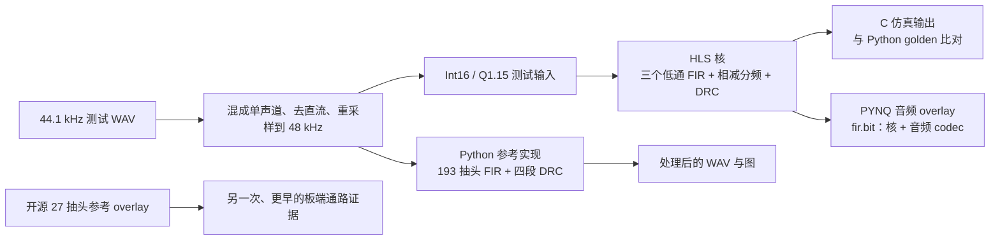
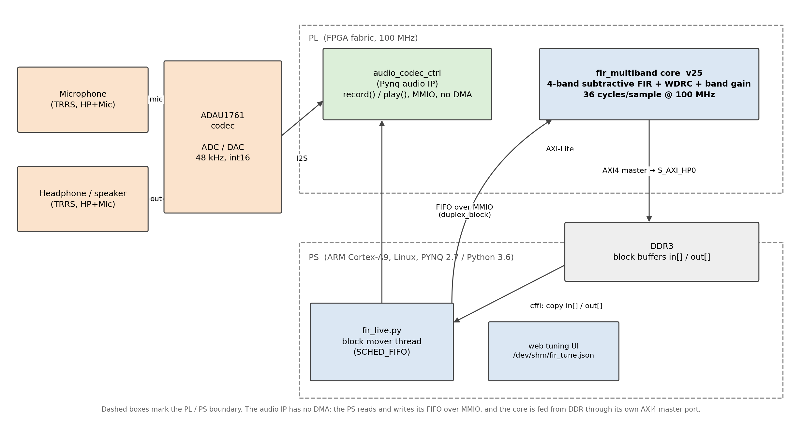
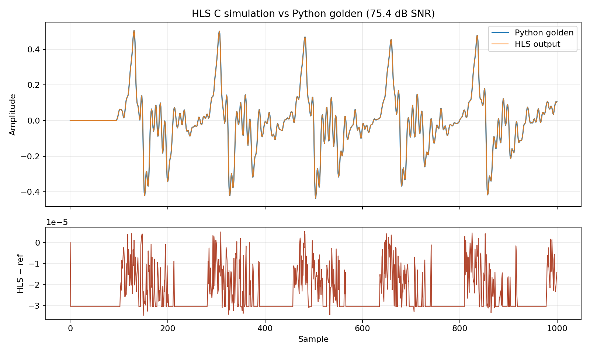
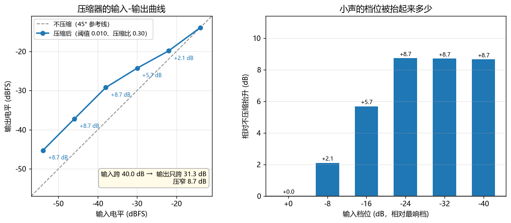
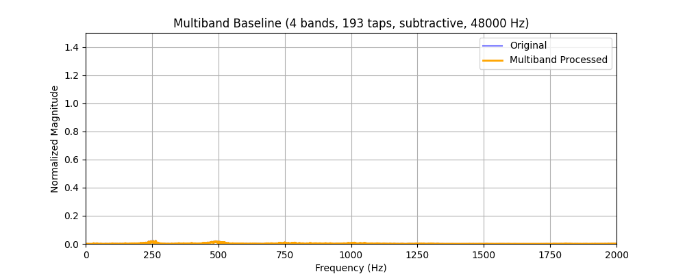

# PYNQ-Z2 多频段音频处理加速器

## 设计报告（草案）

**状态（截至 2026-10-24）：** Python 参考通路和自研 HLS 核都在。核已经和 PYNQ 音频 codec 一起集成进板级 overlay（`board/overlay/fir.bit`），在板上处理过真实采集的音频，现在跑的是麦克风 → 核 → 耳机的实时全双工通路（§5.4）；2026-10-15 一次 40 秒的实时运行保持在 1.00×、自检逐位一致，耳机里听得到处理后的声音（原始运行记录 `data/results/fir_live_run_20261015.txt`）。那次的四段增益是默认的 0 dB，所以它证明的是通路，不是分段调音；分段调音本身由 2026-10-15 的第二次运行证明 —— 音频流动中改增益，操作者用耳朵确认了变化（§5.4）。核单独综合的数据和集成进 overlay 的数据分开报、分开标注；参考 overlay 的测量是另一个实验，不与自研核混在一起。出货位流是 `v25_env_indep`，36 拍/采样（2026-10-23）。同芯片 ARM 对比已于 2026-10-23 针对这版核在板上重测：ARM 6.117 µs/采样，核 0.367 µs/采样，**16.7×**（原始运行 `data/results/compare_cpu_fpga_run_20261023.txt`）。早先的 12.5× 属于 49 拍的 `v21_wdrc`，19.5× 属于 §4.1 三方对比里用到的 31 拍 `v19`。§7 写明创新点主张、对照的前人工作，以及一处对本项目不利的差别。

**本报告与提交要求（指导书 3.3.5.3）的对应关系：**

| 要求项 | 对应章节 |
| --- | --- |
| 选题背景与创新点 —— 为什么选这个题、解决什么问题、前人做过什么 | 1、7.1–7.4 |
| 设计原理与功能框图 | 2.1、2.2（图 1） |
| 软硬件划分依据与接口设计 | 2.3 |
| 优化过程，含优化前后的性能与资源对比表 | 4、5.2 |
| 大模型协作记录 —— 提示词、模型回答、自我纠错轨迹 | 11 |
| 技能包的提炼过程 —— 从哪来、怎么验证、边界在哪 | 12 |
| 复现说明 —— 从零开始的完整步骤 | 8、`BUILD_GUIDE.md` |

## 1. 项目目标

本项目在 PYNQ-Z2 上实现一条多频段动态范围压缩（DRC）音频通路。DRC 把超过阈值的信号压低。算法把音频分成若干频段，对每个频段套用同一条压缩规则，再把结果相加。

对比涉及 Python 参考实现、HLS 实现和 RTL 实现三份。三份都在，并在 §4.1 用同一段输入做过对比：Python 参考、HLS 源码，以及一个自研 RTL 前端（`src/rtl/fir_mb_fe.v`：三个低通、相减式分频和四段求和，不含 DRC、增益和 AXI shell），已在 xsim 里逐位验证。

## 2. 设计原理与功能框图

### 2.1 算法：相减式分频

当前设计用的是相减式分频。在 500 Hz、1,000 Hz、2,000 Hz 各设计一个线性相位低通，每个 193 抽头。四个频段这样构成：

```text
频段 1 = LP500
频段 2 = LP1000 - LP500
频段 3 = LP2000 - LP1000
频段 4 = 延迟后的输入 - LP2000
```

压缩之前，四段之和等于延迟了一个 FIR 群延迟的输入。193 抽头时群延迟是 96 个采样，48 kHz 下 2.00 ms。DRC 的算法默认值是阈值 0.1、压缩比 0.7（`src/python/band_design.py`）；**板上出货配置用的是 set 4 —— 阈值 0.030、压缩比 0.50**，理由见 §9 第 4 条。Python 参考用浮点，HLS 核的输入输出是定点，所以量化误差必须和算法对齐分开测。

采样率、分频点和 DRC 默认值的唯一参数源是 `src/python/band_design.py`；HLS 系数由 `src/python/export_coefficients.py` 生成到 `sim/hls_csim/`。



这张图把自研 HLS 核和开源参考 overlay 分开画。自研核已集成并在板上跑过；参考 overlay 是一次无关的早期实验。

### 2.2 功能框图



*图 1 —— 出货配置（`v25_env_indep`）的功能框图，由 `src/python/plot_block_diagram.py` 生成。*

从左到右读这条数据通路：

1. **模拟前端。** 话筒和线路输入都进板上那颗 ADAU1761 编解码器，耳机和音箱也从同一颗 codec 出去。48 kHz 下 ADC 产出 16 位采样，与 Q1.15 核吃进的位型相同，所以采样通路上不需要任何格式转换。
2. **PL 音频 IP。** codec 由 PL 里厂商的 `audio_codec_ctrl` IP 通过 I2S 驱动。它是寄存器映射的模块，每个方向各有一块采样 FIFO，**没有 DMA**：常用的 `record()` / `play()` 调用会阻塞整个传输窗口。
3. **PS 搬样线程。** `board/scripts/fir_live.py` 里的搬样线程通过 MMIO 从接收 FIFO 取出一整块采样（`duplex_block`，经 cffi 调用的 C 例程），拷进 DDR 块缓冲，启动核，轮询 `ap_done`，把结果拷进发送 FIFO，然后重复。线程用实时调度优先级；这个核的关键路径上只有音频这一件事。
4. **PL 核。** `fir_multiband` 通过 `S_AXI_HP0` 以 AXI4 主设备的身份读写 DDR 里的 `in[]` 和 `out[]`。参数放在 AXI4-Lite 寄存器里 —— 两个地址、块长、四个阈值、四个压缩比、四段增益、四组启动和释放系数 —— 所以 PS 从不通过寄存器口流式传音频。
5. **双缓冲。** DDR 里 `NBUF` 个块槽位，让搬样线程填下一块的同时核在算当前一块。端到端延迟约 `NBUF × L / 48000`，再加上 codec 和驱动的缓冲；实测 16.2 ms（L=360、NBUF=2）、21.1 ms（480/2）、31.0 ms（480/3），都含在耳机处测到的 1.23 ms 声学段（§5.5）。
6. **控制面。** 调音界面（板上网页，或等价的 Jupyter notebook）把频段增益、阈值、压缩比和启动/释放时间写进 `/dev/shm/fir_tune.json`；搬样线程取这个文件，在块与块之间重写 AXI4-Lite 寄存器。界面上的任何东西都不在采样通路上。

结构上最要紧的一点：核**没有流式接口，也不需要**。算一个采样 36 拍，一块 360 采样只占用它 7.5 ms 里的 1.3 ms；剩下的时间 PS 可以用来拷贝，所以按块工作付出的是延迟，不是吞吐。

### 2.3 软硬件划分依据与接口设计

**为什么运算放 PL。** 算法每采样 579 次有效乘法（三个 193 抽头低通，加频段合并；核没有利用滤波器对称性 —— `FIR_FOLD` 是关的，Python 参考实现也重写成同样的三滤波器形状，让对比是同工作量）。48 kHz 下是每秒 2778 万次乘法。同一块板子上，ARM 做这件事每采样 6.117 µs，是实时的 3.41 倍 —— 约一个核的 29%，而且没有余量留给同时要跑的 FIFO 服务、调音界面和 Jupyter。早先那次关键测量是：核还没变快的时候，光拷贝通路就把一个核吃满了。PL 核做同样的工作每采样 0.367 µs，实时的 56.77 倍，而 PL 没有别的事要做。§4.1 给了这个选择的拍数和资源代价。

**为什么 I/O 留在 PS。** PYNQ 已经提供了 codec 配置、overlay 加载、Jupyter 环境和网络栈。用 RTL 重写其中任何一样，只增加风险，碰不到瓶颈。PS 侧也是调音界面该在的地方：参数按人的速度变，不按采样速度变。

**为什么不做 DMA / 流式切分。** 考虑过三种放法：

| 方案 | 动什么 | 为什么没选 |
|---|---|---|
| (a) 改厂商音频 IP 内部 | 别人写的 RTL | 已验证的通路要整个重建 |
| (b) 换成 `axi_i2s_adi` + AXI DMA | 核要改成流式设计 | 所有已测结果 —— C 仿真、36 拍/采样、时序收敛 —— 全部作废 |
| (c) **核自己作 AXI4 主设备进 DDR**（采用） | 核的数据接口一点不动 | 代价：除了双缓冲没有更多重叠；每个 8,000 采样的块有约 56 µs 软件开销（那里不到 10%，L=360 时占比更大） |

(c) 行得通，是因为核天然是「块进块出」：给它两个 DDR 地址，比让它去消费一条流简单。`S_AXI_HP0` 是 Zynq-7000 上标准的 PL 到 DDR 高带宽口。

**接口契约。** 完整寄存器表和出处见 `report/hardware_interface_spec.md`；主机侧驱动需要的摘要如下：

| 项 | 值 |
|---|---|
| 采样格式 | int16 / Q1.15，48 kHz，I2S 到核之间不做转换 |
| 抽头数 | 193，编译期常量（`FIR_N_TAPS`），不是寄存器 |
| 群延迟 | 96 个采样 = 2.00 ms |
| 控制 | AXI4-Lite：`AP_CTRL` 0x00（start / done / idle / ready）、`in_r` 0x10–0x14、`out_r` 0x1c–0x20、`length_r` 0x28、`drc_thr` 0x30–0x34、`drc_ratio` 0x38–0x3c、`reset` 0x40、`bypass` 0x48、`band_gain` 0x50–0x54、`drc_attack` 0x58–0x5c、`drc_release` 0x60–0x64 |
| 数据 | 一个合并的 AXI4 主端口（`m_axi_gmem`）；64 位缓冲地址拆成两个 32 位寄存器 |
| 顺序 | 所有参数在 `ap_start` 时锁存；块中途写新地址不影响这一块 |

有两条契约性质是踩出来才发现的，源码里看不出来：

- 新参数总是**追加在 HLS 函数签名末尾**（10 月加 `band_gain`，后来加 `drc_attack` / `drc_release`）。HLS 按签名顺序分配 AXI4-Lite 偏移，在中间插一个参数会让后面所有寄存器静默搬家，而且照样能编译通过。追加让 0x00–0x4f 跨三个位流版本都没变。
- `band_gain` 的复位值是 0，不是 1.0。跳过写它的驱动拿到的是静音块，不是原样块；`fir_core.py` 每次都写（默认 256 = Q7.8 的 1.0）。

**接口怎么验的。** `bypass` 让核输出四段之和，也就是恰好延迟 96 个采样的输入。板上 144,000 个采样零失配，测到的位移正好 96 个采样。这一个测试同时检查了地址寄存器、块长、延迟线跨块连续和数值格式，也是 shell 任何改动之后要重跑的测试。

## 3. Python 参考实现

`src/python/multiband_baseline.py` 读 `data/audio/real_voice.wav`，把立体声混成单声道、去掉直流，再从文件的 44.1 kHz 重采样到设计用的 48 kHz。它用四段相减式分频处理信号，存出一个 WAV 和一张频谱图。

本机这次运行用的是 Python 3.9.12、NumPy 2.0.2、SciPy 1.13.1、Matplotlib 3.9.4、SoundFile 0.13.1。五次取最好的一次，处理 10.58 秒音频用了 89.5 ms，即每采样 0.176 µs、主机实时 118.3 倍。主机 CPU 型号没有记录，所以这是本机参考值，不是可移植基准，也**不能**拿去除以板端数字 —— 3 GHz 的桌面 x86 和 100 MHz 的 FPGA，量级差别是构造出来的。

真正承载加速比主张的对比，是在板子上、同一颗芯片上、两边跑同一算法测出来的：软件跑在 Zynq ARM 上，对手是 PL 核。最近一次（2026-10-23，原始输出 `data/results/compare_cpu_fpga_run_20261023.txt`）是 ARM 每采样 6.117 µs（float64 + `scipy.signal.lfilter`，实时 3.41 倍），出货核每采样 0.367 µs（Q1.15 定点、AXI4 主设备，实时 56.77 倍），比值 **16.7×**。同样方法在 49 拍的 `v21_wdrc` 上是 0.497 µs、12.5×，在更早的 31 拍 `v19` 上是 0.317 µs、19.5×；三个数的差别来自拍数和后来几版核多做的运算，不是方法变了。`data/results/accel_cpu_vs_fpga.md` 记着引用这类数字必须一起带上的条件和边界：CPU 用 float64 而核用 Q1.15；scipy 是优化过的 C 实现，但没有做过手写 NEON 的对比。两边计算的有效乘法次数相同（每采样 579 次）；早先「核靠滤波器对称性把乘法次数减半」的说法是错的（`FIR_FOLD` 是关的）。PL 的计时里包含软件侧的寄存器和 cache 处理 —— 每个 8,000 采样的块约 56 µs，在这个块长下不到实测每采样时间的 10%，块越短占比越高。

这次运行报告的压缩前系数和重建最大误差是 `3.469e-18`。产物是 `data/audio/multiband_output.wav` 和 `data/figures/multiband_comparison.png`。HLS 测试台用的那份独立 1,000 采样测试向量在 `data/audio/test_input.txt`，对应的 Python golden 输出在 `data/results/python_golden.txt`。

## 4. HLS 核结果

`src/hls/fir_multiband.cpp` 是相减式 FIR 和 DRC 的实现，`src/hls/fir_tb.cpp` 是 C 仿真测试台。同一份 193 抽头定点源码有两种实现的记录，两组数字不能混着用：

| 指标 | 核单独（OOC） | 核在板级 overlay 内 |
| --- | ---: | ---: |
| LUT | 5,622（10.57%） | 6,669（12.54%） |
| 触发器 | 9,447（8.88%） | 10,876（10.22%） |
| DSP | 205（93.18%） | 205（93.18%） |
| BRAM | 55（39.29%） | 55（39.29%） |
| 10 ns 约束下的最坏负裕量 | +1.739 ns | +0.533 ns |
| 失败端点 | 0 | 0 |
| HLS 调度 | 36 拍/采样 | 36 拍/采样 |

两列描述的都是出货的 `v25_env_indep`（2026-10-23）。OOC 列是核自己，报告在 `build/hls/reports/v25_env_indep_impl/`；集成列是完整设计，构建成 `board/overlay/fir.bit`。描述系统时用集成列，并且任何数字都要说明取自哪一列。上一版 v21 的记录（OOC 5,608 LUT / 8,884 FF / 205 DSP / 55 BRAM / +1.270 ns；集成 6,624 LUT / 10,281 FF / +0.251 ns；49 拍）和更早 v19 的记录（OOC 3,670 LUT / 200 DSP / +1.832 ns；集成 6,127 LUT / 200 DSP / +1.283 ns；31 拍）留在 `data/results/impl_metrics.md`，供 2026-10-08 和 2026-10-22 的 ARM 对比引用，不能和上表的数混用。

整机裕量从 +1.283 ns（v19 overlay）掉到 +0.251 ns（v21 加上包络逻辑），到 v25 又回到 +0.533 ns：`DEPENDENCE inter false` 让关键路径变短，代价是多出 595 个触发器，但它们不在关键路径上。10 ns 约束满足，失败端点为零，但 +0.533 ns 不算宽裕 —— 之后任何往 PL 里加的东西都必须重新测，不能假设。

关于拍数要说明一句，因为记录里出现过五个值，分属不同的构建。2026-10-07 的 OOC 记录是 28 拍/采样；同一流程重跑、以及从 2026-10-08 的板端测量反推，都得到 31。那个 31 属于 2026-10-08 上板测的位流，那版**还没有**分段增益。2026-10-09 加 `band_gain` 多花四拍（每段一次乘法），那一版（`v20_gain`）调度到 **35 拍/采样**（`build/hls/reports/v20_gain/`）。2026-10-19 加峰值包络和启动/释放平滑（`v21_wdrc`）再多 14 拍，得到 **49**。2026-10-23 去掉一条假循环携带依赖（`v25_env_indep`），出货的 `board/overlay/fir.bit` 落到 **36 拍/采样**。出货核引用 **36**；49 描述 2026-10-19 到 2026-10-22 那版；35 是 2026-10-09 到 2026-10-19 那版；31 是 2026-10-08 ARM 对比测的那版；28 只属于中间的 t 系列实验。

100 MHz 下，36 拍/采样对应理论 0.360 µs，而 48 kHz 的采样周期是 20.83 µs。2026-10-23 用 8,000 采样的块实测，出货位流每采样 0.367 µs —— 实时 56.77 倍，对 ARM 是 16.7×（§3）。实测与理论之间每采样 0.007 µs 的差，在 36 拍和 31 拍两版位流上都出现；它是每块的软件开销 —— 寄存器写、cache 维护、DONE 轮询 —— 每个 8,000 采样的块约 52–56 µs，在这个块长下不到实测时间的 10%。49 拍的 `v21_wdrc` 于 2026-10-22 实测 0.497 µs/采样（12.5×），31 拍的 `v19` 于 2026-10-08 实测 0.317 µs（19.5×）。三者都不是勉强赢：最慢的那版也比 ARM 少用 92% 的每采样时间。

核的代价主要来自数据搬运，不是算术：综合的循环表把原始 450 拍里的 398 拍归给了 193 级延迟线的移位，三个低通加起来只占 11 拍。这部分搬运现在由编译期开关 `-DFIR_SHIFT_CHAIN=1` 消除，v19 里把调度从 450 拍压到 31 拍/采样 —— `v20_gain` 35 拍、`v21_wdrc` 49 拍、出货的 `v25_env_indep` 36 拍 —— 算法没动；开关默认关闭，默认构建路径逐字节不变。这个改动已经实现并在板上验证，不是待办。

实现历史和测量的限制记在 `data/results/impl_metrics.md`。拿 OOC 的行去和另一套流程测出来的行比较之前，先算清方法学的差异。

### 4.1 同一段输入上的三方对比（Python / HLS / RTL）

三行算的是同一个前端：三个 193 抽头低通（按 195 抽头分配，其中六个为零），两两相减成四段，再求和。三行都不含压缩器、分段增益和 AXI shell。ARM 那行每采样做 579 次乘法；两行硬件是 585 次（579 次有效，其余是零抽头）。48 kHz 的采样周期是 20.83 µs。

| | ARM Cortex-A9（软件） | HLS 核 `v19_shift_chain` | RTL 前端 `fir_mb_fe.v` |
| --- | ---: | ---: | ---: |
| 算术 | float64，`scipy.signal.lfilter` | Q1.15，18 位 Q1.17 系数 | Q1.15，同一套定点契约 |
| 每采样拍数 | — | 31 | **3**（xsim 里 1,000 采样共 3,000 拍） |
| 100 MHz 下每采样时间 | 6.199 µs（实测） | 0.310 µs 理论 / 0.317 µs 实测 | 0.030 µs（由仿真拍数推算） |
| 48 kHz 下的实时余量 | 3.36× | 65.7×（实测） | ≈694×（推算） |
| 相对 ARM 的加速比 | 1× | **19.5×（实测）** | ≈207×（推算） |
| LUT | 不适用（用两个核中的一个） | 3,670（6.90%） | 4,559（8.57%） |
| 触发器 | 不适用 | 5,547（5.21%） | 3,138（2.95%） |
| DSP48 | 不适用 | 200（90.91%） | 189（85.91%） |
| BRAM | 不适用 | 49（35.00%） | 0 |
| 布线后 10 ns 约束下的 WNS | 不适用 | +1.832 ns | +0.585 ns |
| 失败端点 | 不适用 | 0 | 0 |

HLS 列用 `v19_shift_chain`，因为它是唯一功能相同的 HLS 构建。出货的 `v25_env_indep` 多了分段增益、峰值包络和启动/释放，调度 36 拍/采样；拿 3 拍的前端去比一个带压缩器的构建，会夸大 RTL 的优势，所以这里不用它。

两列硬件都是布线后、OOC、同一颗器件、同一个 10 ns 约束。相对 HLS，RTL 多用 889 个 LUT（+24%）、裕量少 1.247 ns，但触发器少 2,409 个（−43%）、DSP 少 11 个、不用 BRAM。拍数优势来自让全部 195 个乘法器每个周期都满负荷、每采样走三个系数相位；而 HLS 的调度是把同样的乘法器按五个部分和分时喂进去。

只有 ARM 和 HLS 核在硬件上测过。RTL 列是仿真加 OOC 布线：它没有 AXI shell，从没上过板，所以 0.030 µs 不包含 HLS 板端测量里那部分 PS 侧开销（寄存器写、cache 维护、DONE 轮询，每个 8,000 采样的块约 52–60 µs，在该块长下不到 10%）。所以 ≈207× 是推算值，不是同芯片实测；同芯片实测的是本表 31 拍前端的 19.5×，以及**出货 36 拍核的 16.7×**。

两份定点实现在数值上都与各自的参考一致：RTL 前端在 xsim 里对九个观测信号逐位一致 —— 三个累加抽头、四个频段、频段和、最终 int16 输出，各 1,000/1,000 采样；HLS 核的 C 仿真与完整算法的 Python golden 参考相比，SNR 75.4 dB，最佳对齐位置为 0（§6）。ARM 和硬件不能逐位比，因为精度不同（float64 对 Q1.15）；它们的吻合是在输出 RMS 和峰值上核的（0.10659 对 0.10706，0.28627 对 0.28625）。



*图 4 —— 1,000 采样测试向量上，HLS C 仿真输出与 Python golden 参考的对比。由 `src/python/compare_golden_vs_hw.py` 生成。*

出处：`data/results/accel_cpu_vs_fpga.md`、`impl_metrics.md`、`rtl_vs_hls.md`；原始日志 `compare_cpu_fpga_run_20261008.txt`、`sim/rtl_sim/xsim_work_mb/xsim_mb.log`，以及报告 `build/hls/reports/win_shiftchain_impl/` 和 `data/results/rtl_fe_impl_{util,timing}.rpt`。

## 5. 板端证据

项目 overlay 是 `board/overlay/fir.bit`：自研多频段 HLS 核加上 PYNQ 音频 codec，由 `board/overlay/build_fir.tcl` 构建。`board/scripts/fir_core.py` 通过 AXI-Lite 驱动核，`board/scripts/fir_audio_loop.py` 一块一块地跑麦克风 → 核 → 耳机。现在有一条实时全双工通路（`board/scripts/fir_live.py`，流式音频通路在自己的 `board/scripts/audio_stream.cpp` 和 `build_audio_stream.sh` 里）在连续地跑麦克风 → 核 → 耳机，核本身没有任何改动。全双工数据通路逐位验证过，从 2026-10-15 起实时监听端到端可用 —— 见 §5.4。

板端记录过的检查全部通过：

| 检查 | 结果 |
| --- | --- |
| 直通：输出等于延迟一个群延迟的输入 | 1,000 采样 0 失配；延迟正好 96 采样 |
| 块连续性：157 点分块对整块 | 逐位相同 |
| 真实采集音频过核：18 块共 144,000 采样 | 0 失配 |
| 对 Python golden 参考的量化 SNR | 75.4 dB（判据 ≥ 70 dB） |
| 固定输入上的直通：36 块共 288,000 采样 | 0 失配 |
| 同一输入下压缩输出对直通 | 288,000 个采样里有 287,910 个不同（100.0%） |

### 5.1 固定输入与幂等检查

演示输入现在是固定文件 `data/audio/board_input_48k.wav`，由 `src/python/export_board_input.py` 从 `data/audio/real_voice.wav` 生成。它的处理方式和 Python 参考处理自己输入的完全一样 —— 声道相加、去直流、`resample_poly` 到 48 kHz —— 重采样后长度 507,905 采样，与 `data/results/baseline_metrics.md` 一致。固定文件让参数对比有意义：每次运行都吃同样的 288,000 采样，所以两组参数之间的差异只能来自参数。

核的输入增益由一个公式给出，这个公式同时出现在生成脚本和板端脚本里（一个在浮点域，一个在 int16 域，代数等价）。因为文件已经在目标电平上，板子报出的增益正好是 **1.0000×**。这让这个读数成为检查而不是数字：出现别的值，说明装错了文件，或者两个公式已经分叉。

| 固定输入的属性 | 值 |
| --- | --- |
| 长度 | 288,000 采样 = 48 kHz 下 6.00 秒 |
| RMS | 4,915（满量程 15.0%） |
| 峰值 | 27,346（满量程 83.5%） |
| 波峰因数 | 5.56 |
| 板子为它算出的增益 | 1.0000× |

### 5.2 压缩器传输曲线

压缩器用标准方法刻画：一段电平阶梯，六级、每级 1 秒、级间 8 dB，每级是四个单音（250、700、1400、4000 Hz）以固定相对相位相加。阶梯向下延伸 40 dB，比语音更深，所以它显示的是整条曲线的形状而不只是语音占用的那一段。把最响一级对齐等响之后：

| 级 | 输入 | 直通 | 压缩后 | 相对直通的提升 |
| --- | --- | --- | --- | --- |
| 0 dB | 6,554 | 6,554 | 6,554 | 0.0 dB |
| −8 dB | 2,609 | 2,609 | 3,323 | +2.1 dB |
| −16 dB | 1,039 | 1,039 | 2,000 | +5.7 dB |
| −24 dB | 414 | 414 | 1,131 | +8.7 dB |
| −32 dB | 165 | 165 | 450 | +8.7 dB |
| −40 dB | 66 | 66 | 179 | +8.7 dB |

**输入跨度 40.0 dB，输出跨度 31.3 dB —— 电平跨度被压窄了 8.7 dB。** 底下三级出现平台，是硬拐点压缩器的预期形状：低于阈值时曲线就是恒等映射，所以那几级被同一个常数抬高。



*图 2 —— 压缩器输入输出曲线，以及每一级较低电平上施加的提升。数据与上表同一段阶梯，由 `src/python/plot_drc_curve.py` 生成。*

这个压缩器是**瞬时的**：它把每个采样逐点映射过一条分段线性曲线，没有启动或释放时间常数。这决定了参数扫描该怎么读。整段信号的波峰因数在六组参数里几乎不动 —— 5.02 到 5.34，跨度 0.3 dB —— 而帧级动态范围变化很大：

| 参数组 | 阈值 / 压缩比 | 帧级动态范围（20 ms，95/5 分位） | 压窄 | 波峰因数 |
| --- | --- | --- | --- | --- |
| 直通 | — | 22.1 dB | — | 5.56 |
| 1 | 0.100 / 0.70 | 20.3 dB | 1.9 dB | 5.04 |
| 2 | 0.050 / 0.70 | 19.4 dB | 2.7 dB | 5.26 |
| 3 | 0.030 / 0.70 | 19.2 dB | 3.0 dB | 5.34 |
| 4 | 0.030 / 0.50 | 17.1 dB | 5.0 dB | 5.07 |
| 5 | 0.020 / 0.40 | 16.0 dB | 6.2 dB | 5.02 |
| 6 | 0.010 / 0.30 | 15.6 dB | **6.5 dB** | 5.08 |

板子自己的扫描报告会打印波峰因数，而那不是该用来选参数的一列：六组候选之间它只差 0.3 dB，区分不出来。选参数应该看帧级动态范围，它相差 4.6 dB。两个数都是实测，不是仿真 —— 表格所用的离线复现能把板子自己的 4c 扫描复现到 0.1 dB。

描述压缩效果的两个数都该写进任何摘要：阶梯上跨度压窄 8.7 dB；实际语音材料上是 6.5 dB。阶梯那个数更大，因为阶梯向下延伸了 40 dB。只引大的那个，会夸大在出货材料上的效果。

### 5.3 频谱效果

压缩是在各频段求和之前逐段施加的，而四段压缩程度不同，所以频谱平衡也会移动。在固定输入上测得：

| 频段 | 直通 RMS | 压缩后 RMS | 压缩器增益 | 等响对齐后的净变化 |
| --- | --- | --- | --- | --- |
| 0–500 Hz | 0.1009 | 0.0352 | −9.15 dB | −0.41 dB |
| 500–1000 Hz | 0.0563 | 0.0215 | −8.36 dB | +0.38 dB |
| 1000–2000 Hz | 0.0228 | 0.0107 | −6.60 dB | +2.14 dB |
| 2000–24000 Hz | 0.0311 | 0.0136 | −7.22 dB | +1.51 dB |
| *（参数组 6：阈值 0.010、压缩比 0.30）* | | | | |

这张表要带一条测量说明。四段是用相减得到的，所以过渡区互相重叠、互相抵消；四段信号加起来还原成输入（扣掉 96 采样群延迟后误差 `4.4e-16`），但它们的 RMS 不能按功率相加。因此对这套滤波器组来说，「占总能量的份额」不是一个有意义的量，表里给的是逐段增益和净变化。



*图 3 —— Python 参考：四段分解和由此得到的频谱。由 `src/python/multiband_baseline.py` 生成。*

形状对每组参数都一样，只是幅度随设置放大：0–500 Hz 段压得最狠，1–2 kHz 段压得最轻，set 6 时相差 2.55 dB，set 4 时 2.04 dB。等响对齐之后，低频段基本回到原位（−0.41 dB），中频段被抬起（+2.14 dB）。净效果是一个很小的向上倾斜 —— set 6 约 1.9 dB，set 4 约 1.7 dB，按 2–24 kHz 段对 0–500 Hz 段计。

有两个后果值得说明。第一，逐段瞬时压缩器对音色的改变至少和对动态的改变一样明显，所以听感上是温和的动态范围压缩加一点频谱倾斜，而不是戏剧性的响度变化。第二，一个保响度、让材料听起来还是同一个人的压缩器，就是工作正常的；「听起来差不多」是预期结果，不是失败，上面的定量刻画才是效果的证明。

### 5.4 演示通路

现在演示跑的是实时全双工流：`board/scripts/fir_live.py` 连续跑麦克风 → 核 → 耳机 8 秒、10 秒、24 秒，全部 1.00× 实时、零丢块（24 秒那趟自检 960,000/960,000 逐位一致）。做到这一点没有改核、也没有改接口 —— `fir.bit` 没有为此重编，也没有加流式接口（之后出货的 `fir.bit` 又重编过两次，v21 和 v25，寄存器接口不变）。核的吞吐从来不是障碍；瓶颈在 Python/PS 一侧：音频驱动的 `play()` 每次调用要在八次 I2C 事务上花 3.33 ms；音频 IP 没有 DMA，所以进出两条流各占一个核；格式转换跑在供样线程上，而那线程没有余量。

同芯片加速比对比已于 2026-10-23 重测，见 §3。`data/results/reference_overlay_metrics.md` 记的是另一个更早的实验：一个开源 27 抽头参考 overlay。它验证了一条板端 DMA 通路，但没有执行自研核，不能当作本项目的加速器结果。

**实时监听（2026-10-15 收口）。** 实时话筒监听现在可用：一次 40 秒运行连续跑麦克风 → 核 → 耳机（4,000 块，墙钟 40.19 秒里走了 40.00 秒音频 = 1.00× 实时，自检 960,000/960,000 逐位一致），核内电平 RMS 中位 107、峰值 24,076，操作者在耳机里听到了自己被处理过的声音。为了走到这一步改了两件事，两件都值得记下来，因为每一件当初都是一个错误结论。

*「自激」是读法造成的假象，不是硬件。* 2026-10-13 那个「采集输入在约 0.7 秒内被推到满幅自激」的发现，不描述硬件里的任何东西。I2S 采集寄存器的低 24 位是二进制补码，而采集脚本按无符号读：于是任何负采样都变成接近满量程的值。采集通路上带着大约 31,679 的直流偏置（16 位域）—— 24 位域里是 2²³ × 0.966，正好落在符号边界上 —— 所以数字零加上几个最低位的抖动，被读成了一个接近满幅的方波，算出来的 RMS 恰好是 46,341 = 65535/√2。这就是为什么电平看起来与话筒增益、话筒静音、输出电平、耳放状态全都无关：这些一个都没参与。做完符号扩展（取低 24 位、符号位置位时减 2²⁴、再除以 256），读数就对了。**一个恰好落在干净理论值上的满量程读数，是提醒你去查读数路径，不是查硬件。**

*真正的卡点是耳机口的自动检测开关。* `HP + Mic` 口里有 U41，一颗 TI TS3A226AE 自动耳机开关，它**只在插入的上升沿检测一次 CTIA/OMTP 接线，然后锁存**。如果板子上电时插头已经插着，那个边沿永远不发生，开关可能停在错误状态，话筒就断着。办法是反复拔插直到输入电平表跳起来 —— 一次实测要连续拔插 18 秒，另一次 35.5 秒 —— 然后不要再碰插头，因为之后任何移动或断电重启都可能重新锁错。所以演示以这一步拔插开始。一次 90 秒的单动作探针（`board/scripts/cap_probe16.py`）直接抓到了这个跳变：前 17 秒 RMS 在 13–17，第 18 秒峰值到 45,104，之后电平一直活着，只在插头拔出的那些时段回落到 RMS ≈ 12。

*这个结果的范围。* 那 40 秒里四段增益全在 0.0 dB（`LIVE_GAIN_DB` 默认值），所以它本身证明的是实时通路能把音频从头送到尾。四段控制的听感效果是同一场里另外测的，一次 66 秒的运行在音频流动中六次改写分段增益：一段在 0.0 dB 和 −41.9 dB（Q7.8 的下限，`fir_live.py` 里的 `GAIN_LIMIT_DB`）之间以 12 秒间隔交替，更早试过的一个对称 +6/0/0/−6 设置证实听不出来。板子报告六次改动全部生效，逐块自检仍以 960,000/960,000 通过（运行内有八次增益变化），速率保持 1.00×，操作者报告听到了多次明显变化。作为运行内的对比，它不依赖记忆，也不依赖两次试验之间重载 overlay。原始输出在 `data/results/fir_gain_ab_run_20261015.txt`，复现用 `board/scripts/gain_ab_live.sh`。最后，那次 40 秒运行比它 40.00 秒的音频多用了 0.19 秒，即约 18 个丢块，听起来是断续的卡顿：搬样线程占满了它每块 10 ms 预算的 99%（中位 9.88 ms，最大 15.5 ms）。这是当前音频 IP 的结构性限制 —— 它没有 DMA，靠 CPU 自旋轮询驱动 —— 不是调参数能调掉的。

### 5.5 端到端延迟（2026-10-22 实测）

两段测量，各管通路的一半。完整数据和方法在 `data/results/performance_profile_20261022.md`。

**数字段。** 不用咔嗒声刺激，`fir_live.py` 在 `duplex_block()` 两端给每一块打时间戳：这块采样被采到的时刻，和同一块交给 codec 的时刻。两个时间戳都在同一次调用的开头取，所以块内偏移抵消，差就是流水线的数字延迟。四种配置的中位：

| 配置 | 数字延迟中位 |
| --- | --- |
| NBUF=3, L=480（稳定） | 29.80 ms |
| NBUF=2, L=480 | 19.86 ms |
| NBUF=2, L=360（低延迟） | 14.96 ms |
| NBUF=2, L=240 | 9.99 ms |
| NBUF=2, L=120 | 5.78 ms |

后两档跑不到实时（25–30 秒里 0.83× 和 0.42×，分别丢 1,053 和 5,843 块），所以它们测的是「这样缓冲要付多少代价」，不是可用配置。29.80 ms 正是 `NBUF × L / 48000` 预期的值（30 ms），也就是说延迟来自缓冲，不是计算：核一块只占块周期的 2.35%。

*19.86 ms 的重复性。* NBUF=2 这一档用同一套插桩跑了 120 秒：12,071 块，墙钟 120.24 秒里走了 120.71 秒音频（1.00×），中位 19.89 ms，p99 20.56 ms，最大 28.92 ms，8 块（0.07%）超过 25 ms，逐块自检 960,000/960,000。分布和 20 秒那趟一致，所以这个数不是碰巧抓到的一次。那 8 个离群块是搬样线程超出 10 ms 预算的块（同一次运行里最大 12.62 ms）；它们让一块晚交，但不是丢块。这一档没有 600 秒运行，稳定性证据是 120 秒。

*块长下界到底在哪。* 七档块长扫描（每档 25–30 秒）把可用下界从 10 ms 推到了 7.5 ms：L=360 跑 120 秒保持 1.00×，中位 14.96 ms、p99 15.30 ms、没有超过 25 ms 的块；而 L=300（6.25 ms）已经丢掉 1.6% 的块，L=264（5.5 ms）丢 8%。在搬样循环里给四个时刻插桩，排除了软件侧：等一块算好的结果要 23 µs，入队 19 µs，DSP 线程占块周期的 18–25%，而把搬样线程的 `SCHED_FIFO` 优先级提到高于所有内核线程（20 → 60，同一个核上有八个 `FIFO 50` 的内核工作线程）没有任何变化（5.92 对 5.93 ms）。出问题的是 `duplex_block` 里逐采样的 I2S 握手 —— 一旦块短于约 6 ms，它就跟不上 48 kHz 的节奏。所以再降延迟要改音频 IP（更深的 FIFO 或 DMA），不是改 Python 侧。

**声学段。** `board/scripts/acoustic_lat.py` 把耳机贴着板上话筒，在每个幅度设置下放六次 500–6000 Hz 线性扫频，把六次采集同步平均（相干回声相加，随机房间噪声按 √6 下降），再和扫频模板做互相关。三个幅度设置的主峰都落在同一个采样：**R = 1.23 ms**，这是 DAC 重建、耳机、空气、话筒和 ADC 抗混叠几段合起来。1.23 ms 这个数对着扫频自身的自相关旁瓣核过（±0.29 ms，32%）；1 ms 之前没有独立的峰（0.15 ms 处只有主峰的 2%），所以它不是电串扰。

| 配置 | 数字 | + 模拟/空气 | 嘴到耳 |
| --- | --- | --- | --- |
| L=480, NBUF=3（稳定） | 29.80 ms | 1.23 ms | **31.0 ms** |
| L=480, NBUF=2 | 19.86 ms | 1.23 ms | **21.1 ms** |
| L=360, NBUF=2（低延迟） | 14.96 ms | 1.23 ms | **16.2 ms** |

范围说明：低延迟配置到 16.2 ms，稳定配置 31.0 ms。两者都远低于蓝牙音频（100–200 ms），但都高于助听器 ≤10 ms 的目标，报告应当照实写，不要声称达到助听器级延迟。离 10 ms 剩下的差距是逐采样 I2S 握手，它把块长卡在约 6 ms；补上它需要音频 IP 里更深的 FIFO 或 DMA，不是软件改动。

取这些数的时候发现并修掉了两个测量错误，两个都记下来，因为重做这件事的人会被它们误导：两个新脚本一开始调用 `configure()` 时没带 `select_microphone()`，于是 ADC 采的是没接东西的线路输入，读数恒为 0.7 LSB；第一次运行的时候网页服务也开着，结果板子失去响应，只能断电重启。

## 6. 验证状态

| 检查 | 本快照的状态 |
| --- | --- |
| Python 相减分频重建恒等式 | 本机重跑；最大误差 `3.469e-18` |
| Python 音频输出与频谱 | 2026-10-01 本机重新生成 |
| Python 时频瀑布图 | 2026-10-01 本机生成 |
| 当前 1,000 采样测试向量的 Python golden 输出 | 2026-10-01 本机重新生成 |
| 已有 HLS 输出与重新生成的 golden 文件对比 | 2026-10-01 通过：SNR 75.4 dB，最佳对齐位置 0；已有的直通输出与延迟 96 采样的输入逐位一致 |
| 重编 HLS C 仿真 | 2026-09-30 用 Vitis HLS 2020.2 从源码重编，流程是 `build/hls/run_csim.tcl`；系数位宽扫描输出留在 `data/results/fixed_dw16_cw12/16/18/20.txt` |
| 自研 HLS 核 OOC 实现 | 结果记在 `data/results/impl_metrics.md` |
| 自研 HLS 核集成进板级 overlay | 完成：`board/overlay/fir.bit`；时序和资源在 `board/overlay/fir_timing.rpt` 和 `fir_util.rpt` |
| 自研核经真实采集通路在板上处理音频 | 完成：18 块共 144,000 采样，0 失配 |
| 自研核在板上处理固定输入 | 2026-10-06 完成：直通 288,000 采样 0 失配；压缩输出在 288,000 个采样里有 287,910 个不同 |
| 压缩器输入输出电平曲线 | 2026-10-06 实测：输入 40.0 dB 对输出 31.3 dB，压窄 8.7 dB；图在 `data/figures/drc_transfer_curve.png`，原始运行 `data/results/fir_audio_loop_run_20261006.txt` |
| 同芯片 ARM 对 PL 核计时 | 2026-10-08 对 31 拍 `v19` 实测：ARM 6.199 µs/采样（实时 3.36×）对 PL 核 0.317 µs/采样（实时 65.69×），比值 19.5×；原始运行 `data/results/compare_cpu_fpga_run_20261008.txt`，条件和边界见 `data/results/accel_cpu_vs_fpga.md`。2026-10-22 对 49 拍 `v21_wdrc` 重测（12.5×），2026-10-23 对出货 36 拍 `v25_env_indep` 重测：ARM 6.117 µs/采样，核 0.367 µs/采样，**16.7×**（`data/results/compare_cpu_fpga_run_20261023.txt`）。 |
| 实时麦克风 → 核 → 耳机全双工通路 | 2026-10-15 完成：40 秒 1.00×（4,000 块，墙钟 40.19 秒里 40.00 秒音频），自检 960,000/960,000 逐位一致；操作者听到了自己被处理过的声音。原始运行 `data/results/fir_live_run_20261015.txt`。四段增益都在 0.0 dB，所以它确立的是通路，不是分段效果。 |
| 分段增益，运行时写入 | 2026-10-15 完成：一次连续 66 秒运行里对四个 `band_gain` 寄存器做了六次实时写入，全部生效，八次增益变化中逐块自检仍为 960,000/960,000，速率保持 1.00×。原始运行 `data/results/fir_gain_ab_run_20261015.txt`；复现用 `board/scripts/gain_ab_live.sh`。 |
| 分段增益，听感效果 | 2026-10-15 完成：同一次 66 秒运行让一段在 0.0 dB 和 −41.9 dB（Q7.8 下限）之间交替，操作者报告听到了多次明显变化。先试过对称的 +6/0/0/−6，听不出来 —— 增益确实生效了（电平比 1.00 → 1.23），但总响度几乎没动 —— 所以演示改用单段大幅变化。 |
| RTL 实现与 Python/HLS/RTL 对比 | 完成。RTL 前端 `src/rtl/fir_mb_fe.v`（三个低通、相减分频、四段求和；不含 DRC、增益和 AXI shell）在 xsim 里对九个信号 × 1,000 采样逐位验证，1,000 采样 3,000 拍。三方表在 §4.1：每采样 3 拍，同功能 HLS 构建是 31 拍；4,559 LUT / 3,138 FF / 189 DSP / 0 BRAM，布线后 +0.585 ns。RTL 没有上过板。 |

现有的 HLS 输出对重新生成的 193 抽头 Python golden 文件比对通过 —— 最佳对齐位置 0 时 SNR 75.4 dB —— 已有的直通输出与延迟了预期 96 采样的输入逐位一致。这些输出背后的 C 仿真是 2026-09-30 用 Vitis HLS 2020.2 从源码重编的，所以产出它的工具链和开关有记录，而不是从文件名猜的：构建由 `build/hls/run_csim.tcl` 驱动，系数位宽扫描输出留在 `data/results/fixed_dw16_cw12/16/18/20.txt`。

## 7. 相关工作与创新点

这一节把项目和前人工作对照 —— 前人做了什么、本项目不同在哪 —— 也包括一处对本项目不利的差别。

### 7.1 前人做过什么

| 项目 | 平台 | 覆盖内容 | 运行时分段增益 / 验配界面 |
|---|---|---|---|
| openMHA | PC / ARM | 完整助听链路：多频段动态压缩、波束成形、降噪、NAL-NL2 验配 | 有验配，但在 CPU 上 —— 不涉及 FPGA |
| Tympan / CHAPRO GHA | Teensy（MCU） | 8 段 FIR 滤波器组加完整 WDRC（阈值、拐点、压缩比、启动/释放） | 有 —— 手机通过 BLE 控制 MCU |
| `dennisongit/fpga-hearing-aid-sim` | 仅 RTL 仿真 | 5 段 Linkwitz-Riley，逐段 WDRC 和限幅 | 没有 —— 参数是模块端口，综合时固定 |
| `mastersim7/vhdl-hearing-aid` | ASIC（0.13 µm） | 滤波器组加增益级 | 没有 |
| `VRM21-Studios` 音频模块系列 | RTL | AXI-Lite 后面的增益、包络和 FIR 模块 | 有，但只有单段，且通用 |
| 18 段 IFIR 加对数域 DRC（论文） | Zynq-7000 原型板 | 1/3 倍频程滤波器组加对数域压缩 | 没有 —— 参数固定 |
| **PYNQ/Zynq + 运行时验配** | — | — | **检索没有结果；没找到先例** |

读成一句话：助听器的算法侧很拥挤 —— 阈值、压缩比、验配曲线到处都是。检索没找到的是**在可编程逻辑里实现、由 CPU 侧控制面驱动的运行时验配**。这一格是空的，而且这个空是可复核的：同样的检索词，任何人重做都得到同样的结果。

这张表有三条限定要一起看。

1. **「没有先例」不等于「我们第一个做」。** 空的那一格是 *PYNQ/Zynq 加运行时验配*，不是助听器，也不是 FPGA。这里的主张只是这一格是空的，而这个主张可验证。没有主张本项目开创了 FPGA 助听器。
2. **两个最接近的 RTL 项目都是零星的个人项目。** `dennisongit/...` 那个仓库在它自己的文档里自相矛盾 —— 一处 5 段、另一处 8 段，Q1.17 对 Q2.30 —— 读起来像生成的文本而不是测出来的工作。这里引的是它的**结构**，一个数字都没引。引用的数字来自软件侧的 openMHA、Tympan/CHAPRO，和硬件侧那篇 18 段 IFIR 论文。
3. **算法是故意不重新发明的。** 阈值、压缩比和时间常数的语义沿用 openMHA 和 Tympan，没有自己造。那些参数是已经解决的问题，重新推导只会白花时间。

### 7.2 本项目不同在哪，以及一处并不不同

**差别在运行时增益通路，不在滤波器。** `fir_multiband` 的四段增益是 PL 核里的硬件寄存器，位于 AXI4-Lite 偏移 `0x50` 和 `0x54`（`report/hardware_interface_spec.md`），Q7.8 步进 1/256 ≈ 0.034 dB。它们在运行时由板端 Python 侧写入，所以改一段增益只是一次寄存器写 —— 不重综合、不重编译、不重启。验配界面是一个四滑杆的 Jupyter notebook（`board/notebooks/w5_tuning_ui.ipynb`），通过共享内存文件把值交给流式进程；关掉或重启它不会中断音频。

在表里其他每个平台上，参数决定了两种情况之一：有运行时控制的时候，控制住在 CPU 上（openMHA），或住在通过 BLE 连到的 MCU 上（Tympan）；控制存在于硬件里的时候，参数就是综合期常量（两个 RTL 项目和 IFIR 论文）。本项目把可调寄存器留在可编程逻辑里、和音频通路放在一起，CPU 只负责写。这个组合是检索没找到的。

这条主张有一个范围说明：寄存器坐在实时音频通路上，而逐块自检会用每块实际用到的增益重算，所以运行时通路在数值上被验证过。它也过了耳朵：§5.4 那次 66 秒运行在音频流动中把增益调离平坦，操作者听到了变化。本节的主张是「旋钮装在哪、怎么拧」 —— 听感结果由那次运行确立。

**并不不同的地方是压缩器。** 表里每一个真正的 WDRC —— openMHA、Tympan、`dennisongit` 的 RTL —— 都带两样本项目的压缩器没有的东西：

- 包络检测（峰值或 RMS），以及
- 启动和释放时间常数（启动约 2–15 ms，释放约 40–150 ms）。

这里的压缩器是逐采样、无状态的。严格说，它是一个**无记忆压缩器，不是 WDRC**。

这一点主动写明，而不是留给别人发现：懂这行的人一定会问，因为 openMHA 和 Tympan 都带着这个压缩器没有的两块。这是一次有意的范围取舍：加包络检测和平滑意味着每段多一组状态，以及排期里没有的几天；而且会作废当前证据所依赖的逐位自检。后果是有界的。上面关于运行时增益的论证不依赖压缩器是不是 WDRC；§4 和 §5 的定点和硬件结果是对同一条无记忆规则的参考实现测的，所以仍然有效。**不**主张的是本项目实现了完整的助听器压缩模型。

### 7.3 助听之外的迁移

这里演示的机制是「可编程逻辑里的运行时可调多频段增益级，加一个 CPU 侧控制面」。这个描述也适用于两个更大的市场。

**会议。** 会议终端本来就要跑多频段处理，均衡发言人和房间。把它搬进 PL 能释放应用处理器并给延迟定界；这一点在这里比在助听器里更重要，因为同一块缓冲还要承载对端信号。

**车载。** 座舱音频需要能随车况改变的逐区频段塑形 —— 座椅位置、车窗状态、车速都在移动目标曲线。这正是这里用的运行时寄存器通路，而车载还要求 PL 提供的确定性。

两条迁移都没有实现。两者都是从同一个机制推出来的；要说的是可迁移的部分是机制，不是助听这个应用。

### 7.4 主张摘要

主张有两部分，都可核查。第一，改进在目标芯片上测：同芯片 ARM 对 PL 的比值，针对出货 36 拍核是 **16.7×** —— ARM 6.117 µs/采样，核 0.367 µs/采样（§3，2026-10-23）；49 拍那版测到 12.5×，31 拍那版 19.5×。第二，这个组合 —— PL 音频通路里一个运行时可调的分段增益寄存器，由 CPU 侧控制面驱动 —— 在 §7.1 调研的现有工作里没有找到。第一部分是在本仓库里重测的，不是引用的；第二部分是关于一次检索的陈述，任何人都能重做。

## 8. 复现说明

在仓库根目录建立 Python 环境并运行：

```powershell
py -3 -m venv .venv
.\.venv\Scripts\Activate.ps1
python -m pip install -r requirements-python.txt
python src/python/multiband_baseline.py --taps 193 --repeat 5
python src/python/export_coefficients.py --taps 193
python src/python/export_golden.py --taps 193
```

HLS C 仿真流程写在 `build/hls/run_csim.tcl` 和 README 里，用 `./rebuild.sh csim` 可以端到端跑通；它需要对应版本的 Vitis HLS 安装（见 `BUILD_GUIDE.md`）。对比结果连同工具版本、确切的构建开关、测试输入、输出文件名、采样对齐、SNR 和直通逐位检查一起记录。

## 9. 提交前剩余工作

1. **工具链版本，以及为什么不用推荐版本。** 比赛指导书推荐 Vivado/Vitis 2026.1 或 2025.2，也允许其他版本，条件是报告写明理由、脚本保持可复现。本项目用 **PYNQ 2.7.0 镜像配 Vivado / Vitis HLS 2020.2**，仓库里每一次板端测量和综合记录都是这一对产出的。理由是 PYNQ 2.7.0 镜像、它的 overlay 加载流程、板上的 `audio_codec_ctrl` IP 都属于同一代工具；换到 2025.2 需要一块尚未在本板验证过的 PYNQ 镜像，还要重新生成音频 IP、重验时序、位流和 600 秒实时运行。可复现性不取决于工具装在哪：`rebuild.sh` 接受 `VIVADO_BIN` 和 `VITIS_HLS_BIN`，唯一的版本相关配置是 `HLS_CFLAGS` 和 `build/hls/directives/`。见 `BUILD_GUIDE.md`。
2. 193 抽头的 C 仿真已于 2026-09-30 用记录在案的工具链从源码重编，并与重新生成的 Python golden 数据比对；记录在 §6，原始输出在 `data/results/`。
3. ~~做同输入的 Python/HLS/RTL 对比。~~ **§4.1 已完成。** 范围只到前端：RTL 没有 DRC、分段增益和 AXI shell，也没有上过板。
4. ~~选定最终的压缩器参数组。~~ **定为 set 4 —— 阈值 0.030、压缩比 0.50**（`board/scripts/fir_live.py` 里的 `THR_Q15 = 983`、`RATIO_Q15 = 16384`，与 `fir_audio_loop.py` 用的是同一对）。在语音材料上它把帧级动态范围压窄 5.0 dB，set 6 是 6.5 dB；选轻的那组，是因为音色更接近原声，效果由分段增益通路演示，而不是靠更重的压缩器。
5. 从板端证据录制演示视频、审英文海报、做一次干净机器复现。
6. ~~用耳朵验证分段增益。~~ **2026-10-15 完成。** 寄存器通路此前已数值验证；听感检查是在一次连续的 66 秒实时运行里把增益调离平坦做的（六次实时写入，一段在 0.0 ↔ −41.9 dB 之间交替），八次增益变化中自检仍逐位一致，操作者报告听到多次变化。见 §5.4；原始输出在 `data/results/fir_gain_ab_run_20261015.txt`。
7. 板端与仓库在 2026-10-23 重新同步：`overlay/fir.bit`、`fir.hwh` 是 v25 核（md5 `5aa079f29e8d66c21d1d34f1302c3695`，板上与仓库一致），板上的驱动脚本已与仓库逐个哈希核对。`mic_level.py` 和 `mic_live.py` 用 200 的阈值，2026-10-13 对 `board/scripts/audio_stream.cpp` 的改动只动了注释，所以 `libaudio_stream.so` 不需要重编。

## 10. 项目产物

- Python 参考实现：`src/python/multiband_baseline.py`
- 板端固定输入生成：`src/python/export_board_input.py`
- 压缩器传输曲线图：`src/python/plot_drc_curve.py` → `data/figures/drc_transfer_curve.png`
- 频谱瀑布工具：`src/python/plot_spectrum_waterfall.py`
- 共用的滤波器设计：`src/python/band_design.py`
- HLS 核与测试台：`src/hls/fir_multiband.cpp`、`src/hls/fir_tb.cpp`
- 当前 Python 指标：`data/results/baseline_metrics.md`
- HLS 实现指标：`data/results/impl_metrics.md`
- 板上音频回环运行：`data/results/fir_audio_loop_run_20261006.txt`
- 板上实时全双工运行：`data/results/fir_live_run_20261015.txt`
- 参考 overlay 指标：`data/results/reference_overlay_metrics.md`
- 协作记录：`report/llm_collab_log/`
- 技能包：`skill/`

## 11. 大模型协作记录

工作以大模型作为主要的编码与推理伙伴，人负责测量闭环。每个工作时段产出一篇带日期的日志，都在 `report/llm_collab_log/` 下（42 篇加一个索引）；每篇记录任务、提示词、模型回答、实际做了什么、实测结果，以及哪里错了。提示词凡是记录下来的都是原话；日志目录的 README 会标明哪些是事后用问题式写成的，读者能分清逐字稿和重建。

### 11.1 工作规则

三条规则塑造了这次协作，也是这份记录三周后还能读得懂的原因。

1. **提示词是干活时记的，不是事后编的。** 事后补写的条目会标明是问题式重建；会话期间写的日志保留原话，包括那些后来发现问得不好的提示词。
2. **模型提方案，测量定结论。** 任何从模型回答里出来的数字，进报告前都在板上或综合里重测过。`data/results/` 里没有原始文件的数字不写 —— 几个虚高的数就是在这里被抓出来的（见 11.2）。
3. **一个结论只和它的对照实验一样可靠。** 当某个改动看起来修好了什么，就在不改的情况下把同一个实验重做一遍。有两次这样把「修复」证伪了（11.2 第 4、5 行），两次记下的都是证伪，不是原来的结论。

同样的规则产出了 §12 的技能包：写进去的，都是活过规则 3 的。

### 11.2 模型答错的案例

| 日期 | 问模型什么 | 第一版回答 | 测量说明了什么 | 改了什么 |
|---|---|---|---|---|
| 2026-10-07 | 综合说每采样 449 拍，这些拍花在哪、能不能减 | 给外层循环加 `#pragma HLS PIPELINE`；再减乘法器数量 | 两条都被数据否掉：循环本来就流水了，乘法器数量也不是限制。大部分拍子 —— 449 里的 398 拍，88% —— 是延迟线每采样移位一级 | 一个编译开关 `-DFIR_SHIFT_CHAIN=1`，用标量临时变量保存历史；算法一字没动，拍数从 449 掉到几十 |
| 2026-10-22 | 四段压缩循环 II=4，是不是乘法器不够 | 加乘法器 / 重构压缩循环 | II 卡在 `env` 数组上的一条**假携带依赖**，不是乘法器数量。两次重写又各自失败：抽函数那版要 215/220 个 DSP，宏那版最坏路径 71 拍，比原来 49 还差 | 两个重写都没出货。最后是合段循环上一条 `DEPENDENCE inter false`：49 → 36 拍，DSP 一个没多 |
| 2026-10-10 → 10-14 | 采到的话筒电平一秒内爬到满幅，codec 通路里是什么造成的 | 硬件/模拟解释；随后一串寄存器级修法（增益、静音、耳放、噪声门） | 一个都没改变读数，因为一个都没参与。I2S 字的低 24 位是二进制补码，被当成无符号读了；直流偏置落在符号边界上，数字零读回来的 RMS 恰好是 46,341 = 65535/√2 | 先做符号扩展再缩放。**三个晚上花在一个不存在的故障上**；线索是那个满幅值恰好等于一个干净的理论常数 |
| 2026-10-15 | 自检过了，加速比数字就对了吗 | 对，输出一致，比值成立 | 两边做的不是同样的工作：四个滤波器对三个。1.6 倍是对不相等乘法次数做的算术；重数之后是 1.4 倍 | Python 参考实现重写成同样的三滤波器形状；头条比值换成同芯片 ARM 对 PL 的实测（§3），两边都是每采样 579 次乘法 |
| 2026-10-16 → 10-17 | 实时音频负载下板子不响应，是供电、SD 卡还是软件 | 实时优先级饿死内核；后来改成供电问题 | 探针抓到了真实内核栈（`panic_print=31`）：RCU CPU stall。但**关掉实时调度**的对照也挂，所以第一版修法是被证伪而不是被证实。供电和硬件看门狗另行用测量排除 | 报告写明抓到的机制（一个永不让出 CPU 的 `SCHED_FIFO` 搬样线程饿死 CPU0 上的 CFS 内核工作），并明说板子在其他条件下为什么停还没有关；原来「关掉实时就好了」的结论记为错误 |
| 2026-10-23 → 10-24 | 16.2 ms 档刚过完 600 秒，当晚就丢块，是什么在抢 CPU | 运行系统里的负载或调度问题 | 同一档、同一位流、同一份脚本：插桩开着 60 秒丢 19 块，关掉 60 秒丢 0 块，关掉后 600 秒 80,188 块 0 丢块。插桩每块多花 15–25 µs，而每块的余量差不多也就这么大 | 探针加了 `--no-trace`；「0 丢块」这个数以后必须和插桩状态、跑测条件一起引 |

另外两处更正属于同一类错误，值得点名：一处定点设计，综合估计指向一边、布局布线指向另一边（最后弃用估计值、改用实现后的数）；还有一句报告文字把 0.130 µs 的差挂到了错误的位流上，而两个位流的差其实都是 0.007 µs。

### 11.3 记录里有什么、没有什么

日志保留了走不通的回合，事后不改。死机排查有三个回合后来证明测的是被截断的观测窗口，不是故障本身；它们留在记录里，推翻它们的那一篇会写明。原始 `.txt` 运行输出按原样保存，包括后来改过的措辞和内部文件名引用。

不在记录里的：要求模型直接给结果、不做验证的提示词。`skill/prompts/` 里保留的提示词模板都和「判断答案好不好的检查」配在一起，因为没配检查的提示词正是上面第 1、2 行的来源。

## 12. 技能包提炼过程

包在 `skill/`：16 条坑、1 个提示词工作流、1 个测试台模板、5 个检查脚本，索引在 `skill/README.md`。每条回答四个问题 —— 什么时候用、怎么用、验证过能达到什么、什么时候**不**适用。

**提炼规则。** 一个条目只有在一次失败花了可测量的时间、**而且**之后修复被验证过，才写下来。这就是为什么是 16 条而不是 60 条：没被复跑确认的候选留在协作日志里。每条都引用它来自哪一次运行，所以「这个有用」指向一个文件。

从失败到条目的三个例子：

- **`hls-csim-setup`** —— `open_project` 拒绝带 `:` 的工程名；测试台找不到输入，因为路径是相对的；每次 C 仿真都要跑几分钟，因为为了查语法把整条流程重跑了一遍。条目现在给出三个修法（工程名不带路径、输入用绝对路径、先用 `g++` 查语法），并写明边界：它不涉及综合或实现数据。
- **`pynq-audio-playback`** —— 两周里攒下的七个坑，两个很贵：耳机口的自动检测开关只在插入沿锁存（两次实测分别要拔插 18 秒和 35.5 秒），以及 §11.2 里那条 24 位补码读法。两条都写成「配着确认修复的测量」的操作程序，而不是硬件描述。
- **`audio-data-consistency`** —— 从 1.6 倍 → 1.4 倍那次错误长出来的条目。规则一句话：两个时间相除之前，先数两边的乘法次数、确认是同样的工作量。此后报告里每一个加速比都过了这一条。

**有效性怎么验的。** 每条都写明是哪次运行确立了它，其中几条后来在别的问题上被复用：串口那条在网络全断时一直扛着排查，Jupyter HTTP API 那条在 SSH 不通时负责和板子传文件。没被复用的条目，只有在原始测量可复现时才保留。

**边界怎么定的。** `skill/README.md` 给每条打 A、B、C：A 既不依赖具体任务也不依赖板子（7 条），B 需要 PYNQ-Z2 但不需要这个项目（8 条），C 是建立在 PYNQ base overlay 上的音频通路专属（3 条）。这个分级回答的是「陌生人能不能拿它解决自己的问题」，也是比赛指导书给的判据。A、B 两类是打算向外迁移的部分；C 类收进来，是因为它们记录了最花时间的那两次失败。

**这个包故意不做什么。** 它不把工作流写成「一串模型调用、中间不夹测量」，也不声称没测过的可移植性：每条都写明验证时的板子、PYNQ 版本（2.7.0）和工具版本（Vivado / Vitis HLS 2020.2）。


