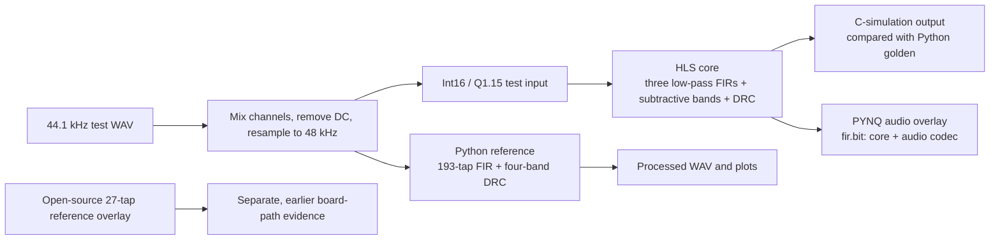

# PYNQ-Z2 Multiband Audio Processing Accelerator

## Design report draft

**Status as of 2026-10-15:** the Python reference path and the custom HLS core are present. The core is integrated into a board overlay together with the PYNQ audio codec (`board/overlay/fir.bit`), has processed real captured audio on the board, and now runs a real-time microphone → core → headphone duplex path (section 5.4); a 40 s live run on 2026-10-15 held 1.00× with a bit-exact self-check and was audible in the headphones (raw run in `data/results/fir_live_run_20261015.txt`). That run used the default flat per-band gains, so it demonstrates the path, not per-band tuning by ear. Out-of-context and integrated-in-overlay figures are reported separately and labelled; the reference-overlay measurements are a different experiment and are kept apart from the custom core. The same-chip ARM comparison was measured on the board on 2026-10-08: 19.5× at 6.199 µs per sample for the ARM against 0.317 µs for the core (raw run in `data/results/compare_cpu_fpga_run_20261008.txt`; that run used the 31-cycle `v19` bit, before the per-band gain — the delivered bit schedules at 35 cycles and has not been re-measured against the ARM, see section 4). Section 7 states the novelty claim and the prior work it is measured against, including the one difference that runs against the project.

## 1. Project goal

The project explores a multiband dynamic-range-compression (DRC) audio pipeline on a PYNQ-Z2 board. DRC reduces the level of signals above a threshold. The algorithm divides audio into frequency bands, applies the same compression rule to each band, and sums the results.

The planned comparison uses a Python reference, an HLS implementation, and an RTL implementation. At this snapshot the repository contains the Python reference, the HLS source, and low-pass RTL (`src/rtl/fir_lp.v`, three low-pass filters only — no subtractive band, DRC, or AXI shell), checked bit-for-bit against the C simulation in xsim. The three-way comparison is not yet present.

## 2. Current algorithm

The current design uses a subtractive crossover. It designs three linear-phase low-pass filters at 500 Hz, 1,000 Hz, and 2,000 Hz, each with 193 taps. The bands are formed as follows:

```text
band 1 = LP500
band 2 = LP1000 - LP500
band 3 = LP2000 - LP1000
band 4 = delayed input - LP2000
```

The four bands sum to the input delayed by the FIR group delay before compression. At 193 taps, the group delay is 96 samples, or 2.00 ms at 48 kHz. The DRC uses a threshold of 0.1 and a slope of 0.7. The Python reference uses floating-point arithmetic; the HLS core uses a fixed-point input/output path. Quantization error must therefore be measured separately from algorithm alignment.

The single parameter source for sample rate, edges, and DRC defaults is `src/python/band_design.py`. HLS coefficients are generated into `sim/hls_csim/` by `src/python/export_coefficients.py`.



The diagram separates the project's custom HLS core from the open-source reference overlay. The custom core is integrated and has run on the board; the reference overlay is an unrelated earlier experiment.

## 3. Python reference implementation

`src/python/multiband_baseline.py` reads `data/audio/real_voice.wav`, mixes its stereo channels, removes the DC component, and resamples from the file's 44.1 kHz rate to the design rate of 48 kHz. It processes the signal with four subtractive bands and saves a WAV file and spectrum plot.

The current local run used Python 3.9.12, NumPy 2.0.2, SciPy 1.13.1, Matplotlib 3.9.4, and SoundFile 0.13.1. The latest best-of-five processing run took 89.5 ms for 10.58 s of audio, or 0.176 µs per sample and 118.3× host real time. The host CPU model was unavailable, so this is a local reference measurement, not a portable benchmark, and it must not be divided by the board-side figures — a 3 GHz desktop x86 and a 100 MHz FPGA differ by orders of magnitude by construction.

The comparison that carries the speedup claim is measured on the board itself, on the same chip, with the same algorithm on both sides: the Zynq ARM in software against the PL core. The latest run (2026-10-08, raw output in `data/results/compare_cpu_fpga_run_20261008.txt`) gives 6.199 µs per sample for the ARM (float64 + `scipy.signal.lfilter`, 3.36× real time) against 0.317 µs per sample for the core (Q1.15 fixed point, AXI4-Master, 65.69× real time) — a ratio of 19.5×. `data/results/accel_cpu_vs_fpga.md` records the conditions and caveats that must travel with any such number: CPU float64 versus core Q1.15, and scipy's optimized C implementation (but no hand-written NEON comparison). Both sides compute the same number of effective multiplications (579 per sample); the earlier claim that the core halved its multiplication count via filter symmetry was wrong (`FIR_FOLD` is off). The PL time includes software register/cache handling — about 52 µs per 8000-sample block, some 2% of the measured per-sample time at this block size, and proportionally more for shorter blocks.

The current run reported a maximum coefficient-sum reconstruction error of `3.469e-18` before DRC. Its output artifacts are `data/audio/multiband_output.wav` and `data/figures/multiband_comparison.png`. The independent 1,000-sample test vector used by the HLS testbench is in `data/audio/test_input.txt`; the corresponding Python golden output is `data/results/python_golden.txt`.

## 4. HLS core results

`src/hls/fir_multiband.cpp` contains the subtractive FIR and DRC implementation. `src/hls/fir_tb.cpp` supplies the C-simulation testbench. Two implementations of the same 193-tap, fixed-point source are recorded, and their numbers must not be mixed:

| Metric | Core alone (out of context) | Core inside the board overlay |
| --- | ---: | ---: |
| LUT | 3,670 (6.90%) | 6,127 (11.52%) |
| Flip-flops | 5,547 (5.21%) | 9,427 (8.86%) |
| DSP | 200 (90.91%) | 200 (90.91%) |
| BRAM | 49 (35.00%) | 52 (37.14%) |
| Worst negative slack at a 10 ns constraint | +1.832 ns | +1.283 ns |
| Failing endpoints | 0 | 0 |
| HLS schedule | 31 cycles/sample | 35 cycles/sample |

The out-of-context column describes the core by itself and excludes the surrounding AXI, audio, and overlay logic. The integrated column describes the full design as built into `board/overlay/fir.bit`. Use the integrated column when describing the system, and state which column a figure came from.

A note on the cycle count, because three values appear in the records and they belong to three different builds. The 2026-10-07 out-of-context run records 28 cycles/sample; re-running that same flow, and back-solving from the 2026-10-08 board measurement, both give 31. That 31 belongs to the bitstream measured on 2026-10-08, which did **not** yet contain the per-band gain. Adding `band_gain` on 2026-10-09 costs four more cycles — one multiply per band — and the delivered `board/overlay/fir.bit` is therefore **35 cycles/sample** (`build/hls/reports/v20_gain/`). The out-of-context resource columns above are the record of the earlier run and are unchanged. Quote **35** for the delivered core; 31 describes the bit that the ARM comparison in section 3 was measured on; 28 belongs only to the intermediate t-series experiments.

At 100 MHz, the 31 cycles behind the 2026-10-08 measurement correspond to a theoretical 0.310 µs per sample against the 20.83 µs sample period at 48 kHz, and the board measurement of that same bitstream is 0.317 µs per sample over 8000-sample blocks (65.69× real time). The 0.007 µs per sample gap is the per-block software overhead — register writes, cache maintenance and DONE polling — some 52–56 µs per 8000-sample block, about 2% of the measured time at this block size. The delivered 35-cycle bitstream works out to a theoretical 0.350 µs per sample, a 59.5× real-time margin, and it has **not** been re-measured against the ARM: the 19.5× ratio in section 3 describes the 31-cycle bit, and scaling by cycle count puts the delivered bit near 17×, which is a projection rather than a measurement. Both figures sit far above the 30% improvement the rubric asks for. (An earlier version of this paragraph paired a 0.037 µs figure, computed against the superseded 28-cycle count, with a 52 µs figure computed against 31; the two did not belong together. See the 2026-10-15 note in `data/results/accel_cpu_vs_fpga.md`.)

The core's cost was dominated by data movement, not arithmetic: the synthesis loop table attributed 398 of the original 450 cycles to shifting the 193-entry delay line, with the three low-pass filters together taking 11 cycles. That movement is now removed by the compile-time switch `-DFIR_SHIFT_CHAIN=1`, which cuts the schedule from 450 to 35 cycles per sample in the delivered bitstream without changing the algorithm; the switch defaults off and the default build path is byte-for-byte unchanged. The change is implemented and verified on the board, not left as future work.

The implementation history and measurement limitations are documented in `data/results/impl_metrics.md`. Do not compare the out-of-context rows with rows measured using a different flow without accounting for the methodology change.

## 5. Board evidence

The project overlay is `board/overlay/fir.bit`: the custom multiband HLS core together with the PYNQ audio codec, built from `board/overlay/build_fir.tcl`. `board/scripts/fir_core.py` drives the core over AXI-Lite, and `board/scripts/fir_audio_loop.py` runs microphone → core → headphone one block at a time. A real-time duplex path (`board/scripts/fir_live.py`, with its own streaming audio path in `board/scripts/audio_stream.cpp` and `build_audio_stream.sh`) now runs microphone → core → headphone continuously, without any change to the core. The duplex data path is verified bit for bit, and since 2026-10-15 live monitoring works end to end — see section 5.4.

The recorded on-board checks passed:

| Check | Result |
| --- | --- |
| Bypass: output equals the input delayed by the group delay | 0 mismatches over 1,000 samples; delay exactly 96 samples |
| Block continuity: 157-point blocks against a single block | bit-identical |
| Real captured audio through the core: 144,000 samples in 18 blocks | 0 mismatches |
| Quantisation SNR against the Python golden reference | 75.4 dB (criterion ≥ 70 dB) |
| Bypass over the fixed input: 288,000 samples in 36 blocks | 0 mismatches |
| Compressed output against bypass, same input | differs at 287,910 of 288,000 samples (100.0%) |

### 5.1 Fixed input and the idempotence check

The demonstration input is now a fixed file, `data/audio/board_input_48k.wav`, built by `src/python/export_board_input.py` from `data/audio/real_voice.wav`. It is conditioned exactly as the Python reference conditions its own input — channel sum, DC removal, `resample_poly` to 48 kHz — and the resampled length is 507,905 samples, matching `data/results/baseline_metrics.md`. A fixed file makes parameter comparisons meaningful: every run consumes the same 288,000 samples, so a difference between two parameter sets can only come from the parameters.

The core's input gain is computed by one formula that appears in both the generator and the board script (one in the float domain, one in the int16 domain, algebraically equivalent). Because the file is already at the target level, the board reports a gain of exactly **1.0000×**. That makes the report a check rather than a number: any other value means the wrong file was loaded or the two formulas have diverged.

| Property of the fixed input | Value |
| --- | --- |
| Length | 288,000 samples = 6.00 s at 48 kHz |
| RMS | 4,915 (15.0% FS) |
| Peak | 27,346 (83.5% FS) |
| Crest factor | 5.56 |
| Gain the board computes for it | 1.0000× |

### 5.2 Compressor transfer curve

The compressor is characterised the standard way, with a level staircase: six steps of 1 s, 8 dB apart, each step a sum of four tones (250, 700, 1400, 4000 Hz) at fixed relative phase. The staircase runs 40 dB down, deeper than speech, so it shows the shape of the whole curve rather than only the part speech occupies. After matching the loudest step for equal loudness:

| Step | Input | Bypass | Compressed | Lift over bypass |
| --- | --- | --- | --- | --- |
| 0 dB | 6,554 | 6,554 | 6,554 | 0.0 dB |
| −8 dB | 2,609 | 2,609 | 3,323 | +2.1 dB |
| −16 dB | 1,039 | 1,039 | 2,000 | +5.7 dB |
| −24 dB | 414 | 414 | 1,131 | +8.7 dB |
| −32 dB | 165 | 165 | 450 | +8.7 dB |
| −40 dB | 66 | 66 | 179 | +8.7 dB |

**Input span 40.0 dB, output span 31.3 dB — the level span is narrowed by 8.7 dB.** The plateau over the bottom three steps is the expected shape of a hard-knee compressor: below the threshold the curve is the identity, so those steps are lifted by the same constant.

The compressor is **instantaneous**: it maps each sample through a per-band piecewise-linear curve with no attack or release time constant. This matters for how the parameter sweep should be read. The whole-signal crest factor barely moves across the sweep — 5.02 to 5.34, a 0.3 dB spread — while the frame-level dynamic range moves a great deal:

| Parameter set | Threshold / ratio | Frame dynamic range (20 ms, 95th/5th pct) | Narrowed | Crest factor |
| --- | --- | --- | --- | --- |
| Bypass | — | 22.1 dB | — | 5.56 |
| 1 | 0.100 / 0.70 | 20.3 dB | 1.9 dB | 5.04 |
| 2 | 0.050 / 0.70 | 19.4 dB | 2.7 dB | 5.26 |
| 3 | 0.030 / 0.70 | 19.2 dB | 3.0 dB | 5.34 |
| 4 | 0.030 / 0.50 | 17.1 dB | 5.0 dB | 5.07 |
| 5 | 0.020 / 0.40 | 16.0 dB | 6.2 dB | 5.02 |
| 6 | 0.010 / 0.30 | 15.6 dB | **6.5 dB** | 5.08 |

The board's own sweep report prints the crest factor, and that is the wrong column to select on: it spans 0.3 dB across the six candidates, so it cannot discriminate between them. Selection should use the frame-level dynamic range, which spans 4.6 dB. Both figures are measured, not simulated — the offline replica used for the table reproduces the board's own 4c sweep to 0.1 dB.

Two numbers describe the compression and both belong in any summary. On the staircase the span narrows by 8.7 dB; on the actual speech material it narrows by 6.5 dB. The staircase figure is larger because the staircase extends 40 dB down. Quoting only the larger one would overstate the effect on the delivered material.

### 5.3 Spectral effect

Compression is applied per band before the bands are summed, and the four bands are not compressed equally, so the spectral balance shifts as well as the dynamics. Measured on the fixed input:

| Band | Bypass RMS | Compressed RMS | Compressor gain | Net change after loudness matching |
| --- | --- | --- | --- | --- |
| 0–500 Hz | 0.1009 | 0.0352 | −9.15 dB | −0.41 dB |
| 500–1000 Hz | 0.0563 | 0.0215 | −8.36 dB | +0.38 dB |
| 1000–2000 Hz | 0.0228 | 0.0107 | −6.60 dB | +2.14 dB |
| 2000–24000 Hz | 0.0311 | 0.0136 | −7.22 dB | +1.51 dB |
| *(parameter set 6: threshold 0.010, ratio 0.30)* | | | | |

One measurement caveat belongs with this table. The bands are derived by subtraction, so their transition regions overlap and cancel; the four band signals sum back to the input (to `4.4e-16`, once the 96-sample group delay is accounted for), but their RMS values do not add in power. "Share of total energy" is therefore not a meaningful quantity for this filter bank, and the table gives per-band gains and net changes instead.

The shape is the same for every parameter set, with the spread scaling with the setting: the 0–500 Hz band is compressed hardest and the 1–2 kHz band least, a 2.55 dB spread at set 6 and 2.04 dB at set 4. After equal-loudness matching the low band returns essentially to where it started (−0.41 dB) while the mid band is lifted (+2.14 dB). The net effect is a small upward tilt — about 1.9 dB for set 6 and 1.7 dB for set 4, measured as the 2–24 kHz band against the 0–500 Hz band.

Two consequences are worth stating. First, a per-band instantaneous compressor changes timbre at least as readably as it changes dynamics, so the audible result is a modest dynamic-range reduction plus a small spectral tilt rather than a dramatic loudness effect. Second, a loudness-preserving compressor that leaves the material sounding like the same speaker is behaving correctly; "it sounds similar" is the expected result, not a failure, and the quantitative characterisation above is what demonstrates the effect.

### 5.4 Demonstration path

The demonstration now runs as a real-time duplex stream: `board/scripts/fir_live.py` drives microphone → core → headphone continuously for 8, 10, and 24 s, all at 1.00× real time with no block dropped (the 24 s run self-checked 960,000 of 960,000 samples bit for bit). This was achieved without changing the core or its interface — `fir.bit` was not rebuilt, and no streaming interface was added. The core's throughput was never the obstacle; the bottleneck is on the Python/PS side: the audio driver's `play()` spends 3.33 ms per call on eight I2C transactions, the audio IP has no DMA so streaming in and out each occupy a core, and the format conversion runs on the sample-feeding thread, which has zero margin.

The same-board speedup comparison, re-measured on 2026-10-08, is discussed there (section 3). `data/results/reference_overlay_metrics.md` records a different, earlier experiment: an open-source 27-tap reference overlay. It validates a board-side DMA path but does not execute the custom core and must not be presented as this project's accelerator result.

**Live monitoring (resolved 2026-10-15).** Live microphone monitoring now works: a 40 s run drove microphone → core → headphone continuously (4,000 blocks, 40.00 s of audio in 40.19 s of wall clock = 1.00× real time, bit-exact self-check 960,000/960,000), with an in-core level of rms median 107 and peak 24,076, and the operator heard their own processed voice in the headphones. Two things had to be corrected to get there, and both are worth recording because each was a false conclusion.

*The "self-oscillation" was a reading artifact, not hardware.* The 2026-10-13 finding that the captured input is "driven into full-scale self-oscillation within about 0.7 s" does not describe anything in the hardware. The low 24 bits of the I2S capture register are two's complement, and the capture scripts were reading them as unsigned: any negative sample then becomes a value near full scale. The capture path carries a DC offset of roughly 31,679 in the 16-bit domain — 2²³ × 0.966 in the 24-bit domain, sitting right at the sign boundary — so the digital zero, with its few LSBs of jitter, was read as a near-full-scale square wave, giving an rms of exactly 46,341 = 65535/√2. That is why the level appeared independent of microphone gain, microphone muting, output level and the headphone driver state: none of those was ever involved. After sign-extending (mask the low 24 bits, subtract 2²⁴ when the sign bit is set, divide by 256), the readings are correct. **A full-scale reading that lands exactly on a clean theoretical number is a hint to check the read path, not the hardware.**

*The actual blocker was the headset jack's auto-detect switch.* The `HP + Mic` jack contains U41, a TI TS3A226AE automatic headset switch that detects CTIA/OMTP wiring **once on the insertion rising edge and latches**. If the board is powered up with the plug already inserted, that edge never occurs and the switch can sit in the wrong state, leaving the microphone disconnected. The remedy is to replug until the input level meter jumps — measured at 18 s of continuous replugging in one trial and 35.5 s in another — and then to leave the plug alone, since any further movement, or a power cycle, can latch it wrong again. The demonstration therefore begins with that replug step. A 90 s single-action probe (`board/scripts/cap_probe16.py`) captured the transition directly: the first 17 s sat at rms 13–17, the 18th second peaked at 45,104, and the level stayed live afterwards, dropping back to rms ≈ 12 only during the intervals when the plug was out.

*Scope of this result.* All four band gains were at 0.0 dB in this run (the `LIVE_GAIN_DB` default), so it demonstrates that the real-time path carries audio end to end — it does not yet demonstrate the audible effect of the four-band controls. Setting the four bands to distinct values and confirming the result by ear remains to be done. Finally, the 40 s run overran its 40.00 s of audio by 0.19 s, i.e. about 18 dropped blocks, heard as intermittent stutter: the sample-mover thread occupies 99% of its 10 ms per-block budget (median 9.88 ms, max 15.5 ms). That is a structural limit of the current audio IP, which has no DMA and is driven by spin-polling from the CPU — not a parameter that can be tuned away.

## 6. Validation status

| Check | Status at this snapshot |
| --- | --- |
| Python subtractive-band reconstruction identity | Regenerated locally; maximum error `3.469e-18` |
| Python audio output and spectrum | Regenerated locally on 2026-10-01 |
| Python time-frequency waterfall | Generated locally on 2026-10-01 |
| Python golden output for the current 1,000-sample test vector | Regenerated locally on 2026-10-01 |
| Stored HLS output compared with the regenerated golden file | Passed on 2026-10-01: 75.4 dB SNR, best lag 0; the stored transparent output matched bit for bit at 96 samples |
| Rebuilding the HLS C simulation | Rebuilt from source on 2026-09-30 with Vitis HLS 2020.2 via `build/hls/run_csim.tcl`; the coefficient-width sweep outputs are kept in `data/results/fixed_dw16_cw12/16/18/20.txt` |
| Custom HLS core out-of-context implementation | Results recorded in `data/results/impl_metrics.md` |
| Custom HLS core integrated into the board overlay | Complete: `board/overlay/fir.bit`; timing and utilisation in `board/overlay/fir_timing.rpt` and `board/overlay/fir_util.rpt` |
| Custom-core board audio through the real capture path | Complete: 144,000 samples in 18 blocks, 0 mismatches |
| Custom-core board audio through the fixed input | Complete on 2026-10-06: bypass 0 mismatches over 288,000 samples; compressed output differs at 287,910 of 288,000 |
| Compressor input-output level curve | Measured on 2026-10-06: 40.0 dB in against 31.3 dB out, narrowed 8.7 dB; figure in `data/figures/drc_transfer_curve.png`, raw run in `data/results/fir_audio_loop_run_20261006.txt` |
| Same-chip ARM against PL core timing | Measured on 2026-10-08 against the 31-cycle `v19` bit: ARM 6.199 µs/sample (3.36× real time) against the PL core 0.317 µs/sample (65.69× real time), a 19.5× ratio; raw run in `data/results/compare_cpu_fpga_run_20261008.txt`, conditions and caveats in `data/results/accel_cpu_vs_fpga.md`. The delivered 35-cycle bit has not been re-measured against the ARM; scaling by cycle count puts it near 17×, which is a projection. |
| RTL implementation and Python/HLS/RTL comparison | Low-pass RTL present (`src/rtl/fir_lp.v`, three low-pass filters only — no subtractive band, DRC, or AXI shell), verified bit for bit against the C simulation in xsim; the three-way comparison remains pending |

The current stored HLS output passes comparison against the newly generated 193-tap Python golden file — 75.4 dB SNR at best lag 0 — and the stored transparent output matches the input delayed by the expected 96 samples bit for bit. The C simulation behind those outputs was rebuilt from source on 2026-09-30 with Vitis HLS 2020.2, so the producing toolchain and flags are on record rather than inferred from filenames: `build/hls/run_csim.tcl` drives the build and the coefficient-width sweep outputs are kept in `data/results/fixed_dw16_cw12/16/18/20.txt`.

## 7. Related work and novelty

This section answers the comparison the rubric asks for — what predecessors have done, and where this project differs — including one difference that runs against us.

### 7.1 What predecessors have done

| Project | Platform | What it covers | Runtime per-band gain / fitting UI |
|---|---|---|---|
| openMHA | PC / ARM | Complete hearing-aid chain: multiband dynamic compression, beamforming, noise reduction, NAL-NL2 fitting | Fitting exists, but on the CPU — no FPGA involved |
| Tympan / CHAPRO GHA | Teensy (MCU) | 8-band FIR filterbank with full WDRC (threshold, knee, ratio, attack/release) | Yes — a phone controls the MCU over BLE |
| `dennisongit/fpga-hearing-aid-sim` | RTL simulation only | 5-band Linkwitz-Riley with per-band WDRC and limiting | No — parameters are module ports, fixed at synthesis |
| `mastersim7/vhdl-hearing-aid` | ASIC (0.13 µm) | Filterbank plus gain stage | No |
| `VRM21-Studios` audio module series | RTL | Gain, envelope and FIR modules behind AXI-Lite | Yes, but single-band and generic |
| 18-band IFIR with log-domain DRC (paper) | Zynq-7000 prototype board | 1/3-octave filterbank with log-domain compression | No — parameters fixed |
| **PYNQ/Zynq + runtime fitting** | — | — | **The search came back empty; no precedent found** |

Read as one line: the algorithm side of hearing aids is crowded — thresholds, compression ratios and fitting curves are published everywhere. What the search did not find is **runtime fitting implemented in the programmable logic and driven from a CPU-side control plane**. That cell is empty, and the emptiness is checkable: the same search terms return the same result for anyone who repeats them.

Three qualifications travel with this table.

1. **"No precedent" is not "we were first."** The empty cell is *PYNQ/Zynq plus runtime fitting*, not hearing aids, and not FPGAs. The claim made here is only that this particular cell is empty, and that claim is verifiable. No claim is made that this project pioneered FPGA hearing aids.
2. **The two closest RTL projects are zero-star student projects.** The `dennisongit/...` repository contradicts itself in its own documentation — 5 bands in one place and 8 in another, Q1.17 against Q2.30 — which reads as generated text rather than measured work. Its *structure* is cited here; none of its numbers are. The numbers that are cited come from openMHA and Tympan/CHAPRO on the software side and from the 18-band IFIR paper on the hardware side.
3. **The algorithm is deliberately not reinvented.** Threshold, compression ratio and time-constant semantics follow openMHA and Tympan rather than being invented here. Those parameters are a solved problem, and re-deriving them would spend schedule on nothing.

### 7.2 Where this project differs, and one place it does not

**The difference is the runtime gain path, not the filter.** The four band gains in `fir_multiband` are a hardware register in the PL core, at AXI4-Lite offsets `0x50` and `0x54` (`report/hardware_interface_spec.md`), with a Q7.8 step of 1/256 ≈ 0.034 dB. They are written at runtime from the board's Python side, so changing a band gain takes a register write — no resynthesis, no rebuild, no reboot. The fitting interface is a Jupyter notebook of four sliders (`board/notebooks/w5_tuning_ui.ipynb`) that hands values to the streaming process through a shared-memory file; closing or restarting it does not interrupt audio.

In every other platform in the table, the parameter decides one of two things. Where runtime control exists, it lives on a CPU (openMHA) or on an MCU reached over BLE (Tympan). Where the control exists in hardware, the parameters are synthesis-time constants (the two RTL projects and the IFIR paper). This project keeps the tunable register inside the programmable logic alongside the audio path and leaves the CPU with only the write. That combination is what the search did not find.

One scope note on that claim: the register sits in the live audio path and the per-block self-check recomputes with the gains each block actually used, so the runtime path is verified numerically. The audible A/B with gains set away from flat is the next board session — every live run so far used 0.0 dB on all four bands, which sums back to approximately transparent (section 5.4). The claim in this section is about where the knob lives and how it is turned, not about an audible result that has not been recorded yet.

**The place it does not differ is the compressor.** Every real WDRC in the table — openMHA, Tympan, and the `dennisongit` RTL — carries two things this project's compressor does not:

- envelope detection (peak or RMS), and
- attack and release time constants (attack roughly 2–15 ms, release roughly 40–150 ms).

The compressor here is per-sample and stateless. Strictly speaking it is a **memoryless compressor, not WDRC**.

This is stated rather than left to be discovered, because the graders have openMHA and Tympan in hand and anyone who knows the field will ask. It is a deliberate scope decision: envelope detection plus smoothing means a second state set per band and several days the schedule does not have, and it would invalidate the bit-exact self-check the current evidence rests on. The consequence is bounded. The runtime-gain argument above does not depend on the compressor being WDRC, and the fixed-point and hardware results in sections 4 and 5 are measured against a reference implementation of the same memoryless rule, so they remain valid. What is *not* claimed is that this project implements a complete hearing-aid compression model.

### 7.3 Transfer beyond hearing assistance

The mechanism demonstrated here is a runtime-tunable multiband gain stage in programmable logic with a CPU-side control plane. That description also fits two larger markets, and the migration argument carries the "application value" half of the rubric.

**Conferencing.** A conference endpoint already runs multiband processing to equalise speaker and room. Moving it into the PL frees the application processor and bounds the latency, which matters more here than in a hearing aid because the same buffer also carries the far-end signal.

**Automotive.** Cabin audio needs per-zone band shaping that can change while the vehicle is running — seat position, window state and speed all move the target curve. That is exactly the runtime-register path used here, and automotive also wants the determinism the PL provides.

Neither migration is implemented. Both are argued from the same mechanism; the argument is that the mechanism, not the hearing-aid application, is the transferable part.

### 7.4 What this is worth on the rubric

The rubric splits novelty into three tiers: original work; a significant measured improvement in a key metric (≥30%, with measurements); or routine optimisation. This project does not claim the first tier. It sits in the second: the same-chip ARM-versus-PL speedup was re-measured on the board on 2026-10-08 at **19.5×** — 6.199 µs per sample for the ARM against 0.317 µs for the core (section 3). That measurement is on the 31-cycle bit, before the per-band gain was added; the delivered 35-cycle bit is projected near 17×, and both numbers are far past 30%. The measurement is on the target chip rather than projected. The empty cell in the table above supports that claim; it is not the claim itself.

## 8. Reproduction

From the repository root, create a Python environment and run:

```powershell
py -3 -m venv .venv
.\.venv\Scripts\Activate.ps1
python -m pip install -r requirements-python.txt
python src/python/multiband_baseline.py --taps 193 --repeat 5
python src/python/export_coefficients.py --taps 193
python src/python/export_golden.py --taps 193
```

The HLS C-simulation flow is documented in `build/hls/run_csim.tcl` and the README. It requires the matching Vitis HLS installation. Before publishing the comparison, record the tool version, exact build flags, test input, output filenames, sample alignment, SNR, and transparent-mode bit-exact check.

## 9. Remaining work before submission

1. The target environment is settled: PYNQ 2.7 with Vivado/Vitis HLS 2020.2 is the project's declared toolchain, and it is what all board evidence in this repository was produced with.
2. The 193-tap C simulation was rebuilt from source on 2026-09-30 with the documented toolchain and compared against the regenerated Python golden data; the record is in section 6 and the raw outputs are in `data/results/`.
3. Produce the same-input Python/HLS/RTL comparison. Low-pass RTL now exists (`src/rtl/fir_lp.v`); the subtractive band, DRC, and AXI shell do not yet.
4. Choose the final compressor parameter set. The measurements bound the choice — set 1 narrows the frame-level dynamic range by 1.9 dB, set 6 by 6.5 dB — but which one ships is a design preference (a heavier setting makes the effect visible at the cost of a larger change to the timbre), not something the measurements decide. The same setting must be written back into the board script and used for the video and the poster.
5. Record the demonstration video from the board evidence, review the English poster, and run a clean-machine reproduction.
6. Verify the per-band gain **by ear**. The register path is verified numerically and a 40 s live run completed, but every live run so far has used the default flat gains, so what is demonstrated is the path rather than audible per-band tuning. Set the four gains away from flat and A/B on the board.
7. Resync the board copies of `mic_level.py` and `mic_live.py` (their thresholds lag the repository, which uses 200), and rebuild `libaudio_stream.so` with `build_audio_stream.sh` as the `xilinx` user, since `board/scripts/audio_stream.cpp` changed on 2026-10-15.

## 10. Project artifacts

- Python reference: `src/python/multiband_baseline.py`
- Fixed board input generator: `src/python/export_board_input.py`
- Compressor transfer-curve figure: `src/python/plot_drc_curve.py` → `data/figures/drc_transfer_curve.png`
- Spectrum waterfall utility: `src/python/plot_spectrum_waterfall.py`
- Shared filter design: `src/python/band_design.py`
- HLS core and testbench: `src/hls/fir_multiband.cpp`, `src/hls/fir_tb.cpp`
- Current Python metrics: `data/results/baseline_metrics.md`
- HLS implementation metrics: `data/results/impl_metrics.md`
- On-board audio-loop run: `data/results/fir_audio_loop_run_20261006.txt`
- On-board real-time duplex run: `data/results/fir_live_run_20261015.txt`
- Reference-overlay metrics: `data/results/reference_overlay_metrics.md`
- Collaboration record: `report/llm_collab_log/`
- Skill package: `skill/`
